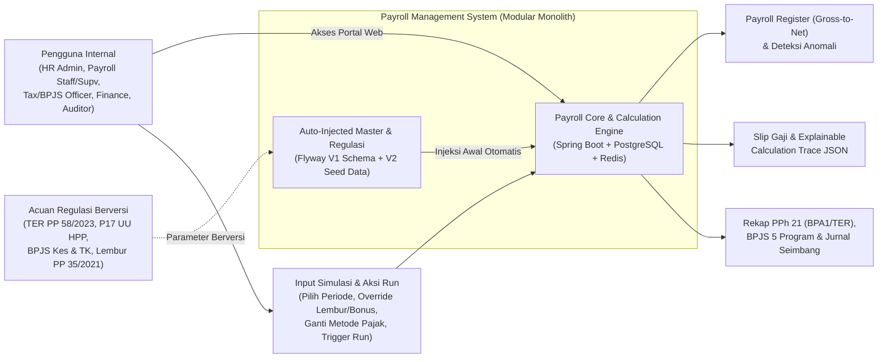
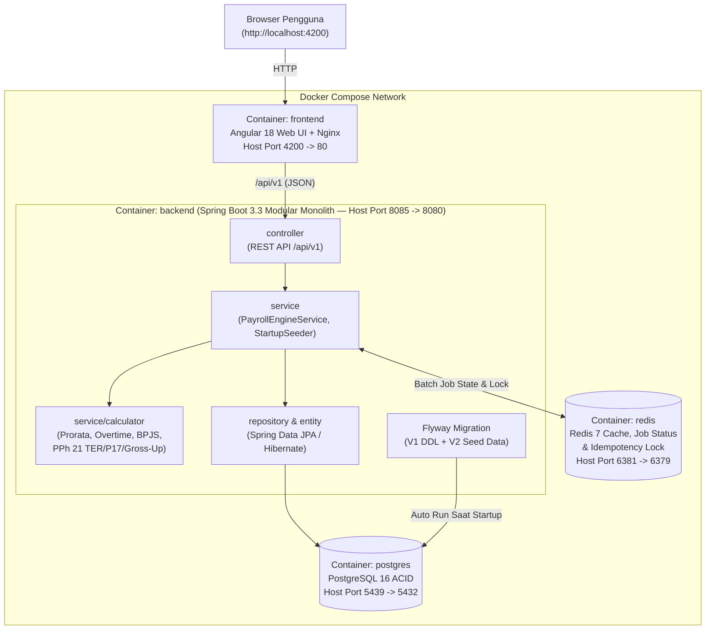
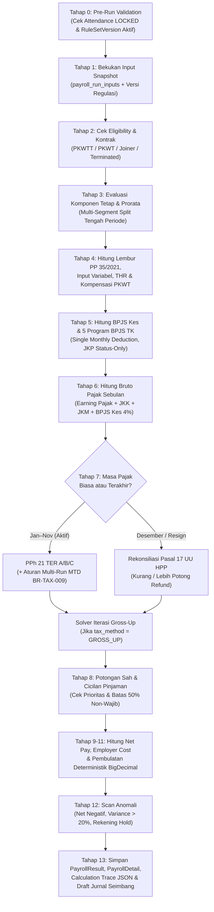

# Sistem Informasi Penggajian (Payroll Management System — Standar Indonesia)

Aplikasi **Payroll Management System** berbasis **Modular Monolith** dengan fokus **Core-Engine-First**: data master organisasi, parameter regulasi Indonesia, komponen gaji, serta skenario karyawan uji di-*inject* secara otomatis lewat skrip migrasi database (**Flyway**), sehingga pengembangan dan pengujian dapat langsung berfokus pada **akurasi mesin kalkulasi gaji, *calculation trace*, kepatuhan pajak/BPJS, dan jurnal akuntansi**.

---

## 1. Tentang Aplikasi

Sistem ini dirancang mengacu pada spesifikasi analisis bisnis & sistem standar Indonesia dengan cakupan MVP **Single-Company (1 Badan Hukum PT dengan dukungan multi-cabang & *cost center*)** untuk karyawan bulanan **PKWTT** dan **PKWT**:

* **Arsitektur Modular Monolith + Background Worker:** Seluruh modul inti berjalan dalam satu aplikasi Spring Boot dengan satu database PostgreSQL transaksional (**ACID**) agar perhitungan gaji, PPh 21, BPJS, cicilan pinjaman, hingga jurnal akuntansi bersifat atomik dan bebas *distributed transaction bug*.
* **Kepatuhan Regulasi Indonesia:**
  * **PPh Pasal 21 (PP 58/2023, PMK 168/2023, PMK 81/2024):** Pemetaan PTKP ke TER Kategori A/B/C (Januari–November), dukungan **Multi-Run** dalam 1 masa pajak (*THR/Bonus + Regular*), rekonsiliasi **Masa Pajak Terakhir** (Desember/Resign) berbasis tarif progresif Pasal 17 UU HPP (termasuk pengembalian *lebih potong* / *tax refund*), metode **Gross**, **Gross-Up** (iterasi *fixed-point*), **Net**, serta siap ekspor format **BPA1 (Coretax)**.
  * **BPJS Kesehatan & 5 Program BPJS Ketenagakerjaan:** BPJS Kesehatan (4% pemberi kerja + 1% pekerja dengan batas UMP/UMK s/d Rp12.000.000 + tanggungan tambahan), serta pemisahan JHT, JKK (sesuai kelompok risiko), JKM, JP (dengan batas upah tahunan berversi), dan **JKP sebagai status kelayakan (`is_jkp_eligible`) tanpa *double-counting* iuran**. Diterapkan **1x pemotongan BPJS per bulan** meski terdapat lebih dari satu *payroll run*.
  * **Lembur & Ketenagakerjaan (PP 35/2021 & Permenaker 6/2016):** Basis upah sejam `1/173` (termasuk aturan 100% vs 75% upah tetap), pengali lembur pola 5 & 6 hari kerja + hari pendek, prorata *multi-segment* saat gaji berubah di tengah bulan, THR Keagamaan, serta uang kompensasi akhir PKWT.
* **Reproduksibilitas & Auditability:** Setiap *payroll run* membekukan *snapshot* input dan versi aturan (`rule_set_versions` & `company_policy_versions`), menggunakan aritmatika presisi tetap (`BigDecimal`), serta menyimpan **`calculation_trace_json`** sebagai rincian rumus yang dapat diperiksa rupiah per rupiah.

---

## 2. Diagram Konteks & Arsitektur Aplikasi

### 2.1 System Context Diagram



### 2.2 Arsitektur Container Docker & Modular Monolith

Seluruh layanan dibungkus dalam satu file orkestrasi `docker-compose.yml` di root proyek:



### 2.3 Alur Mesin Perhitungan Gaji 13 Tahap

Pipeline deterministik yang dijalankan oleh `PayrollEngineService` dan paket `service/calculator` untuk setiap karyawan pada sebuah `PayrollRun`:



---

## 3. Teknologi yang Digunakan

| Lapisan | Teknologi | Peran & Alasan Pemilihan |
| --- | --- | --- |
| **Backend Framework** | **Java 21 + Spring Boot 3.x** | Ekosistem enterprise stabil dengan tipe **`BigDecimal`** bawaan untuk aritmatika finansial presisi tetap (*fixed-point*) tanpa *floating-point drift*. |
| **Database Utama** | **PostgreSQL 16** | Penyimpanan transaksional **ACID**, mendukung `UUID`, `DECIMAL(18,2)`, `JSONB` (untuk *snapshot* & *calculation trace*), serta `CHECK` constraint ketat. |
| **Migrasi & Seeder** | **Flyway** | Menjalankan DDL skema (`V1`) dan injeksi otomatis data master serta skenario uji karyawan (`V2`) setiap kali database diinisialisasi. |
| **Cache & Job Lock** | **Redis 7** | Menyimpan status eksekusi batch *payroll run*, *idempotency lock* untuk mencegah proses ganda, dan cache parameter regulasi baca-banyak. |
| **Frontend Web** | **Angular 18+ (TypeScript)** | Cocok untuk antarmuka finansial terstruktur seperti *Payroll Register (Gross-to-Net)*, form simulasi variabel, dan panel inspeksi *Calculation Trace*. |
| **Container & Orkestrasi** | **Docker & Docker Compose** | Membungkus `postgres`, `redis`, `backend`, dan `frontend` agar seluruh stack berjalan konsisten lewat satu perintah. |

---

## 4. Struktur Folder Proyek

Menggunakan konvensi **Standard Layered Architecture** yang umum dipakai oleh developer Java Spring Boot dan struktur fitur ringkas pada Angular:

```text
Payroll/
├── README.md                                  # Dokumentasi utama proyek ini
├── Makefile                                   # Shortcut perintah Docker & Test (make up, make test, dll.)
├── docker-compose.yml                         # Orkestrasi 4 container (postgres, redis, backend, frontend)
├── docs/                                      # Dokumentasi BA, SA, ERD, API & Roadmap SDLC
├── backend/                                   # Aplikasi Backend Spring Boot 3.3 (Java 21)
│   ├── Dockerfile                             # Multi-stage build Maven -> JRE 21
│   ├── pom.xml                                # Dependensi Spring Web, JPA, PostgreSQL, Redis, Flyway
│   └── src/
│       ├── main/
│       │   ├── java/com/payroll/
│       │   │   ├── PayrollApplication.java    # Entrypoint Spring Boot
│       │   │   ├── config/                    # Konfigurasi CORS & Spring
│       │   │   ├── controller/                # PayrollController (/api/v1)
│       │   │   ├── dto/                       # Request & Response DTO (Java 21 Records)
│       │   │   ├── entity/                    # Mapping Tabel PostgreSQL (@Entity JPA)
│       │   │   ├── exception/                 # DomainException & GlobalExceptionHandler
│       │   │   ├── repository/                # Spring Data JPA Repository
│       │   │   └── service/                   # PayrollEngineService & StartupSeederRunner
│       │   │       └── calculator/            # ProrataCalculator, OvertimeCalculator, BpjsCalculator, Pph21Calculator
│       │   └── resources/
│       │       ├── application.yml            # Konfigurasi datasource, Redis & Flyway
│       │       └── db/migration/              # Skrip SQL Flyway (V1__init_schema.sql & V2__seed_master_data.sql)
│       └── test/
│           └── java/com/payroll/
│               ├── architecture/              # ModularMonolithBoundaryTest (cegah cross-domain SQL join)
│               ├── integration/               # PayrollIntegrationTest (uji API end-to-end vs Postgres/Redis)
│               └── service/calculator/        # PayrollCalculatorTest (unit test vektor kalkulasi)
└── frontend/                                  # Aplikasi Web Portal Angular 18
    ├── Dockerfile                             # Build Angular -> Nginx static server + API reverse proxy
    ├── nginx.conf                             # Proxy /api/ -> http://backend:8080/api/
    ├── package.json                           # Dependensi Angular 18 & RxJS
    └── src/
        ├── app/
        │   ├── app.component.ts               # Layout & navigasi utama
        │   ├── app.routes.ts                  # Routing halaman Angular
        │   ├── core/
        │   │   ├── models/                    # TypeScript interfaces (payroll.model.ts)
        │   │   └── services/                  # HTTP Client Service (payroll-api.service.ts)
        │   ├── pages/
        │   │   ├── master-data/               # Halaman Master Data, Skenario & Regulasi (master-data.component.ts)
        │   │   ├── payroll-run/               # Halaman Payroll Run, Simulator, Register & Jurnal (payroll-run.component.ts)
        │   │   └── payslip-trace/             # Halaman Slip Gaji & Calculation Trace (payslip-trace.component.ts)
        │   └── shared/
        │       └── pipes/                     # RupiahPipe (rupiah.pipe.ts)
        └── environments/                      # environment.ts (apiUrl: '/api/v1')
```

> **Catatan Penamaan Package Java:** Folder `backend/src/main/java/com/payroll/` merupakan namespace standar bahasa Java (`package com.payroll.*`) agar class tidak bentrok dengan library eksternal, dan tidak bermasalah meskipun folder root proyek juga bernama `Payroll`.

---

## 5. Skenario Data Master yang Di-*Inject* Otomatis (SQL Seeder)

Karena modul master di-*inject* langsung lewat skrip SQL (`V2__seed_master_data.sql`), begitu aplikasi menyala Anda sudah memiliki **1 PT (`PT Nusantara Teknologi`)**, struktur organisasi, parameter regulasi, dan **daftar skenario karyawan uji** yang siap dihitung:

| Kode Uji | Profil & Skenario Karyawan | Aturan yang Teruji Otomatis |
| --- | --- | --- |
| **EMP-001** | PKWTT Normal, `TK/0` (**TER A**), Metode **GROSS** | Alur standar Gaji Pokok + Tunjangan Tetap, BPJS Kes 4%/1%, BPJS TK, PPh 21 TER A |
| **EMP-002** | PKWTT Gaji Tinggi (`> Rp15 jt`), `K/1` (**TER B**) | Pembatasan upah atas (*wage cap*) BPJS Kesehatan (Rp12 jt) dan JP BPJS TK |
| **EMP-003** | PKWTT Metode **GROSS-UP**, `K/3` (**TER C**) | Solver iterasi *fixed-point* hingga `Tunjangan Pajak == PPh 21 Terutang` |
| **EMP-004** | PKWTT Metode **NET** + Tambahan Keluarga BPJS Kes | Pajak ditanggung perusahaan (*Employer Tax Expense*) + potongan +1% anak ke-4 |
| **EMP-005** | PKWTT Masuk Tengah Bulan (*Joiner*) + *Unpaid Leave* | Prorata hari kerja terjadwal (`hari_dibayar / hari_kerja_periode`) |
| **EMP-006** | PKWTT Naik Gaji Tengah Periode (efektif tgl 16) | Pemecahan **Multi-Segment Split** 2 periode gaji (10 hari @ Rp8 jt + 11 hari @ Rp10 jt) |
| **EMP-007** | PKWT Aktif dengan Lembur Hari Kerja & Libur Resmi | Rumus lembur PP 35/2021 (`1/173`, pengali `1.5x / 2x / 3x / 4x`) + Reimbursement non-upah |
| **EMP-008** | PKWTT dengan Cicilan Pinjaman & Uji Batas Potongan 50% | Urutan prioritas potongan, `DEDUCTION_OVER_50_PCT`, & status bayar `ON_HOLD` |
| **EMP-009** | PKWTT Uji Lebih Potong PPh 21 (Desember Refund) | Rekonsiliasi **Pasal 17 Masa Pajak Terakhir** menghasilkan **Lebih Potong (*Tax Refund*)** |
| **EMP-010** | PKWT Kontrak Berakhir 30 Nov 2026 | Perhitungan **Uang Kompensasi PKWT** (`12/12 × upah_tetap`) + Final Tax Pasal 17 |

> **Catatan Kepatuhan:** Tabel TER PP 58/2023 (125 lapisan: 44 TER A, 40 TER B, 41 TER C) dan parameter awal BPJS (termasuk batas atas JP Rp11.086.300) yang di-*seed* oleh Flyway berfungsi sebagai *baseline* dan tetap wajib diverifikasi terhadap lampiran regulasi resmi sebelum produksi.

---

## 6. Cara Menjalankan Aplikasi

### Prasyarat

Pastikan di mesin Anda sudah terpasang:

* **Docker Engine** & **Docker Compose v2** (`docker compose version`)

*(Opsional jika ingin menjalankan atau debug langsung di luar Docker: Java 21 JDK, Maven 3.9+, dan Node.js 20+)*

### Menjalankan Seluruh Stack dengan Docker (1 Perintah)

### Menjalankan Seluruh Stack dengan Docker (via Makefile atau Docker Compose)

Dari folder root `/home/aliube/Workspace/Project-Personal/Gemini/Payroll`:

```bash
# 1. Build image backend & frontend, lalu nyalakan seluruh layanan di background
docker compose up --build -d
make up                  # atau: docker compose up --build -d

# 2. Pantau log startup (pastikan Flyway selesai inject V1 & V2 dan Spring Boot ready)
docker compose logs -f backend
make logs                # atau: docker compose logs -f backend
```

### Akses Layanan Setelah Berjalan

> **Catatan Port Host:** Port host `5439`, `6381`, dan `8085` digunakan di `docker-compose.yml` agar tidak bentrok dengan layanan lain pada port default (`5432`, `6379`, `8080`). Di dalam jaringan internal Docker, layanan tetap berkomunikasi pada port standar (`postgres:5432`, `redis:6379`, `backend:8080`).

| Layanan | Alamat / Port Host | Keterangan |
| --- | --- | --- |
| **Web Frontend (Angular + Nginx)** | `http://localhost:4200` | Antarmuka utama Payroll Portal (otomatis mem-proxy `/api/` ke backend) |
| **Backend REST API (Spring Boot)** | `http://localhost:8085/api/v1` | Endpoint kalkulasi, master read, simulator, & trace |
| **PostgreSQL 16** | `localhost:5439` | Database `payroll_db` (user/pass: `payroll` / `payroll123`, skema & seed otomatis via Flyway) |
| **Redis 7** | `localhost:6381` | Cache status run & lock idempotensi |

### Menghentikan & Reset Data Awal

```bash
# Menghentikan seluruh container tanpa menghapus data database
docker compose down
make down                # atau: docker compose down

# Menghentikan container SEKALIGUS menghapus volume DB (reset ulang data seed V1 & V2)
docker compose down -v
make reset               # atau: docker compose down -v && docker compose up --build -d
```

---

## 7. Cara Penggunaan Aplikasi

### Alur Kerja di Web Portal (`http://localhost:4200`)

1. **Cek Data Master & Skenario (`Master Data & Regulasi`)**
   * Buka menu **Master Data & Regulasi** untuk melihat seluruh data yang telah ter-*inject* otomatis: profil perusahaan, daftar 10 skenario karyawan uji, komponen gaji multi-dimensi, konfigurasi BPJS 5 program, serta lapisan Pasal 17 & TER PP 58/2023.
2. **Jalankan & Simulasikan Payroll (`Payroll Run & Simulator`)**
   * Pilih periode payroll (**November 2026 — Masa Biasa TER** atau **Desember 2026 — Masa Pajak Terakhir P17**) yang sudah terhitung otomatis saat startup.
   * Klik **Buka Simulator Input** untuk mencoba mengubah metode pajak (`GROSS` / `GROSS_UP` / `NET`), bonus variabel, jam lembur hari kerja/libur, atau hari *unpaid leave*, lalu klik **Terapkan Simulasi & Hitung Ulang**.
   * Coba klik **Jalankan THR Run (Multi-Run)** di periode yang sama untuk menguji aturan **Multi-Run PPh 21 (`BR-TAX-009`)** dan **BPJS 1x/bulan (`BR-BPJS-TK-007`)**.
3. **Inspeksi Slip Gaji & Calculation Trace (`Slip Gaji & Trace`)**
   * Klik tombol **Slip & Trace** pada salah satu baris di *Payroll Register* untuk melihat **Slip Gaji** berdampingan dengan **Explainable Calculation Trace** (Prorata Multi-Segment, Lembur `1/173`, BPJS 5 Program, PPh 21 TER / Gross-Up / Pasal 17 Refund, serta raw `calculation_trace_json`).
4. **Validasi Jurnal Akuntansi & Kunci Run**
   * Periksa bagian **Jurnal Akuntansi Otomatis** di bawah tabel *Payroll Register* untuk memastikan `Total Debit == Total Kredit` per *cost center* (`CC-ENG`, `CC-FIN`, `CC-OPS`), lalu klik **Approve & Kunci Run** untuk mengunci run menjadi `APPROVED` (*immutable*).

### Ringkasan Endpoint REST API Utama (`/api/v1`)

| Method & Endpoint | Fungsi |
| --- | --- |
| `GET /api/v1/health` | Pemeriksaan status kesehatan backend |
| `GET /api/v1/master/overview` | Mengambil profil perusahaan, kebijakan, aturan aktif, komponen gaji, dan 10 skenario uji |
| `GET /api/v1/payroll-periods` | Daftar periode payroll yang tersedia (Nov & Des 2026) |
| `GET /api/v1/payroll-runs` | Daftar seluruh *payroll run* aktif |
| `POST /api/v1/payroll-runs/calculate` | Membekukan snapshot & mengeksekusi mesin kalkulasi 13 tahap (`REGULAR` / `THR`) |
| `GET /api/v1/payroll-runs/{runId}/results` | Mengambil tabel *Payroll Register (Gross-to-Net)* & *anomaly flags* |
| `GET /api/v1/payroll-runs/{runId}/results/{resultId}` | Mengambil detail Slip Gaji (`payroll_details`) & *Calculation Trace JSON* per karyawan |
| `POST /api/v1/payroll-runs/{runId}/approve` | Mengunci run menjadi `APPROVED` (*immutable*) & mem-posting jurnal |
| `GET /api/v1/payroll-runs/{runId}/journal` | Melihat baris jurnal akuntansi seimbang (`Debit == Kredit`) per *cost center* |
| `GET /api/v1/simulator/overrides?payrollPeriodId=...` | Melihat daftar override simulator aktif untuk suatu periode |
| `POST /api/v1/simulator/override` | Menerapkan simulasi sementara (metode pajak/bonus/lembur/unpaid) & hitung ulang |
| `POST /api/v1/simulator/reset?payrollPeriodId=...` | Mereset seluruh simulasi pada periode terkait ke data seed awal & hitung ulang |

---

## 8. Indeks Dokumentasi Analisis (`docs/`) & Pengujian Unit

### 8.1 Paket Dokumentasi BA & SA (`docs/`)

Seluruh spesifikasi bisnis, aturan matematis regulasi Indonesia, kontrak API, dan skema database tersimpan di folder `docs/`:

* [00-Master-Roadmap-BA-SA-SDLC.md](docs/00-Master-Roadmap-BA-SA-SDLC.md) — Peta jalan proyek, penguncian cakupan MVP, register regulasi, status implementasi awal, dan katalog `UAT-001` s/d `UAT-022`.
* [dokumen-saran.md](docs/dokumen-saran.md) — Catatan review audit internal BA/SA serta verifikasi regulasi PPh 21 & BPJS.
* **Business Analysis (`docs/01-business-analysis/`):**
  * [01-BRD-Business-Requirements-Document.md](docs/01-business-analysis/01-BRD-Business-Requirements-Document.md) — Tujuan bisnis, RACI & SoD 14 peran, serta katalog `BR-001` s/d `BR-026`.
  * [02-BPA-Business-Process-Architecture-and-Flows.md](docs/01-business-analysis/02-BPA-Business-Process-Architecture-and-Flows.md) — Diagram alur proses *end-to-end* (`BPA-01` s/d `BPA-10`).
  * [03-Business-Rules-and-Calculation-Specification.md](docs/01-business-analysis/03-Business-Rules-and-Calculation-Specification.md) — Rumus deterministik Prorata, Lembur PP 35/2021, BPJS Kes & 5 TK, PPh 21 TER/Pasal 17/Gross-Up, THR, dan kompensasi PKWT/PHK.
  * [04-SOP-Standard-Operating-Procedures.md](docs/01-business-analysis/04-SOP-Standard-Operating-Procedures.md) — 7 SOP operasional (`SOP-PAY-001` s/d `SOP-PAY-007`).
* **System Analysis (`docs/02-system-analysis/`):**
  * [01-SRS-Software-Requirements-Specification.md](docs/02-system-analysis/01-SRS-Software-Requirements-Specification.md) — Spesifikasi fungsional, NFR, dan *Requirements Traceability Matrix*.
  * [02-Use-Case-and-State-Machine.md](docs/02-system-analysis/02-Use-Case-and-State-Machine.md) — Use Case (`UC-01` s/d `UC-13`) & State Machine diagram.
  * [03-ERD-and-Data-Dictionary.md](docs/02-system-analysis/03-ERD-and-Data-Dictionary.md) — ERD per domain, kamus data fisik, dan standar JSON `calculation_trace_json`.
  * [04-API-and-Integration-Specification.md](docs/02-system-analysis/04-API-and-Integration-Specification.md) — Konvensi protokol REST, error catalog, dan format integrasi eksternal.
  * [05-System-Design-and-Architecture.md](docs/02-system-analysis/05-System-Design-and-Architecture.md) — Desain Modular Monolith, keamanan UU PDP, observabilitas, dan realisasi stack implementasi.

### 8.2 Menjalankan Unit Test Kalkulator & Boundary Modular Monolith

### 8.2 Menjalankan Unit Test, Boundary Test & Integration Test (Makefile)

Untuk menjalankan seluruh unit test deterministik (`PayrollCalculatorTest`) serta pengujian batas modul anti-*cross-domain SQL join* (`ModularMonolithBoundaryTest`) secara terisolasi tanpa Docker:
Dari folder root proyek (`/home/aliube/Workspace/Project-Personal/Gemini/Payroll`), gunakan `Makefile` (mirip workflow di Go / .NET):

```bash
cd backend
# Lihat seluruh daftar perintah yang tersedia
make help

# Jalankan seluruh test (kalkulator + boundary arsitektur)
mvn test
# Jalankan Unit Test rumus kalkulator (10 test, tanpa butuh DB)
make test-unit

# Jalankan khusus test pengecekan pelanggaran cross-domain JOIN & batas modul
mvn test -Dtest=ModularMonolithBoundaryTest
# Jalankan Architecture Boundary Test anti-cross-domain SQL join (5 test, tanpa butuh DB)
make test-arch

# Atau jika menggunakan Maven binary lokal:
# /home/aliube/.m2/wrapper/dists/apache-maven-3.10.0-bin/39q0qgmngdu329psje7bjgne79/apache-maven-3.10.0/bin/mvn test -Dtest=ModularMonolithBoundaryTest
# Jalankan Integration Test End-to-End via HTTP API (6 test, butuh Postgres & Redis via make up)
make test-integration

# Jalankan SEMUA test sekaligus (Unit + Architecture + Integration)
make test
```

`ModularMonolithBoundaryTest` memverifikasi 5 aturan batas arsitektur secara otomatis:

1. Seluruh `@Entity` wajib terdaftar ke salah satu dari 6 *Bounded Context* (`ORGANIZATION`, `REGULATORY`, `EMPLOYEE_COMPENSATION`, `TIME_AND_INPUTS`, `PAYROLL_EXECUTION`, `ACCOUNTING_SETTLEMENT`).
2. Tidak ada anotasi relasi JPA (`@ManyToOne`, `@OneToMany`, `@JoinColumn`, dll.) yang melakukan *join* lintas domain.
3. Tidak ada `@Query` JPQL/native di `com.payroll.repository` yang melakukan `JOIN` lintas domain.
4. Pemindaian seluruh kode produksi `.java` untuk mendeteksi raw SQL/JPQL `JOIN` maupun `CROSS JOIN` lintas domain (beserta *self-test* bahwa validator menangkap query pelanggar).
5. Seluruh class di `com.payroll.service.calculator` harus murni logika hitung tanpa dependensi database/repository.
Ringkasan cakupan suite pengujian:
6. **`PayrollCalculatorTest` (Unit Test):** Menguji rumus Prorata (*single* & *multi-segment*), Lembur PP 35/2021 (`1/173` & aturan 75%), BPJS Kesehatan & 5 Program BPJS TK (cap Rp12 jt / Rp11,0863 jt, tanggungan tambahan, pengecualian WNA/usia, JKP non-iuran, 1x/bulan), serta PPh 21 (TER A/B/C, Multi-Run MTD `BR-TAX-009`, Gross-Up konvergen, dan Pasal 17 *Tax Refund*).
7. **`ModularMonolithBoundaryTest` (Architecture Boundary Test):** Memastikan seluruh `@Entity` terdaftar ke 6 *Bounded Context*, bebas relasi JPA lintas domain, bebas `@Query` / raw SQL `JOIN` & `CROSS JOIN` lintas domain, serta class `service/calculator` murni bebas dependensi database.
8. **`PayrollIntegrationTest` (Integration Test):** Menjalankan aplikasi Spring Boot penuh ke PostgreSQL 16 (Flyway V1 & V2) & Redis 7 untuk menguji endpoint `/api/v1/master/overview`, kalkulasi November & Desember 2026, Multi-Run THR, *Calculation Trace JSON*, Jurnal Seimbang (`Debit == Kredit`), Simulator override/reset, serta *immutability* `ERR_PAY_RUN_IMMUTABLE` (`409 Conflict`).
