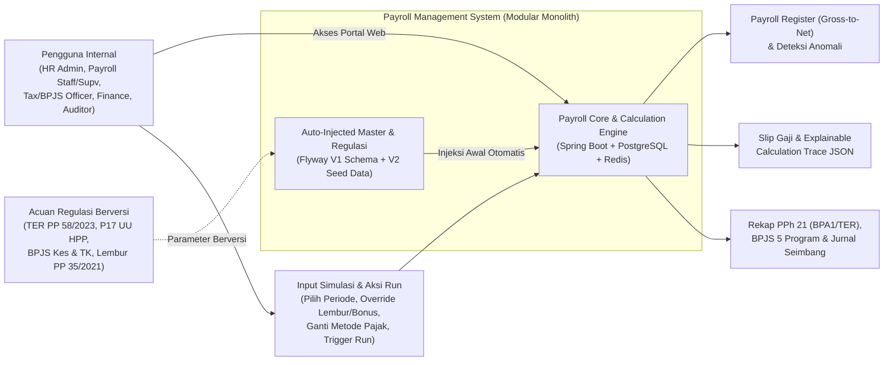
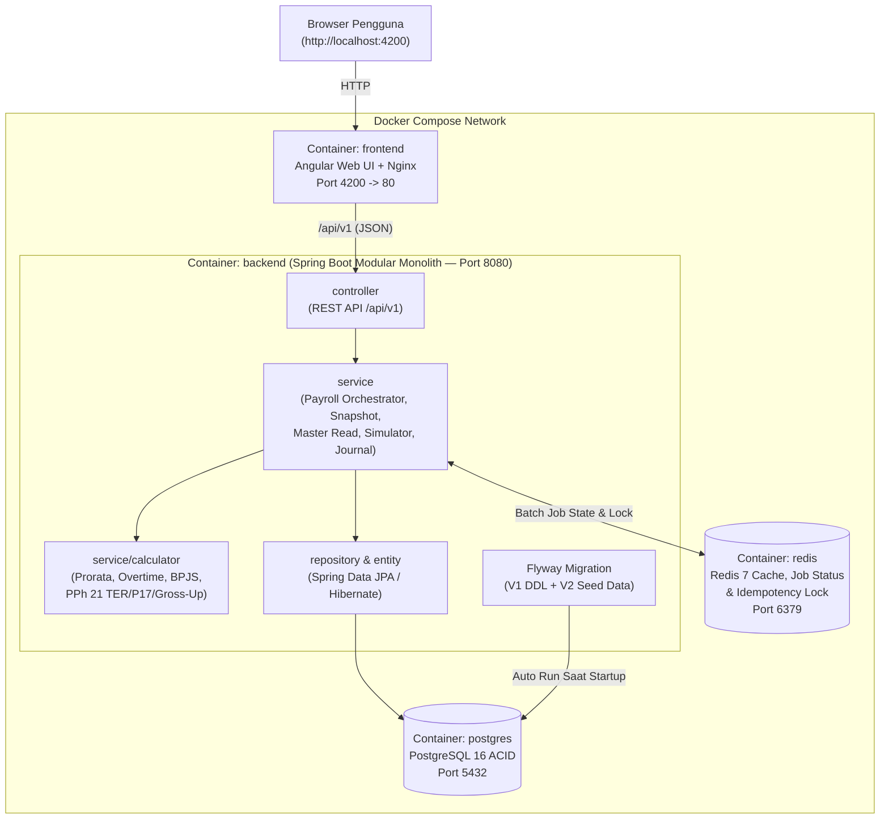
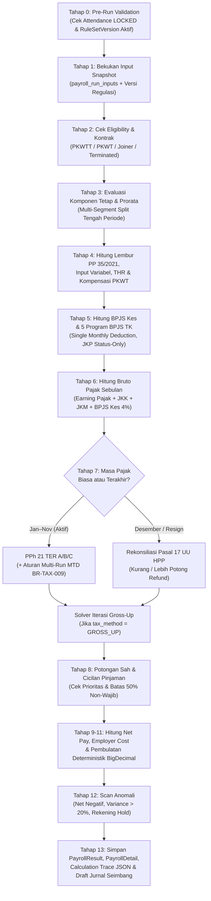

# Sistem Informasi Penggajian (Payroll Management System — Standar Indonesia)

Aplikasi **Payroll Management System** berbasis **Modular Monolith** dengan fokus **Core-Engine-First**: data master organisasi, parameter regulasi Indonesia, komponen gaji, serta skenario karyawan uji di-*inject* secara otomatis lewat skrip migrasi database (**Flyway**), sehingga pengembangan dan pengujian dapat langsung berfokus pada **akurasi mesin kalkulasi gaji, *calculation trace*, kepatuhan pajak/BPJS, dan jurnal akuntansi**.

---

## 1. Tentang Aplikasi

Sistem ini dirancang mengacu pada spesifikasi analisis bisnis & sistem standar Indonesia dengan cakupan MVP **Single-Company (1 Badan Hukum PT dengan dukungan multi-cabang & *cost center*)** untuk karyawan bulanan **PKWTT** dan **PKWT**:

* **Arsitektur Modular Monolith + Background Worker:** Seluruh modul inti berjalan dalam satu aplikasi Spring Boot dengan satu database PostgreSQL transaksional (**ACID**) agar perhitungan gaji, PPh 21, BPJS, cicilan pinjaman, hingga jurnal akuntansi bersifat atomik dan bebas *distributed transaction bug*.
* **Kepatuhan Regulasi Indonesia:**
  * **PPh Pasal 21 (PP 58/2023, PMK 168/2023, PMK 81/2024):** Pemetaan PTKP ke TER Kategori A/B/C (Januari–November), dukungan **Multi-Run** dalam 1 masa pajak (*THR/Bonus + Regular*), rekonsiliasi **Masa Pajak Terakhir** (Desember/Resign) berbasis tarif progresif Pasal 17 UU HPP (termasuk pengembalian *lebih potong* / *tax refund*), metode **Gross**, **Gross-Up** (iterasi *fixed-point*), **Net**, serta siap ekspor format **BPA1 (Coretax)**.
  * **BPJS Kesehatan & 5 Program BPJS Ketenagakerjaan:** BPJS Kesehatan (4% pemberi kerja + 1% pekerja dengan batas UMP/UMK s/d Rp12.000.000 + tanggungan tambahan), serta pemisahan JHT, JKK (sesuai kelompok risiko), JKM, JP (dengan batas upah tahunan berversi), dan **JKP sebagai status kelayakan (`is_jkp_eligible`) tanpa *double-counting* iuran**. Diterapkan **1x pemotongan BPJS per bulan** meski terdapat lebih dari satu *payroll run*.
  * **Lembur & Ketenagakerjaan (PP 35/2021 & Permenaker 6/2016):** Basis upah sejam `1/173` (termasuk aturan 100% vs 75% upah tetap), pengali lembur pola 5 & 6 hari kerja + hari pendek, prorata *multi-segment* saat gaji berubah di tengah bulan, THR Keagamaan, serta uang kompensasi akhir PKWT.
* **Reproduksibilitas & Auditability:** Setiap *payroll run* membekukan *snapshot* input dan versi aturan (`rule_set_versions` & `company_policy_versions`), menggunakan aritmatika presisi tetap (`BigDecimal`), serta menyimpan **`calculation_trace_json`** sebagai rincian rumus yang dapat diperiksa rupiah per rupiah.

---

## 2. Diagram Konteks & Arsitektur Aplikasi

### 2.1 System Context Diagram



### 2.2 Arsitektur Container Docker & Modular Monolith

Seluruh layanan dibungkus dalam satu file orkestrasi `docker-compose.yml` di root proyek:



### 2.3 Alur Mesin Perhitungan Gaji 13 Tahap

Pipeline deterministik yang dijalankan oleh `PayrollRunService` dan paket `service/calculator` untuk setiap karyawan pada sebuah `PayrollRun`:



---

## 3. Teknologi yang Digunakan

| Lapisan | Teknologi | Peran & Alasan Pemilihan |
|---|---|---|
| **Backend Framework** | **Java 21 + Spring Boot 3.x** | Ekosistem enterprise stabil dengan tipe **`BigDecimal`** bawaan untuk aritmatika finansial presisi tetap (*fixed-point*) tanpa *floating-point drift*. |
| **Database Utama** | **PostgreSQL 16** | Penyimpanan transaksional **ACID**, mendukung `UUID`, `DECIMAL(18,2)`, `JSONB` (untuk *snapshot* & *calculation trace*), serta `CHECK` constraint ketat. |
| **Migrasi & Seeder** | **Flyway** | Menjalankan DDL skema (`V1`) dan injeksi otomatis data master serta skenario uji karyawan (`V2`) setiap kali database diinisialisasi. |
| **Cache & Job Lock** | **Redis 7** | Menyimpan status eksekusi batch *payroll run*, *idempotency lock* untuk mencegah proses ganda, dan cache parameter regulasi baca-banyak. |
| **Frontend Web** | **Angular 18+ (TypeScript)** | Cocok untuk antarmuka finansial terstruktur seperti *Payroll Register (Gross-to-Net)*, form simulasi variabel, dan panel inspeksi *Calculation Trace*. |
| **Container & Orkestrasi** | **Docker & Docker Compose** | Membungkus `postgres`, `redis`, `backend`, dan `frontend` agar seluruh stack berjalan konsisten lewat satu perintah. |

---

## 4. Struktur Folder Proyek

Menggunakan konvensi **Standard Layered Architecture** yang umum dipakai oleh developer Java Spring Boot dan struktur fitur ringkas pada Angular:

```text
Payroll/
├── README.md                                  # Dokumentasi utama proyek ini
├── docker-compose.yml                         # (Tahap setup) Orkestrasi 4 container (postgres, redis, backend, frontend)
├── backend/                                   # Aplikasi Backend Spring Boot (Java 21)
│   ├── Dockerfile                             # (Tahap setup) Multi-stage build Maven -> JRE
│   ├── pom.xml                                # (Tahap setup) Dependensi Spring Web, JPA, PostgreSQL, Redis, Flyway
│   └── src/
│       ├── main/
│       │   ├── java/com/payroll/
│       │   │   ├── config/                    # Konfigurasi Spring, Redis, CORS, Async Worker, BigDecimal
│       │   │   ├── controller/                # REST API Endpoints (@RestController)
│       │   │   ├── dto/                       # Request & Response DTO (JSON API + Trace DTO)
│       │   │   ├── entity/                    # Mapping Tabel PostgreSQL (@Entity JPA)
│       │   │   ├── exception/                 # Global Exception Handler & Error Code Domain (ERR_PAY_*)
│       │   │   ├── repository/                # Spring Data JPA Repository
│       │   │   └── service/                   # Logika orkestrasi bisnis (PayrollRunService, JournalService, dll.)
│       │   │       └── calculator/            # Mesin hitung murni (Prorata, Overtime, BPJS, PPh 21 TER/P17/Gross-Up)
│       │   └── resources/
│       │       └── db/migration/              # Skrip SQL Flyway (V1__init_schema.sql & V2__seed_master_data.sql)
│       └── test/
│           └── java/com/payroll/
│               └── service/calculator/        # Unit test vektor perhitungan gaji deterministik
└── frontend/                                  # Aplikasi Web Portal Angular
    ├── Dockerfile                             # (Tahap setup) Build Angular -> Nginx static server
    ├── package.json                           # (Tahap setup) Dependensi Angular CLI & RxJS
    └── src/
        ├── app/
        │   ├── core/
        │   │   ├── models/                    # Interface TypeScript untuk DTO Payroll, Trace, Karyawan, Jurnal
        │   │   └── services/                  # Service HTTP Client pemanggil /api/v1
        │   ├── pages/
        │   │   ├── master-data/               # Halaman lihat data karyawan, komponen, absensi & aturan hasil inject
        │   │   ├── payroll-run/               # Halaman eksekusi run, simulator input & tabel Gross-to-Net
        │   │   └── payslip-trace/             # Halaman Slip Gaji + rincian rumus (Calculation Trace) per karyawan
        │   └── shared/
        │       ├── components/                # Komponen UI pakai ulang (Navigasi, Badge Status/Anomali, Card Ringkasan)
        │       └── pipes/                     # Pipe format Rupiah (Rp), persentase & masking PII
        ├── assets/                            # Aset statis frontend
        └── environments/                      # Konfigurasi URL API per environment
```

> **Catatan Penamaan Package Java:** Folder `backend/src/main/java/com/payroll/` merupakan namespace standar bahasa Java (`package com.payroll.*`) agar class tidak bentrok dengan library eksternal, dan tidak bermasalah meskipun folder root proyek juga bernama `Payroll`.

---

## 5. Skenario Data Master yang Di-*Inject* Otomatis (SQL Seeder)

Karena modul master di-*inject* langsung lewat skrip SQL (`V2__seed_master_data.sql`), begitu aplikasi menyala Anda sudah memiliki **1 PT (`PT Nusantara Teknologi`)**, struktur organisasi, parameter regulasi, dan **daftar skenario karyawan uji** yang siap dihitung:

| Kode Uji | Profil & Skenario Karyawan | Aturan yang Teruji Otomatis |
|---|---|---|
| **EMP-001** | PKWTT Normal, `TK/0` (**TER A**), Metode **GROSS** | Alur standar Gaji Pokok + Tunjangan Tetap, BPJS Kes 4%/1%, BPJS TK, PPh 21 TER A |
| **EMP-002** | PKWTT Gaji Tinggi (`> Rp15 jt`), `K/1` (**TER B**) | Pembatasan upah atas (*wage cap*) BPJS Kesehatan (Rp12 jt) dan JP BPJS TK |
| **EMP-003** | PKWTT Metode **GROSS-UP**, `K/3` (**TER C**) | Solver iterasi *fixed-point* hingga `Tunjangan Pajak == PPh 21 Terutang` |
| **EMP-004** | PKWTT Metode **NET** + Tambahan Keluarga BPJS Kes | Pajak ditanggung perusahaan (*Employer Tax Expense*) + potongan +1% anak ke-4 |
| **EMP-005** | PKWTT Masuk Tengah Bulan (*Joiner*) + *Unpaid Leave* | Prorata hari kerja terjadwal (`hari_dibayar / hari_kerja_periode`) |
| **EMP-006** | PKWTT Naik Gaji Tengah Periode (efektif tgl 16) | Pemecahan **Multi-Segment Split** 2 periode gaji tanpa menimpa histori |
| **EMP-007** | PKWT Aktif dengan Lembur Hari Kerja & Libur Resmi | Rumus lembur PP 35/2021 (`1/173`, pengali `1.5x / 2x / 3x / 4x`) |
| **EMP-008** | PKWTT dengan Cicilan Pinjaman & Uji Batas Potongan 50% | Urutan prioritas potongan, pelacakan saldo pinjaman & deteksi *blocker/warning* |
| **EMP-009** | PKWTT Resign di Bulan Berjalan / Masa Pajak Desember | Rekonsiliasi **Pasal 17 Masa Pajak Terakhir** & kasus **Lebih Potong (*Tax Refund*)** |
| **EMP-010** | PKWT Kontrak Berakhir di Periode Berjalan | Perhitungan **Uang Kompensasi PKWT** (`masa_kerja_bulan / 12 × upah_tetap`) + Final Run |

> **Catatan Kepatuhan:** Angka parameter awal (tabel TER PP 58/2023 dan batas atas JP BPJS TK) yang dimasukkan oleh skrip *seeder* berfungsi sebagai *baseline* pengembangan/pengujian dan wajib diverifikasi ulang oleh Tax/BPJS Officer terhadap lampiran peraturan resmi sebelum digunakan di produksi.

---

## 6. Cara Menjalankan Aplikasi

### Prasyarat
Pastikan di mesin Anda sudah terpasang:
* **Docker Engine** & **Docker Compose v2** (`docker compose version`)

*(Opsional jika ingin menjalankan atau debug langsung di luar Docker: Java 21 JDK, Maven 3.9+, dan Node.js 20+)*

### Menjalankan Seluruh Stack dengan Docker (1 Perintah)

Dari folder root `/home/aliube/Workspace/Project-Personal/Gemini/Payroll` (setelah `docker-compose.yml` dan kode selesai dibuat):

```bash
# 1. Build image backend & frontend, lalu nyalakan seluruh layanan di background
docker compose up --build -d

# 2. Pantau log startup (pastikan Flyway selesai inject V1 & V2 dan Spring Boot ready)
docker compose logs -f backend
```

### Akses Layanan Setelah Berjalan

| Layanan | Alamat / Port | Keterangan |
|---|---|---|
| **Web Frontend (Angular)** | `http://localhost:4200` | Antarmuka utama Payroll Portal |
| **Backend REST API (Spring Boot)** | `http://localhost:8080/api/v1` | Endpoint kalkulasi, master read, & trace |
| **PostgreSQL 16** | `localhost:5432` | Database transaksional (skema & seed otomatis via Flyway) |
| **Redis 7** | `localhost:6379` | Cache, lock idempotensi & status batch job |

### Menghentikan & Reset Data Awal

```bash
# Menghentikan seluruh container tanpa menghapus data database
docker compose down

# Menghentikan container SEKALIGUS menghapus volume DB (reset ulang data seed V1 & V2)
docker compose down -v
```

---

## 7. Cara Penggunaan Aplikasi

### Alur Kerja di Web Portal (`http://localhost:4200`)

1. **Cek Data Master & Skenario (`Master Data`)**
   * Buka menu **Master Data** untuk melihat seluruh data yang telah ter-*inject* otomatis: profil perusahaan, daftar 10 skenario karyawan uji, komponen gaji, rekap absensi *cutoff*, lembur yang disetujui, serta tabel parameter TER & BPJS aktif.
2. **Simulasi Perubahan Input (Opsional — `Simulator`)**
   * Sebelum menjalankan payroll, Anda dapat mengubah parameter simulasi untuk karyawan tertentu (misalnya menambah jam lembur, menambah bonus variabel, atau mengganti metode pajak dari `GROSS` ke `GROSS_UP`) untuk melihat sensitivitas perhitungannya.
3. **Jalankan Kalkulasi Payroll (`Payroll Run`)**
   * Pilih periode payroll (misal **November 2026 — Masa Pajak Biasa TER** atau **Desember 2026 — Masa Pajak Terakhir Pasal 17**) dan tipe run (`REGULAR` atau `THR`).
   * Klik **Calculate Payroll**. Backend akan membekukan *snapshot* input, mengeksekusi 13 tahap kalkulasi, mendeteksi anomali, dan menampilkan **Tabel Payroll Register (Gross-to-Net)**.
4. **Inspeksi Slip Gaji & Calculation Trace (`Payslip & Trace`)**
   * Klik salah satu nama karyawan di *Payroll Register* untuk membuka tampilan **Slip Gaji** berdampingan dengan **Calculation Trace JSON** (penjelasan langkah demi langkah untuk prorata, lembur, iuran BPJS, bruto pajak, tarif TER/Pasal 17, hingga *Net Pay*).
5. **Validasi Kepatuhan & Jurnal Akuntansi**
   * Periksa ringkasan **Rekap PPh 21**, **Rekap BPJS per Program**, serta **Jurnal Akuntansi** untuk memastikan `Total Debit == Total Kredit` per *cost center* sebelum menyetujui (*Approve & Lock*) *payroll run*.

### Ringkasan Endpoint REST API Utama (`/api/v1`)

| Method & Endpoint | Fungsi |
|---|---|
| `GET /api/v1/master/employees` | Daftar karyawan uji beserta komponen gaji, profil pajak, & BPJS |
| `GET /api/v1/master/rules/active` | Melihat parameter aturan hukum (`rule_set_versions`) & kebijakan aktif |
| `POST /api/v1/simulator/inputs` | Mengubah parameter simulasi sementara (lembur/bonus/metode pajak) |
| `GET /api/v1/payroll-periods` | Daftar periode payroll yang tersedia |
| `POST /api/v1/payroll-runs` | Membuat *draft payroll run* baru (`REGULAR` / `THR` / `OFF_CYCLE` / `FINAL_SETTLEMENT`) |
| `POST /api/v1/payroll-runs/{runId}/calculate` | Membekukan snapshot & mengeksekusi mesin kalkulasi 13 tahap |
| `GET /api/v1/payroll-runs/{runId}/results` | Mengambil tabel *Payroll Register (Gross-to-Net)* & status anomali |
| `GET /api/v1/payroll-runs/{runId}/results/{employeeId}/trace` | Mengambil detail Slip Gaji & *Calculation Trace JSON* per karyawan |
| `POST /api/v1/payroll-runs/{runId}/approve` | Mengunci run menjadi `APPROVED` (*immutable*) & membangkitkan jurnal |
| `GET /api/v1/payroll-runs/{runId}/journal` | Melihat baris jurnal akuntansi seimbang (`Debit == Kredit`) per *cost center* |
