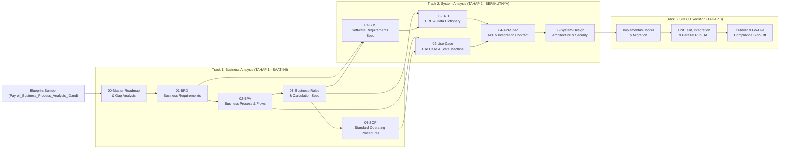

# Master Roadmap & Gap Analysis: Business Analysis -> System Analysis -> SDLC
## Sistem Informasi Penggajian (Payroll Management System — Standar Indonesia)

**Dokumen ID:** `DOC-ROADMAP-001`  
**Versi:** 1.2 (Diselaraskan dengan Implementasi MVP Spring Boot + Angular + Docker)  
**Tanggal:** 18 November 2026  
**Sumber Acuan:** Paket Analisis Bisnis & Sistem (`docs/01-business-analysis` & `docs/02-system-analysis`)  
**Target Cakupan Fase 1 (MVP Implementasi Awal — Core-Engine-First):** Single-Company (`PT Nusantara Teknologi`), Karyawan Bulanan (PKWTT & PKWT), **Data Master & Skenario Uji Di-Inject via Flyway SQL**, Stack: **Java 21 + Spring Boot 3.3 + PostgreSQL 16 + Redis 7 + Angular 18 + Docker Compose**.

---

## 1. Evaluasi Dokumen Sumber (`Payroll_Business_Process_Analysis_ID.md`)

Dokumen sumber setebal 1.315 baris (28 bab) merupakan **Functional Blueprint** tingkat strategis yang sangat baik sebagai titik awal. Evaluasi terhadap dokumen tersebut menghasilkan temuan sebagai berikut:

### 1.1 Kekuatan Utama Dokumen Sumber
1. **Prinsip Kontrol Finansial & Auditability yang Matang**:
   - Menekankan *effective dating* (`valid_from` / `valid_to`) dan pemisahan dengan waktu pencatatan sistem (`created_at` / `updated_at`) untuk mendukung histori bitemporal.
   - Menetapkan *immutability* setelah payroll berstatus `Approved`/`Paid` — koreksi hanya diizinkan via *adjustment*, *off-cycle*, atau *reversal* yang terhubung ke run asal.
   - Mensyaratkan *deterministic calculation* dengan menyimpan snapshot input dan versi aturan (`rule_set_version`) pada tiap *payroll run*.
   - Memisahkan dimensi komponen gaji secara tegas (pajak, BPJS per program, dasar lembur, dasar THR, dan akun akuntansi tidak dijadikan satu flag tunggal).
2. **Kesesuaian Konsep Regulasi Indonesia**:
   - Telah mengacu pada kerangka regulasi utama: PP 35/2021 (Lembur, PKWT, PHK), PP 36/2021 jo. PP 49/2025 (Pengupahan), Permenaker 6/2016 (THR), PP 58/2023 & PMK 168/2023 (PPh 21 TER dan Masa Pajak Terakhir), serta pemisahan 5 program BPJS Ketenagakerjaan + BPJS Kesehatan.
3. **Pemisahan Tugas (Separation of Duties)**:
   - Mendefinisikan 14 aktor dan batasan tegas antara *Maker*, *Checker*, *Approver*, dan *Executor*, termasuk pembatasan hak akses *System Administrator* terhadap data finansial payroll.

### 1.2 Gap Analysis: Celah dari Blueprint Menuju SDLC

Agar proyek dapat dieksekusi oleh tim *Product*, *Engineering*, *QA*, *HR*, dan *Finance/Tax* secara mulus dalam SDLC, terdapat **6 celah (gaps)** pada dokumen sumber yang wajib ditutup oleh paket **Business Analysis (BA)** dan **System Analysis (SA)**:

| No | Area Gap | Kondisi di Dokumen Sumber | Yang Dibutuhkan Sebelum SDLC | Diselesaikan Pada Dokumen |
|---|---|---|---|---|
| **GAP-01** | **Keputusan Cakupan Bisnis (Bab 27)** | Memuat 17 pertanyaan terbuka tanpa keputusan baseline, sehingga ruang lingkup MVP vs fase lanjutan belum terkunci. | Penguncian asumsi & keputusan baseline MVP (single-company, PKWTT & PKWT bulanan, kebijakan prorata, metode pajak, dsb.). | Bagian 2 dokumen ini & [01-BRD](file:///home/aliube/Workspace/PLan/Payroll/docs/01-business-analysis/01-BRD-Business-Requirements-Document.md) |
| **GAP-02** | **Formalisasi Alur Proses End-to-End** | Langkah workflow masih berupa daftar teks pendek tanpa diagram visual, batas tanggung jawab antar-aktor (*swimlane*), gate approval, maupun jalur exception. | Pemetaan proses AS-IS/TO-BE dengan diagram alur visual, trigger, gate kontrol, dan alur pengecualian untuk 9 proses inti. | [02-BPA](file:///home/aliube/Workspace/PLan/Payroll/docs/01-business-analysis/02-BPA-Business-Process-Architecture-and-Flows.md) |
| **GAP-03** | **Spesifikasi Matematis & Parameter Regulasi** | Formula baru berupa penjelasan naratif/konseptual; belum ada tabel keputusan lengkap (tabel pengali lembur, batas upah BPJS, pemetaan PTKP ke TER A/B/C, lapisan Pasal 17, rumus Gross-Up, skala pesangon, aturan pembulatan). | Katalog *Business Rules* bernomor (`BR-xxx`) dengan rumus matematis deterministik, parameter berversi, edge cases, dan contoh uji numerik. | [03-Business-Rules](file:///home/aliube/Workspace/PLan/Payroll/docs/01-business-analysis/03-Business-Rules-and-Calculation-Specification.md) |
| **GAP-04** | **Standar Operasional Prosedur (SOP) Lintas Divisi** | Belum ada jadwal SLA (*cutoff* H-x), prosedur penyelesaian retur transfer, rekonsiliasi tagihan BPJS vs ledger, dan tata kelola update tarif regulasi. | SOP operasional yang dapat langsung dijalankan oleh tim HR, Payroll, Tax, BPJS, dan Finance. | [04-SOP](file:///home/aliube/Workspace/PLan/Payroll/docs/01-business-analysis/04-SOP-Standard-Operating-Procedures.md) |
| **GAP-05** | **Spesifikasi Fungsional Rinci, State Machine & Skema Data Fisik** | Baru memiliki daftar entitas konseptual & ringkasan 22 FR; belum ada Use Case terstruktur, state transition matrix, tipe kolom DB (`DECIMAL(18,2)`), constraint unik, dan indeks. | Paket System Analysis: SRS, Use Case Specification, ERD Fisik & Data Dictionary. | Tahap 2 (Track System Analysis) |
| **GAP-06** | **Kontrak Integrasi, Idempotency & Arsitektur Teknis** | Baru menyebut saran arsitektur (Modular Monolith) secara umum tanpa kontrak API, mekanisme *idempotency*, strategi batch/retry, dan keamanan data sensitif (*masking/encryption*). | API Specification & System Design Document (tech-agnostic contract & NFR architecture). | Tahap 2 (Track System Analysis) |

---

## 2. Keputusan Baseline MVP (Penguncian Bab 27 Dokumen Sumber)

Tabel berikut mengunci 17 poin keputusan bisnis dari Bab 27 dokumen sumber untuk **Fase 1 (MVP)**, sambil menjaga desain tetap fleksibel untuk ekspansi Fase 2+:

| No | Poin Keputusan (Bab 27) | Keputusan Baseline MVP (Fase 1) | Catatan Ekspansi (Fase 2+) |
|---|---|---|---|
| **1** | Industri & karakteristik tenaga kerja | Umum (perkantoran, jasa, ritel/operasional) dengan karyawan kantoran & operasional terjadwal. | Industri padat karya/shift manufaktur kompleks atau konstruksi. |
| **2** | Skala jumlah karyawan | Dirancang untuk mendukung 100 s/d 5.000 karyawan aktif dengan target proses batch < 5 menit per 1.000 karyawan. | Skalabilitas > 10.000 karyawan dengan partisi batch paralel. |
| **3** | Struktur badan hukum | **Single-Company (1 Badan Hukum / PT)** dengan dukungan multi-cabang, divisi, departemen, lokasi kerja, dan cost center. | **Multi-Company** penuh (atribut `company_id` sudah disiapkan sejak awal pada seluruh tabel master & transaksi). |
| **4** | Siklus & jenis hubungan kerja | **Karyawan Bulanan Tetap (PKWTT) & Kontrak (PKWT)**. Siklus regular bulanan + Off-cycle/THR/Final run. | Pekerja harian lepas (BHL), borongan, paruh waktu, dan siklus mingguan/harian. |
| **5** | Sistem & pola kerja | Mendukung pola **5 hari kerja** (Senin–Jumat, 8 jam/hari) dan **6 hari kerja** (40 jam/minggu, termasuk hari pendek), serta shift dasar (termasuk shift lintas tengah malam). | Roster tambang/pelayaran atau pola shift rotasi otomatis kompleks. |
| **6** | Kebijakan prorata | Konfigurasi per komponen/grup: **Hari Kerja Terjadwal** (default untuk gaji bulanan/tunjangan kehadiran) dan **Hari Kalender** (opsi untuk komponen tertentu), serta *multi-segment split* bila ada perubahan gaji tengah bulan. | Prorata berbasis jam kerja aktual. |
| **7** | Komponen upah tetap & tidak tetap | Pemisahan eksplisit: Gaji Pokok, Tunjangan Tetap, Tunjangan Tidak Tetap, Lembur, Bonus/Komisi, THR, Reimbursement (non-upah), dan Potongan sah. | Skema komisi berjenjang (*tiered commission engine*) terintegrasi CRM/POS. |
| **8** | Metode penanggungan pajak PPh 21 | Mendukung ketiga metode secara terkonfigurasi per kelompok karyawan/kebijakan: **Gross** (ditanggung karyawan), **Gross-Up** (tunjangan pajak), dan **Net** (ditanggung perusahaan). | Perlakuan khusus ekspatriat / PPh 26 & fasilitas natura kompleks. |
| **9** | Program BPJS | **BPJS Kesehatan** (PPU 4% + 1% + tambahan tanggungan) dan **BPJS Ketenagakerjaan 5 program terpisah** (JHT, JKK sesuai kelas risiko, JKM, JP, JKP). Mutasi via ekspor/impor file resmi SIPP/e-Dabu. | Integrasi API langsung jika tersedia dari kanal BPJS. |
| **10** | Kebijakan THR & Bonus | THR Keagamaan sesuai Permenaker 6/2016 (mendukung event hari raya tunggal/massal maupun per agama karyawan). Bonus/insentif mendukung input variabel terjadwal/off-cycle. | Skema bonus berbasis KPI/penilaian kinerja otomatis. |
| **11** | Kebijakan cuti, lembur, pinjaman & potongan | Cuti berbasis *ledger* transaksi; Lembur sesuai PP 35/2021 dengan wajib pra-persetujuan; Pinjaman karyawan dengan jadwal cicilan otomatis & pelunasan saat *final payroll*. | Integrasi pinjaman koperasi pihak ketiga via API. |
| **12** | Bank & format pembayaran | Pembuatan *payment batch file* standar perbankan Indonesia (CSV/TXT format LLG/BI-FAST/SKN/Payroll Upload BCA, Mandiri, BNI, BRI) + impor status/mutasi hasil transfer untuk rekonsiliasi. | Integrasi *Host-to-Host* (H2H) API perbankan secara real-time. |
| **13** | Integrasi Akuntansi / ERP | Ekspor jurnal akuntansi terstruktur (CSV/Excel/JSON) berbasis *Chart of Accounts* (COA) & alokasi *Cost Center* per periode/run. | Integrasi API real-time dua arah ke ERP (SAP, Odoo, Accurate, Jurnal, Oracle NetSuite). |
| **14** | Perangkat absensi & integrasi | Impor raw log absensi via API webhook atau file batch (CSV/Excel/JSON dari mesin fingerprint/aplikasi mobile) tanpa mengubah raw timestamp sumber. | Konektor SDK native langsung ke berbagai merk mesin biometrik. |
| **15** | Matriks approval & batas kewenangan | *Maker-Checker-Approver* wajib untuk perubahan data sensitif (gaji, rekening bank), lembur/cuti, eksekusi payroll run, payment batch, dan perubahan aturan regulasi. | *Dynamic approval matrix* berbasis nilai nominal berlapis (*multi-tier threshold*). |
| **16** | Kebutuhan laporan & audit | Laporan operasional, register payroll, gross-to-net, slip gaji PDF, rekap PPh 21 & format pelaporan DJP/Coretax, rekap BPJS, jurnal akuntansi, dan *immutable audit log*. | BI Dashboard eksekutif interaktif & *ad-hoc report builder*. |
| **17** | Keamanan, retensi & DR | RBAC dengan prinsip *least privilege*, enkripsi data saat transit & tersimpan, masking NIK/NPWP/rekening, isolasi slip gaji (anti-IDOR), retensi dokumen finansial & pajak minimal 10 tahun. | Sertifikasi ISO 27001 / SOC 2 & multi-region active-active failover. |

---

## 3. Arsitektur Dokumentasi End-to-End (BA -> SA -> SDLC)

Seluruh dokumentasi disusun berurutan dan saling terhubung (*traceable*) melalui ID unik (`BR-xxx` -> `BR-RULE-xxx` -> `SRS-FR-xxx` -> `UC-xxx` -> `TBL-xxx` -> `API-xxx` -> `TC-xxx`):

### 3.1 Inventaris Artefak per Tahap

| Tahap | Kode Artefak | Lokasi File | Tujuan Utama | Status |
|---|---|---|---|---|
| **Tahap 1 (BA)** | `DOC-ROADMAP-001` | `docs/00-Master-Roadmap-BA-SA-SDLC.md` | Evaluasi blueprint, gap analysis, keputusan MVP, dan peta jalan dokumentasi. | **Selesai (Dokumen ini)** |
| **Tahap 1 (BA)** | `DOC-BA-BRD-001` | `docs/01-business-analysis/01-BRD-Business-Requirements-Document.md` | Tujuan bisnis, cakupan MVP, RACI/SoD 14 aktor, dan 25 Business Requirements. | **Diterbitkan** |
| **Tahap 1 (BA)** | `DOC-BA-BPA-001` | `docs/01-business-analysis/02-BPA-Business-Process-Architecture-and-Flows.md` | Alur proses end-to-end (diagram alur, aktor, input, gate kontrol, exception) untuk 9 proses inti. | **Diterbitkan** |
| **Tahap 1 (BA)** | `DOC-BA-BR-001` | `docs/01-business-analysis/03-Business-Rules-and-Calculation-Specification.md` | Katalog aturan bisnis & formula matematis deterministik (PPh 21 TER/Pasal 17, BPJS, Lembur PP 35/2021, THR, PKWT, Prorata, Kontrol). | **Diterbitkan** |
| **Tahap 1 (BA)** | `DOC-BA-SOP-001` | `docs/01-business-analysis/04-SOP-Standard-Operating-Procedures.md` | 6 SOP operasional standar (Cutoff, Payroll Run, Koreksi/Off-Cycle, Pencairan Bank, PPh/BPJS, Update Regulasi). | **Diterbitkan** |
| **Tahap 2 (SA)** | `DOC-SA-SRS-001` | [01-SRS-Software-Requirements-Specification.md](file:///home/aliube/Workspace/PLan/Payroll/docs/02-system-analysis/01-SRS-Software-Requirements-Specification.md) | Spesifikasi fungsional & non-fungsional tingkat sistem, traceability matrix ke BRD/Rules. | **Diterbitkan** |
| **Tahap 2 (SA)** | `DOC-SA-UC-001` | [02-Use-Case-and-State-Machine.md](file:///home/aliube/Workspace/PLan/Payroll/docs/02-system-analysis/02-Use-Case-and-State-Machine.md) | Use Case (Main/Alternate/Exception flow) & State Transition Diagram seluruh transaksi. | **Diterbitkan** |
| **Tahap 2 (SA)** | `DOC-SA-ERD-001` | [03-ERD-and-Data-Dictionary.md](file:///home/aliube/Workspace/PLan/Payroll/docs/02-system-analysis/03-ERD-and-Data-Dictionary.md) | ERD logis & fisik lengkap, tipe data presisi, PK/FK/Unique constraints, bitemporal & snapshot tables. | **Diterbitkan** |
| **Tahap 2 (SA)** | `DOC-SA-API-001` | [04-API-and-Integration-Specification.md](file:///home/aliube/Workspace/PLan/Payroll/docs/02-system-analysis/04-API-and-Integration-Specification.md) | Kontrak endpoint REST/Async, payload JSON, error catalog, idempotency, format file integrasi bank/pajak/BPJS/absensi. | **Diterbitkan** |
| **Tahap 2 (SA)** | `DOC-SA-SYS-001` | [05-System-Design-and-Architecture.md](file:///home/aliube/Workspace/PLan/Payroll/docs/02-system-analysis/05-System-Design-and-Architecture.md) | Modular Monolith architecture (tech-agnostic), payroll calculation pipeline, batch processing, keamanan & observability. | **Diterbitkan** |

---

## 4. Matriks Keterlacakan Awal (Traceability Overview)

Setiap aturan di SDLC kelak harus dapat ditelusuri mundur (*backward traceability*) hingga kebutuhan bisnis dan regulasi:

- **Business Requirement (`BR-xxx`)** -> **Business Process (`BPA-xx`)** -> **Business Rule (`BR-RULE-xxx`)** -> **SOP (`SOP-PAY-xxx`)** -> *(Tahap 2)* **SRS (`SRS-xxx`)** -> **Use Case (`UC-xxx`)** -> **Tabel (`TBL-xxx`)** -> **Endpoint (`API-xxx`)** -> *(Tahap 3)* **Test Case (`UAT-xxx`)**.

---

## 5. Gate Validasi Sebelum Lanjut ke SDLC & Coding

Sebelum tim masuk ke implementasi SDLC (penentuan tech stack dan penulisan kode), pemangku kepentingan (HR, Finance, Tax, Legal, dan Product Owner) perlu memvalidasi paket **BA + SA v1.1** melalui checklist berikut:
1. Apakah seluruh ruang lingkup MVP (*single-company*, karyawan bulanan PKWTT & PKWT) pada [01-BRD](file:///home/aliube/Workspace/PLan/Payroll/docs/01-business-analysis/01-BRD-Business-Requirements-Document.md) sudah disepakati (termasuk kebijakan tim ramping SoD & saldo awal YTD)?
2. Apakah alur persetujuan dan *Separation of Duties* (Maker–Checker–Approver) pada [02-BPA](file:///home/aliube/Workspace/PLan/Payroll/docs/01-business-analysis/02-BPA-Business-Process-Architecture-and-Flows.md) sesuai struktur organisasi perusahaan?
3. Apakah seluruh formula perhitungan dan parameter regulasi pada [03-Business-Rules](file:///home/aliube/Workspace/PLan/Payroll/docs/01-business-analysis/03-Business-Rules-and-Calculation-Specification.md) telah dicocokkan terhadap naskah primer resmi (lampiran PP 58/2023, PMK 168/2023, PMK 81/2024, PP 35/2021, pengumuman batas atas JP BPJS TK terbaru)?
4. Apakah SLA *cutoff* dan prosedur operasional pada [04-SOP](file:///home/aliube/Workspace/PLan/Payroll/docs/01-business-analysis/04-SOP-Standard-Operating-Procedures.md) realistis untuk dijalankan tim operasional?

---

## 6. Register Regulasi Resmi (Bab 26 Blueprint)

Seluruh parameter hukum disimpan sebagai versi di `rule_set_versions` (terpisah dari `company_policy_versions`). Tim Legal, Tax, dan BPJS wajib memvalidasi naskah primer dari sumber resmi sebelum *go-live*:

| Kode Regulasi | Topik Utama | Dasar Hukum | Sumber Resmi Acuan |
|---|---|---|---|
| **REG-LAB-01** | PKWT, Alih Daya, Waktu Kerja, Lembur, PHK & Pesangon | UU Ketenagakerjaan jo. UU Cipta Kerja; **PP No. 35 Tahun 2021**; Putusan MK 168/PUU-XXI/2023 | `jdih.kemnaker.go.id`, `peraturan.go.id` |
| **REG-LAB-02** | Pengupahan, UMP/UMK, Upah Minimum Sektoral (UMSP/UMSK), Upah Sakit, Batas Potongan | **PP No. 36 Tahun 2021** jo. PP 51/2023 jo. **PP No. 49 Tahun 2025** | `jdih.kemnaker.go.id`, `peraturan.bpk.go.id` |
| **REG-LAB-03** | Tunjangan Hari Raya (THR) Keagamaan | **Permenaker No. 6 Tahun 2016** | `jdih.kemnaker.go.id` |
| **REG-TAX-01** | Tarif Progresif Pasal 17 & PTKP | UU PPh jo. **UU No. 7 Tahun 2021 (UU HPP)** & PMK PTKP berlaku | `www.pajak.go.id`, `jdih.kemenkeu.go.id` |
| **REG-TAX-02** | Tarif Efektif Rata-Rata (TER A/B/C) & Petunjuk Pelaksanaan PPh 21 | **PP No. 58 Tahun 2023** & **PMK No. 168 Tahun 2023** | `www.pajak.go.id`, `jdih.kemenkeu.go.id` |
| **REG-TAX-03** | Sistem Coretax, Bukti Potong BPA1, Batas Setor Tgl 15 & Lapor Tgl 20 | **PMK No. 81 Tahun 2024** (Pasal 94 ayat 2 dll.) | `www.pajak.go.id`, `jdih.kemenkeu.go.id` |
| **REG-TAX-04** | Pajak Final Uang Pesangon, JHT & Pensiun Dibayar Sekaligus | **PP No. 68 Tahun 2009** | `www.pajak.go.id`, `peraturan.bpk.go.id` |
| **REG-BPJS-01** | BPJS Kesehatan PPU (4% + 1%, Cap Rp12 Juta, Tambahan Keluarga 1%) | **Perpres No. 82 Tahun 2018** jo. **Perpres No. 64 Tahun 2020** | `www.bpjs-kesehatan.go.id`, `peraturan.bpk.go.id` |
| **REG-BPJS-02** | BPJS Ketenagakerjaan (JHT, JKK, JKM, JP + Cap Tahunan, JKP Rekomposisi) | **PP 44/2015**, **PP 45/2015**, **PP 82/2019**, **PP 37/2021** & Pengumuman Cap JP Tahunan | `www.bpjsketenagakerjaan.go.id` |
| **REG-SEC-01** | Pelindungan Data Pribadi (PII Karyawan, NIK, NPWP, Rekening, Gaji) | **UU No. 27 Tahun 2022 (UU PDP)** | `peraturan.go.id` |

---

## 7. Roadmap Implementasi 6 Fase (Bab 25 Blueprint)

| Fase | Nama Fase | Ruang Lingkup Modul & Deliverables | Gate Keluar (Exit Criteria) |
|---|---|---|---|
| **Phase 0** | **Discovery, Asumsi & Validasi Regulasi** | Finalisasi konfirmasi asumsi workshop, impor tabel primer TER PP 58/2023 & Cap JP BPJS TK, persetujuan BRD/SA v1.1, pemilihan Tech Stack SDLC. | Sign-off Parameter Regulasi & Tech Stack. |
| **Phase 1** | **Core HR, Policy & Governance** | Struktur Organisasi (1 PT, multi-cabang/cost center), Master Karyawan (Enkripsi + Blind Index), Kontrak PKWTT/PKWT, Kompensasi Bitemporal, IAM/RBAC, Maker-Checker-Approver, `CompanyPolicyVersion`, `AuditLog` terpartisi. | DDL teruji, Auth/SoD/Anti-IDOR lulus tes keamanan. |
| **Phase 2** | **Time, Leave Ledger & Overtime** | `WorkCalendar`, Shift Lintas Malam, Impor Raw Attendance, Koreksi & Cutoff Summary, Leave Ledger, Engine Lembur PP 35/2021. | Ringkasan absensi terkunci & hitung lembur lulus unit test. |
| **Phase 3** | **Core Payroll Engine & Variable Input** | `PayrollPeriod`, `PayrollRun`, Impor Input Variabel, Antrean Rapel, Snapshot Isolation, Multi-Segment Prorata, Deteksi Anomali, Reversal/Off-Cycle. | Kalkulasi deterministik & *calculation trace* JSON berjalan. |
| **Phase 4** | **Compliance Indonesia & Final Settlement** | PPh 21 (TER Multi-Run, Masa Terakhir Pasal 17, Gross/Gross-Up/Net), BPJS Kes & TK (5 program tanpa double-count JKP), Migrasi Saldo Awal YTD, THR Run, Final Payroll/PKWT/PHK. | 100% *Calculation Test Vectors* cocok dengan hitungan manual Pajak/HR. |
| **Phase 5** | **Finance, Bank & Accounting** | `PaymentBatch` + Idempotency, Penanganan Retur Bank, `StatutoryPayments` (NTPN Pajak & VA BPJS), Generator Jurnal Seimbang & Alokasi Cost Center, Payslip PDF & Ekspor BPA1/Coretax. | Uji integrasi file bank & jurnal seimbang 100%. |
| **Phase 6** | **ESS, Pinjaman & Parallel Run Cutover** | Employee Self-Service Portal, Pinjaman & Cicilan, Klaim Reimbursement, Laporan Manajemen, dan **Parallel Payroll Run** (min. 2 siklus) sebelum *Go-Live*. | Sign-off Parallel Run (selisih = Rp0) dari HR, Finance, Tax & Legal. |

### 7.1 Status Implementasi Awal (Core-Engine-First MVP — Terbangun)
Untuk mempercepat validasi akurasi kalkulasi dan *calculation trace*, fase implementasi awal menggunakan pendekatan **Core-Engine-First** di dalam `docker-compose.yml`:
- **Tech Stack Terpilih:** **Java 21 + Spring Boot 3.3.5** (`backend/`), **PostgreSQL 16 + Flyway** (`V1__init_schema.sql`, `V2__seed_master_data.sql`), **Redis 7**, dan **Angular 18 + Nginx** (`frontend/`).
- **Data Master & 10 Skenario Uji Di-Inject Otomatis:** Seluruh master organisasi (`PT Nusantara Teknologi`), parameter regulasi (125 lapisan TER PP 58/2023, Pasal 17 UU HPP, BPJS 5 program, lembur PP 35/2021), komponen gaji, dan 10 karyawan skenario (`EMP-001` s/d `EMP-010`) otomatis disuntikkan oleh Flyway saat startup.
- **Fitur yang Sudah Aktif di Aplikasi:** Mesin hitung 13 tahap (`ProrataCalculator`, `OvertimeCalculator`, `BpjsCalculator`, `Pph21Calculator`), dukungan **Multi-Run (`REGULAR` + `THR`)**, **Simulator Input** sementara, **Payroll Register (Gross-to-Net)** dengan deteksi anomali, **Slip Gaji & Explainable Calculation Trace JSON**, **Jurnal Akuntansi Seimbang (`Debit == Kredit`)**, serta penguncian run (`APPROVED` / `ERR_PAY_RUN_IMMUTABLE`).
- **Port Akses Lokal (Docker):** Frontend `http://localhost:4200`, Backend API `http://localhost:8085/api/v1`, PostgreSQL `localhost:5439`, Redis `localhost:6381`.

---

## 8. Strategi Testing, Migrasi Saldo Awal YTD & Katalog UAT (Bab 24 Blueprint)

### 8.1 Piramida Pengujian Wajib Sebelum Go-Live
1. **Unit Test (Deterministic Calculation Vectors):** Menguji setiap formula terisolasi (*Prorata Multi-Segment, Shift Lintas Tengah Malam, Pengali Lembur 5 vs 6 Hari, TER A/B/C, Multi-Run dalam 1 Bulan, Rekonsiliasi Desember Kurang/Lebih Potong, Gross-Up Iteratif, BPJS Kes/JP Cap, THR Proporsional, Kompensasi PKWT, Pembulatan Rupiah, Batas Potongan 50%*).
2. **Integration & Security Test:** Menguji impor absensi idempotent, generator file bank + retur, ekspor BPA1/jurnal seimbang, *Maker == Approver* ditolak (`403`), akses *SysAdmin* ditolak (`403`), dan uji *anti-IDOR* slip gaji.
3. **Migrasi Data & Saldo Awal YTD (Jika Go-Live Tengah Tahun):**
   - Wajib mengisi `employee_ytd_opening_balances` (Akumulasi Bruto, Biaya Jabatan, JHT/JP Pekerja, dan PPh 21 telah dipotong Jan s/d bulan sebelum cutover), saldo cuti, dan sisa cicilan pinjaman, lalu direkonsiliasi terhadap SPT Masa PPh 21 terakhir sebelum *go-live*.
4. **Parallel Payroll Run (Minimal 2 Siklus):**
   - Menjalankan sistem lama dan sistem baru secara paralel pada periode sama, membandingkan hasil per karyawan dan per komponen via *Automated Parallel Run Comparator* hingga 0 selisih tak terjelaskan.

### 8.2 Katalog Skenario UAT Minimum (`UAT-001` s/d `UAT-022`)

| ID UAT | Skenario Pengujian | Hasil yang Diharapkan |
|---|---|---|
| **UAT-001** | Karyawan aktif PKWTT/PKWT bergaji tetap | Gross-to-net sesuai struktur & konfigurasi komponen |
| **UAT-002** | Karyawan masuk di tengah bulan (*Joiner*) | Prorata hari kerja/kalender sesuai kebijakan aktif |
| **UAT-003** | Kenaikan gaji di tengah periode (*Multi-Segment*) | Periode terpecah 2 segmen tanggal efektif, tidak menimpa histori |
| **UAT-004** | Lembur hari kerja biasa | Jam ke-1 = 1,5x, jam ke-2+ = 2x dari (Upah / 173) |
| **UAT-005** | Lembur hari libur resmi (pola 5 & 6 hari kerja) | Pengali 2x/3x/4x tepat termasuk hari pendek & pra-persetujuan |
| **UAT-006** | Cuti berbayar vs *Unpaid Leave* & Upah Sakit | Ledger cuti terpotong; *unpaid leave* memotong gaji proporsional |
| **UAT-007** | PPh 21 Masa Biasa (Jan–Nov) — Gross | Tarif TER sesuai Kategori A/B/C atas bruto pajak (termasuk JKK, JKM, BPJS Kes 4%) |
| **UAT-008** | PPh 21 Masa Terakhir (Desember / Resign) | Hitung ulang Pasal 17; kurang potong dipotong, **lebih potong dikembalikan (refund)** |
| **UAT-009** | BPJS Kesehatan PPU + Tambahan Keluarga | 4% perusahaan & 1% pekerja dibatasi UMK..Cap; tambahan anak ke-4 dst +1% pekerja |
| **UAT-010** | BPJS Ketenagakerjaan (5 Program) | JHT, JKK, JKM, JP (dengan batas atas) terpisah; **JKP tidak menambah beban/potongan** |
| **UAT-011** | THR Keagamaan (penuh >= 12 bln & proporsional < 12 bln) | Nominal tepat, terbayar <= H-7, dan masuk bruto pajak bulan terkait |
| **UAT-012** | PKWT Berakhir & PHK PP 35/2021 | Kompensasi PKWT = (bln/12)×upah; PHK ikut decision table & PPh Final PP 68/2009 |
| **UAT-013** | Rekening bank invalid atau diubah <= H-5 | Pembayaran berstatus `ON_HOLD` / ditahan dari file batch bank |
| **UAT-014** | Payroll berstatus `APPROVED` / `PAID` | Perubahan langsung ditolak sistem (`ERR_PAY_RUN_IMMUTABLE`) |
| **UAT-015** | Koreksi payroll (Rapel / Off-Cycle / Reversal) | Terlacak ke `parent_run_id` dengan approval Maker-Checker-Approver |
| **UAT-016** | Kontrol akses Employee, SoD & SysAdmin | Anti-IDOR slip gaji; `Maker == Approver` ditolak; `SysAdmin` ditolak baca gaji |
| **UAT-017** | **Multi-Run dalam 1 Bulan (THR Run + Regular Run)** | TER run ke-2 dihitung dari total bruto gabungan bulan itu minus PPh run ke-1; BPJS dipotong 1x |
| **UAT-018** | **PPh 21 Metode Gross-Up** | Tunjangan pajak iteratif konvergen sehingga `Tunjangan Pajak == PPh 21 Terutang` |
| **UAT-019** | **Migrasi Saldo Awal YTD Tengah Tahun** | Akumulasi YTD sistem lama digabung benar pada perhitungan Masa Pajak Terakhir Desember |
| **UAT-020** | **Pinjaman Karyawan & Batas Potongan 50%** | Cicilan otomatis berkurang dari saldo; potongan ditahan jika melanggar net pay negatif |
| **UAT-021** | **Gagal Transfer Bank & Re-payment Batch** | Instruksi retur berstatus `FAILED` dibayar ulang setelah verifikasi rekening tanpa duplikasi |
| **UAT-022** | **Jurnal Akuntansi & Alokasi Cost Center** | Total Debit == Total Kredit; perpindahan cost center teralokasi sesuai kebijakan |
