# Business Process Analysis (BPA) & Alur Proses Bisnis
## Sistem Informasi Penggajian (Payroll Management System — Standar Indonesia)

**Dokumen ID:** `DOC-BA-BPA-001`  
**Versi:** 1.1  
**Tanggal:** 18 November 2026 (Revisi Pasca-Audit Internal BA/SA)  
**Acuan:** [01-BRD-Business-Requirements-Document.md](file:///home/aliube/Workspace/PLan/Payroll/docs/01-business-analysis/01-BRD-Business-Requirements-Document.md)

---

## 1. Peta Proses Bisnis (Process Landscape)

Arsitektur proses bisnis Sistem Payroll dibagi menjadi 9 proses inti end-to-end yang terhubung secara berurutan dari hulu (manajemen SDM & kehadiran) hingga hilir (pencairan dana, kepatuhan pajak/BPJS, akuntansi, dan offboarding):

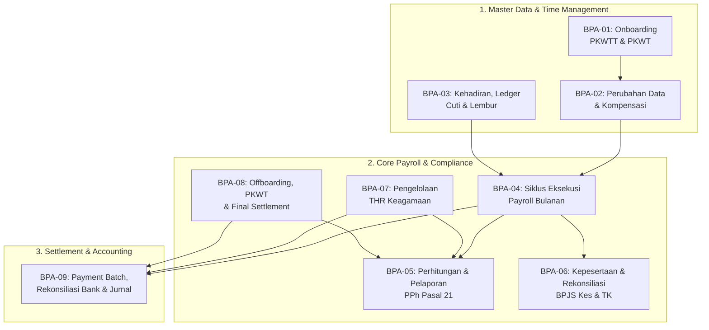

---

## 2. BPA-01: Onboarding Karyawan Baru (PKWTT & PKWT) dan Aktivasi Struktur Gaji

- **Trigger:** Kandidat menandatangani perjanjian kerja (PKWTT/PKWT) dan dinyatakan siap masuk bekerja.
- **Aktor:** HR Administrator (Maker), Tax Officer & BPJS Officer (Validator), HR Manager (Approver).
- **Input:** Data identitas (KTP/NIK, NPWP), kontrak kerja, surat penempatan, struktur kompensasi, informasi rekening bank.
- **Output:** Record `Employee`, `Employment`, `EmploymentContract`, `EmployeeSalaryAssignment`, `TaxProfile`, `BPJSMembership` berstatus aktif pada tanggal mulai kerja (*effective date*), serta daftar tugas onboarding yang belum selesai (bila ada).

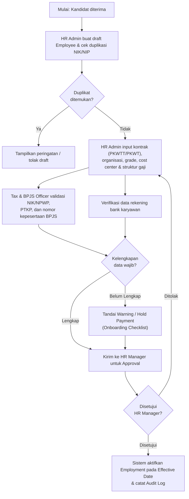

### Gate Kontrol & Exception
- **Hard Block vs Warning:** Karyawan dengan NIK belum valid atau rekening bank belum terverifikasi tetap dapat dibuat dan diaktifkan secara administratif jika sudah bekerja, namun sistem memberi **Warning** pada profil pajak (berisiko tarif lebih tinggi/blokir bukti potong sesuai aturan DJP) dan **Hold Payment** pada instruksi transfer bank (gaji ditahan hingga rekening terverifikasi).

---

## 3. BPA-02: Perubahan Data Karyawan & Kompensasi (Mutasi, Kenaikan Gaji, Rekening Bank)

- **Trigger:** Adanya SK promosi/mutasi organisasi, penyesuaian gaji (awal atau tengah periode), atau permohonan ganti rekening bank.
- **Aktor:** Employee / HR Administrator (Maker), Payroll Supervisor / Finance (Checker), HR Manager / Director (Approver).
- **Prinsip Kunci:** *Append-only bitemporal history* — data lama tidak ditimpa, melainkan ditutup tanggal berakhirnya (`valid_to`) dan dibuat baris versi baru (`valid_from`).

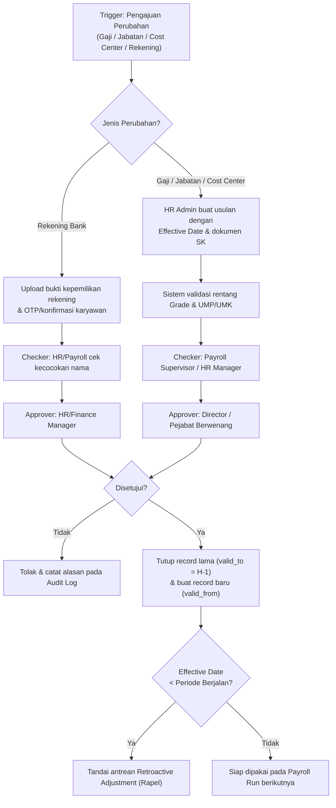

### Gate Kontrol & Exception
- **Perubahan Rekening Mendekati Payday:** Perubahan rekening bank dalam rentang H-5 sebelum hari gajian otomatis memicu status *High-Risk Review* dan mewajibkan verifikasi ganda oleh Finance Manager.
- **Perubahan Gaji Tengah Periode:** Jika `valid_from` berada di tengah periode payroll, engine otomatis memicu kalkulasi multi-segmen (nilai lama untuk hari sebelum `valid_from`, nilai baru sejak `valid_from`).

---

## 4. BPA-03: Pengelolaan Kehadiran, Ledger Cuti, dan Lembur

- **Trigger:** Jadwal shift berjalan, karyawan melakukan absen (clock-in/out), mengajukan cuti/izin, atau ditugaskan lembur.
- **Aktor:** Employee, Line Manager, Attendance Officer, HR Manager.

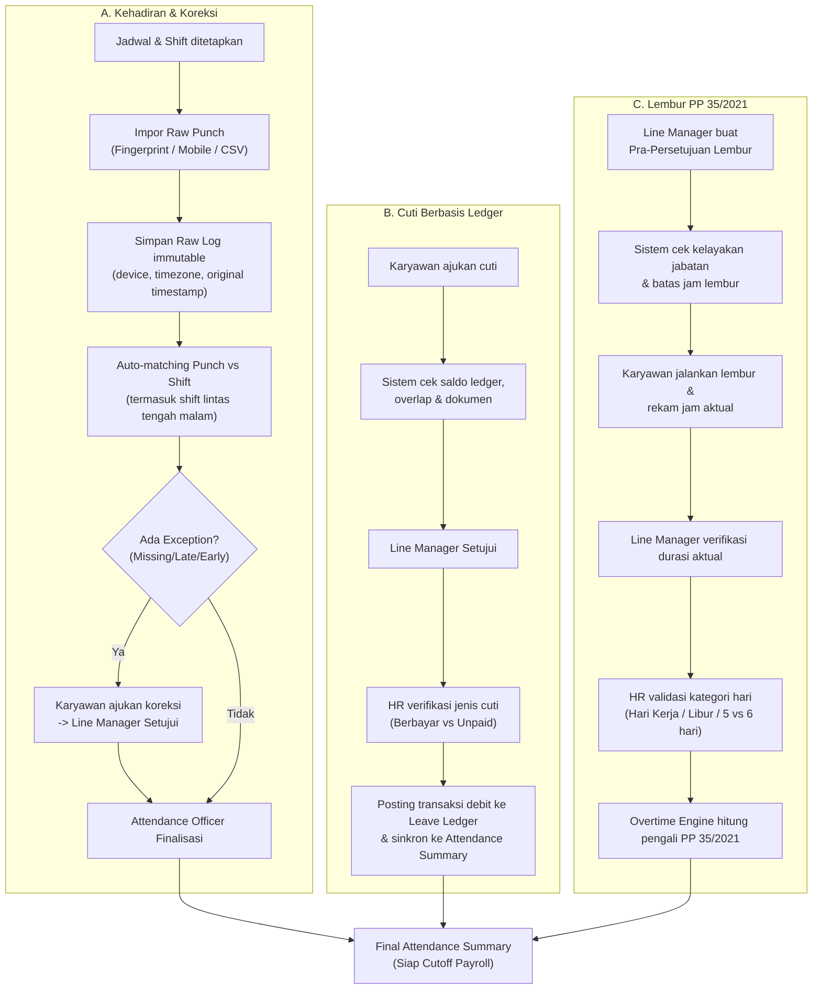

### Gate Kontrol & Exception
- **Strict Cutoff:** Data kehadiran, cuti, dan lembur yang disetujui melewati tanggal *cutoff* periode tidak dimasukkan ke run reguler bulan berjalan secara diam-diam, melainkan masuk sebagai penyesuaian (*adjustment*) pada periode berikutnya.
- **Lembur Tanpa Pra-Persetujuan:** Tidak otomatis dibayar kecuali melewati alur *Emergency Overtime Approval* oleh HR Manager.

---

## 5. BPA-04: Siklus Eksekusi Payroll Bulanan (End-to-End 20 Langkah)

- **Trigger:** Awal siklus periode payroll sesuai kalender bulanan perusahaan.
- **Aktor:** Payroll Staff (Maker), Attendance Officer, Payroll Supervisor (Checker), Tax Officer, BPJS Officer, Finance Manager, Director (Approver).

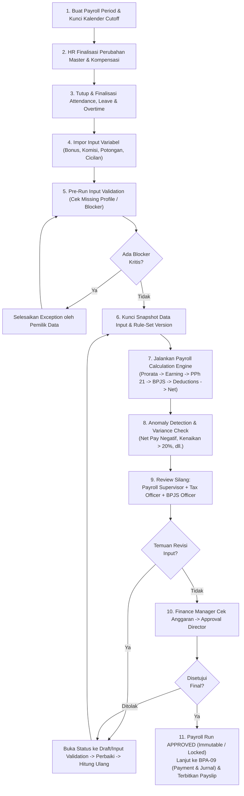

### Gate Kontrol & Exception
- **Snapshot Isolation:** Saat tahap kalkulasi dimulai, sistem membekukan salinan input dan versi aturan (`rule_set_version`) sehingga perubahan master HR yang diinput di tengah proses review tidak mengubah angka run yang sedang ditinjau secara diam-diam.
- **Reopen / Rerun:** Setelah status `Approved`, data tidak dapat diedit. Jika ditemukan kesalahan fatal sebelum dibayar, run harus melalui proses `Reverse` atau `Cancel` dengan otorisasi Director sebelum dibuat run revisi.

---

## 6. BPA-05: Perhitungan, Validasi, dan Pelaporan PPh Pasal 21

- **Trigger:** Eksekusi Payroll Run (Regular, THR, Bonus, atau Final Settlement).
- **Aktor:** Payroll Engine (Otomatis), Tax Officer (Checker/Validator), Finance Staff (Pembayar), Director/Kuasa Pajak (Penandatangan Bukti Potong).

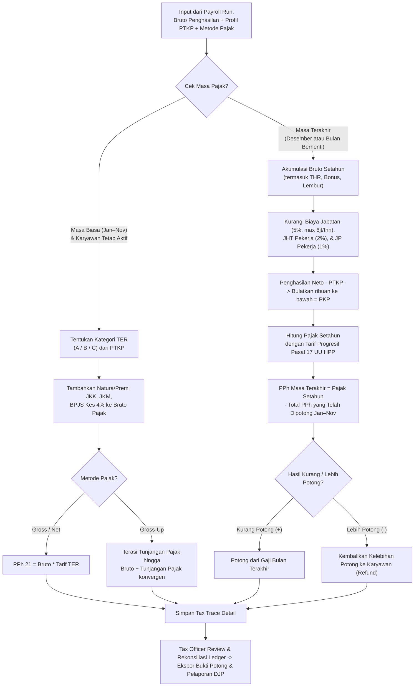

---

## 7. BPA-06: Kepesertaan, Perhitungan, dan Rekonsiliasi BPJS (Kesehatan & Ketenagakerjaan)

- **Trigger:** Onboarding/offboarding karyawan, perubahan upah tetap, dan eksekusi payroll bulanan.
- **Aktor:** HR Admin, BPJS Officer, Payroll Engine, Finance Staff.

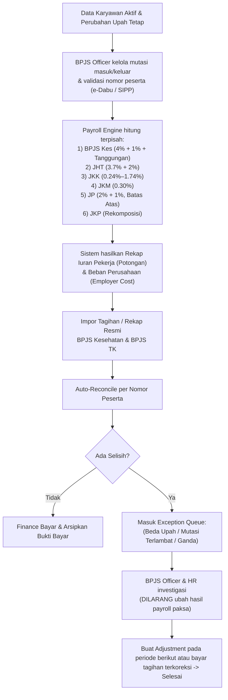

---

## 8. BPA-07: Pengelolaan dan Pembayaran THR Keagamaan

- **Trigger:** HR membuat *THR Event* sesuai kalender Hari Raya Keagamaan (atau serentak menjelang Idul Fitri sesuai kebijakan perusahaan) minimal H-21 sebelum Hari Raya.
- **Aktor:** HR Admin, Payroll Staff, Tax Officer, Finance Manager, Director.

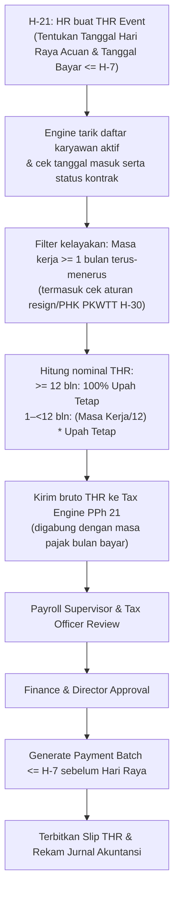

---

## 9. BPA-08: Offboarding, Final Settlement, Kompensasi PKWT & PHK

- **Trigger:** Pengajuan pengunduran diri (*resign*), berakhirnya masa kontrak PKWT, pensiun, atau pemutusan hubungan kerja (PHK).
- **Aktor:** HR Admin, Legal/HR Manager, Attendance Officer, Payroll Staff, Finance Manager, Director.

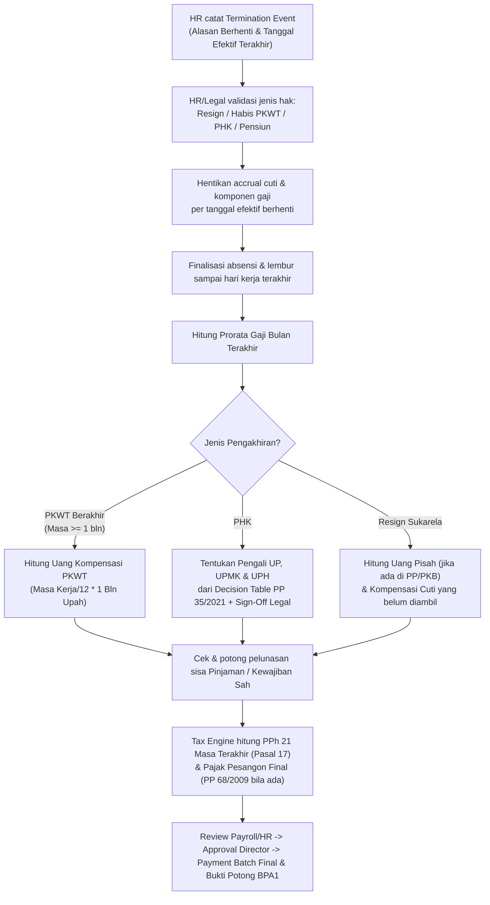

---

## 10. BPA-09: Pembuatan Payment Batch Bank, Rekonsiliasi, dan Jurnal Akuntansi

- **Trigger:** Payroll Run / THR Run / Final Run mencapai status `Approved`.
- **Aktor:** Finance Staff (Maker), Finance Manager (Checker/Approver), Authorized Bank Signatory.

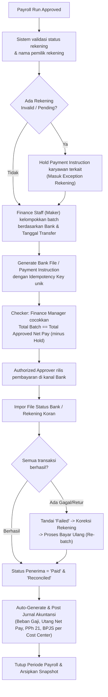

---

## 11. BPA-10: Siklus Penutupan Akhir Tahun (Desember), Penerbitan BPA1 & Rollover Awal Tahun (Januari)

- **Trigger:** Memasuki masa payroll Desember (penutupan tahun pajak) dan tanggal 1 Januari (pembukaan tahun baru).
- **Aktor:** Payroll Staff, Tax Officer, HR Admin, HR Manager, Finance Manager, Director.

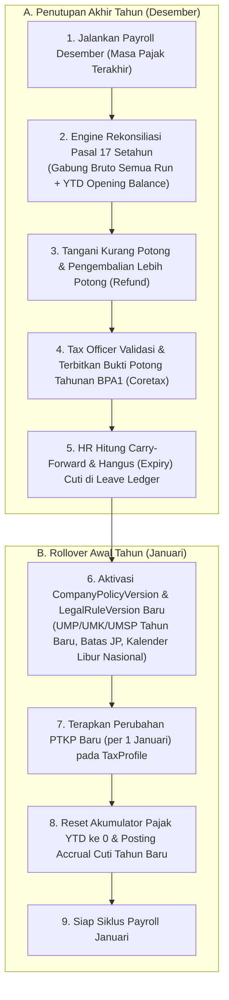
