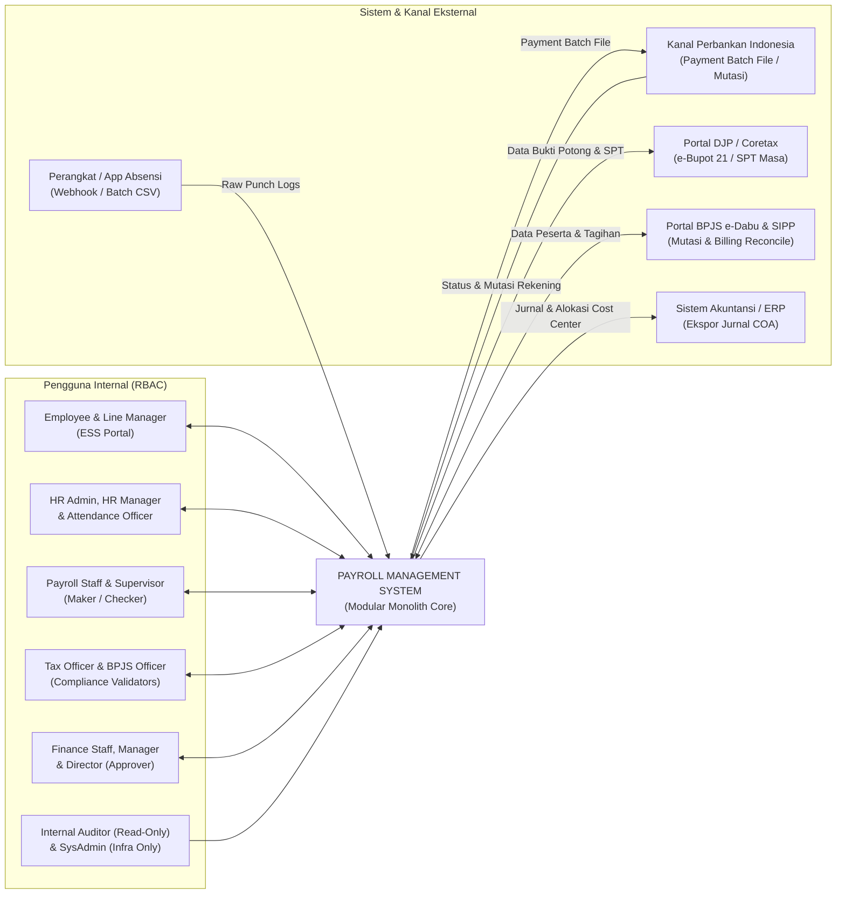

# Software Requirements Specification (SRS)
## Sistem Informasi Penggajian (Payroll Management System — Standar Indonesia)

**Dokumen ID:** `DOC-SA-SRS-001`  
**Versi:** 1.1  
**Tanggal:** 18 November 2026 (Revisi Pasca-Audit Internal BA/SA)  
**Acuan Bisnis:** [01-BRD-Business-Requirements-Document.md](file:///home/aliube/Workspace/PLan/Payroll/docs/01-business-analysis/01-BRD-Business-Requirements-Document.md), [02-BPA-Business-Process-Architecture-and-Flows.md](file:///home/aliube/Workspace/PLan/Payroll/docs/01-business-analysis/02-BPA-Business-Process-Architecture-and-Flows.md), [03-Business-Rules-and-Calculation-Specification.md](file:///home/aliube/Workspace/PLan/Payroll/docs/01-business-analysis/03-Business-Rules-and-Calculation-Specification.md)  
**Target Cakupan MVP:** Single-Company (1 Badan Hukum PT dengan multi-cabang/cost center), Karyawan Bulanan Tetap (PKWTT & PKWT), Arsitektur *Tech-Agnostic Modular Monolith*.

---

## 1. Gambaran Umum Sistem & Konteks Integrasi

Sistem Informasi Penggajian bertindak sebagai pusat pemrosesan transaksi finansial dan kepatuhan ketenagakerjaan perusahaan. Sistem berinteraksi dengan 14 peran internal serta 5 sistem/kanal eksternal.

---

## 2. Spesifikasi Kebutuhan Fungsional per Modul

### 2.1 Modul Identity, Access & Maker-Checker Governance (`SRS-IAM`)

| SRS ID | Nama Kebutuhan Sistem | Spesifikasi Input, Validasi, Proses & Output | Ref BR / Rule |
|---|---|---|---|
| **SRS-IAM-001** | **RBAC Berbasis Scope & Pemisahan SysAdmin** | Sistem mendukung Role-Based Access Control (RBAC) dengan scope `company_id` dan opsional `branch_id`/`department_id`. Peran `System Administrator` secara sistemik ditolak (*hard deny*) mengakses tabel/endpoint gaji, komponen kompensasi, hasil payroll, dan penghapusan audit log. | `BR-025`, `ACT-13` |
| **SRS-IAM-002** | **Generic Maker-Checker-Approver Workflow Engine** | Sistem menyediakan mesin persetujuan umum untuk entitas sensitif (perubahan gaji, rekening bank, payroll run, payment batch, koreksi, perubahan rule regulasi). Sistem **wajib menolak** jika `checker_id == maker_id` atau `approver_id == maker_id` pada `approval_request` yang sama. | `BR-003`, `BR-012` |
| **SRS-IAM-003** | **Perlindungan Anti-IDOR & Isolasi Data Pribadi** | Setiap permintaan baca data pribadi (slip gaji, profil, bukti potong) oleh peran `Employee` atau `Line Manager` wajib memvalidasi kepemilikan `employee_id` dari token sesi atau garis pelaporan aktif di server, bukan dari parameter ID di URL/body semata. | `BR-024`, `BR-025` |
| **SRS-IAM-004** | **Immutable Append-Only Audit Log** | Setiap operasi *create/update/approve/reject/export/login* pada data sensitif mencatat `actor_id`, `role`, `timestamp_utc`, `entity_name`, `entity_id`, `before_json`, `after_json`, `reason`, `correlation_id`, dan `prev_hash`. Database/API tidak menyediakan endpoint `UPDATE` atau `DELETE` untuk `audit_logs`. | `BR-025` |

### 2.2 Modul Organization & Cost Center (`SRS-ORG`)

| SRS ID | Nama Kebutuhan Sistem | Spesifikasi Input, Validasi, Proses & Output | Ref BR / Rule |
|---|---|---|---|
| **SRS-ORG-001** | **Hirarki Entitas Organisasi** | Sistem mengelola entitas `Company` (1 entitas aktif di MVP, siap multi-company), `Branch`, `Division`, `Department`, `Position`, `JobGrade` (dengan batas gaji min/max), `WorkLocation`, dan `CostCenter`. | `BR-001` |
| **SRS-ORG-002** | **Manajemen Regional Minimum Wage (UMP/UMK)** | Setiap `WorkLocation` terhubung ke wilayah administratif yang memiliki referensi `regional_minimum_wage` berversi (`valid_from`, `valid_to`) untuk memvalidasi struktur gaji minimum dan batas bawah BPJS Kesehatan. | `BR-001`, `BR-BPJS-KES-001` |
| **SRS-ORG-003** | **Kalender Kerja & Hari Libur Resmi** | Sistem mengelola `WorkCalendar` per perusahaan/cabang yang menandai hari kerja normal, hari istirahat mingguan, hari pendek (untuk pola 6 hari kerja), dan hari libur nasional/cuti bersama untuk keperluan lembur dan prorata. | `BR-001`, `BR-OT-005` |
| **SRS-ORG-004** | **Pemisahan `LegalRuleVersion` vs `CompanyPolicyVersion`** | Sistem memisahkan tabel aturan hukum nasional (`rule_set_versions`) dari kebijakan internal perusahaan (`company_policy_versions`: metode prorata default, ambang batas *variance warning*, batas lembur internal, kebijakan cuti & pembulatan). Setiap `PayrollRun` wajib mengikat keduanya untuk menjamin determinisme. | `BR-011`, `BR-025` |

### 2.3 Modul Employee, Contract & Bank Account Master (`SRS-EMP`)

| SRS ID | Nama Kebutuhan Sistem | Spesifikasi Input, Validasi, Proses & Output | Ref BR / Rule |
|---|---|---|---|
| **SRS-EMP-001** | **Master Karyawan & Pencegahan Duplikasi Identitas** | Sistem menyimpan data karyawan dengan validasi keunikan `employee_number`, `nik_hash` (16 digit KTP via blind index), dan `npwp_hash` (15/16 digit). NIK/NPWP/rekening disimpan terenkripsi dan ditampilkan dalam format *masked* (mis. `3171********0004`) kecuali untuk peran terotorisasi. | `BR-002`, `BR-025` |
| **SRS-EMP-002** | **Manajemen Employment & Kontrak PKWTT/PKWT** | Sistem memisahkan `Employee` (orang) dengan `Employment` (hubungan kerja dengan tanggal masuk/keluar, status, jenis kontrak `PKWTT`/`PKWT`, tanggal berakhir PKWT, riwayat perpanjangan, dan penugasan organisasi). | `BR-002`, `BR-019` |
| **SRS-EMP-003** | **Histori Bitemporal Penugasan Organisasi** | Perubahan cabang, departemen, jabatan, *cost center*, dan atasan (*reporting line*) dicatat dengan `valid_from` dan `valid_to`. Pengisian record baru otomatis menutup `valid_to` record sebelumnya menjadi `valid_from_baru - 1 hari` tanpa menimpa histori lama. | `BR-003`, `BR-PRO-001` |
| **SRS-EMP-004** | **Manajemen & Verifikasi Rekening Bank** | Rekening bank karyawan menyimpan `bank_code`, `account_number_encrypted`, `account_holder_name`, `verification_status` (`PENDING`, `VERIFIED`, `INVALID`), dan `last_verified_at`. Perubahan rekening melewati workflow approval dan menandai flag *high-risk* jika terjadi `<= 5 hari` sebelum payday. | `BR-003`, `BR-EXC-005` |
| **SRS-EMP-005** | **Onboarding Checklist & Validasi Kelengkapan** | Saat onboarding disetujui HR Manager, sistem mengaktifkan `Employment` pada tanggal mulai kerja dan menghasilkan tugas tindak lanjut untuk field non-blokir yang belum lengkap (mis. nomor peserta BPJS baru). | `BR-002` |
| **SRS-EMP-006** | **Impor & Validasi Saldo Awal Tahun Berjalan (YTD)** | Sistem menyediakan modul impor `employee_ytd_opening_balances` untuk migrasi tengah tahun (akumulasi bruto pajak, biaya jabatan, iuran JHT/JP pekerja, PPh 21 telah dipotong Jan s/d bulan sebelum cutover, saldo awal cuti, dan sisa pinjaman) yang dikunci melalui approval HR & Tax Officer. | `BR-026` |

### 2.4 Modul Compensation & Multi-Dimensional Component (`SRS-COMP`)

| SRS ID | Nama Kebutuhan Sistem | Spesifikasi Input, Validasi, Proses & Output | Ref BR / Rule |
|---|---|---|---|
| **SRS-COMP-001** | **Katalog Komponen Multi-Dimensi** | Sistem mengelola `SalaryComponent` dengan atribut terpisah: `category`, `is_fixed`, `is_recurring`, `tax_treatment`, `is_bpjs_kes_base`, `is_bpjs_jht_base`, `is_bpjs_jkk_jkm_base`, `is_bpjs_jp_base`, `is_overtime_base`, `is_thr_base`, `is_pkwt_comp_base`, `prorate_method`, `rounding_rule`, dan `default_coa_account`. | `BR-004`, `BR-COMP-001` |
| **SRS-COMP-002** | **Salary Assignment & Validasi Grade/UMP** | Pengaitan komponen gaji ke `Employment` (`EmployeeSalaryAssignment`) mendukung `valid_from/valid_to`. Saat pengajuan, sistem memvalidasi total upah tetap terhadap UMP/UMK lokasi kerja (`BR-BPJS-KES-001`), rentang `JobGrade`, dan proporsi gaji pokok >= 75% dari upah tetap (`BR-COMP-002`). | `BR-004`, `BR-COMP-002` |
| **SRS-COMP-003** | **Engine Prorata & Multi-Segment Split** | Saat mengevaluasi komponen pada periode `[period_start, period_end]`, sistem mendeteksi seluruh perubahan nilai komponen atau status kerja di tengah periode, memecah periode menjadi segmen tanggal kontinu, menghitung faktor prorata per segmen (`WORKING_DAYS` atau `CALENDAR_DAYS`), dan menyimpan rincian pembilang/penyebut ke trace. | `BR-005`, `BR-PRO-002..004` |
| **SRS-COMP-004** | **Deteksi Kebutuhan Rapel Otomatis** | Apabila sebuah `EmployeeSalaryAssignment` disetujui dengan `valid_from` yang lebih awal dari periode payroll terakhir berstatus `Approved/Paid`, sistem otomatis membuat entri `RetroactiveQueue` untuk diproses pada run reguler berikutnya atau *off-cycle*. | `BR-003`, `BR-012` |

### 2.5 Modul Time, Shift & Raw Attendance (`SRS-TIME`)

| SRS ID | Nama Kebutuhan Sistem | Spesifikasi Input, Validasi, Proses & Output | Ref BR / Rule |
|---|---|---|---|
| **SRS-TIME-001** | **Manajemen Pola Kerja & Shift Lintas Tengah Malam** | Sistem mendukung pola **5 hari kerja** dan **6 hari kerja** serta definisi `Shift` (`start_time`, `end_time`, `break_minutes`, `is_cross_midnight`, `is_short_day`, `grace_minutes`). Jika `is_cross_midnight = true`, log pulang pada tanggal `H+1` dipetakan ke tanggal jadwal shift `H`. | `BR-006` |
| **SRS-TIME-002** | **Impor Raw Attendance Immutable** | Sistem menerima data log absensi via API maupun unggahan batch CSV/JSON. Setiap log disimpan apa adanya pada `attendance_raw` (`employee_identifier`, `device_id`, `raw_timestamp`, `timezone`, `source_channel`, `import_batch_id`) dan dilindungi dari penimpaan. | `BR-006` |
| **SRS-TIME-003** | **Matching Engine & Deteksi Exception** | Engine memadankan `attendance_raw` dengan `Schedule` menjadi `attendance_records`. Sistem mendeteksi dan mencatat exception (`MISSING_IN`, `MISSING_OUT`, `LATE_IN`, `EARLY_OUT`, `ABSENT`, `UNSCHEDULED_PUNCH`). | `BR-007` |
| **SRS-TIME-004** | **Koreksi Absensi & Cutoff Summary Lock** | Karyawan dapat mengajukan koreksi untuk exception tertentu dengan persetujuan Line Manager dan Attendance Officer. Pada hari *cutoff*, Attendance Officer memfinalisasi `attendance_summaries` (status `LOCKED`) yang mencakup total hari hadir, sakit, cuti berbayar, cuti tidak berbayar (*unpaid*), alpa, dan menit keterlambatan. | `BR-007`, `BR-EXC-007` |

### 2.6 Modul Leave Ledger & Overtime PP 35/2021 (`SRS-LVOT`)

| SRS ID | Nama Kebutuhan Sistem | Spesifikasi Input, Validasi, Proses & Output | Ref BR / Rule |
|---|---|---|---|
| **SRS-LVOT-001** | **Leave Ledger Berbasis Transaksi** | Sistem mencatat seluruh mutasi cuti di `leave_transactions` dengan tipe: `OPENING`, `ACCRUAL`, `USAGE`, `ADJUSTMENT`, `CARRY_FORWARD`, `EXPIRY`. Saldo berjalan dihitung dari agregasi ledger per `employment_id` dan `leave_type_id`. | `BR-008` |
| **SRS-LVOT-002** | **Validasi Pengajuan Cuti & Integrasi Payroll** | Pengajuan cuti memvalidasi kecukupan saldo (kecuali *unpaid leave* atau cuti khusus melahirkan/sakit berdokumen), tidak bertabrakan (*overlap*) dengan pengajuan aktif lain, serta memperbarui `attendance_records` saat disetujui. | `BR-008` |
| **SRS-LVOT-003** | **Workflow Pra-Persetujuan & Verifikasi Lembur** | Pengajuan lembur wajib dibuat sebelum waktu lembur (atau melalui jalur *Emergency Override* oleh HR Manager). Setelah jam aktual direkam dari absensi/input, Line Manager memverifikasi durasi aktual dan HR memvalidasi kategori hari. | `BR-009`, `BR-OT-001` |
| **SRS-LVOT-004** | **Overtime Calculation Engine (PP 35/2021)** | Engine memverifikasi `overtime_eligible`, menghitung `hourly_rate = base_wage / 173` (termasuk aturan 100% vs 75% komponen upah tetap), mengklasifikasikan hari (`WEEKDAY`, `REST_DAY`, `PUBLIC_HOLIDAY`, `SHORT_DAY`) dan pola (`5_DAYS` vs `6_DAYS`), lalu menerapkan pengali berjenjang (`1.5x`, `2x`, `3x`, `4x`) dan menyimpan rincian per jam. | `BR-009`, `BR-OT-002..005` |

### 2.7 Modul Payroll Period, Snapshot & Calculation Engine (`SRS-RUN`)

| SRS ID | Nama Kebutuhan Sistem | Spesifikasi Input, Validasi, Proses & Output | Ref BR / Rule |
|---|---|---|---|
| **SRS-RUN-001** | **Manajemen Periode & Jenis Payroll Run** | Sistem mengelola `PayrollPeriod` (bulan, tahun, tanggal mulai/akhir, tanggal cutoff, tanggal payday) dan mendukung pembuatan `PayrollRun` bertipe: `REGULAR`, `OFF_CYCLE`, `THR`, `BONUS`, `FINAL_SETTLEMENT`, `RETROACTIVE`, dan `REVERSAL`. | `BR-010` |
| **SRS-RUN-002** | **Pre-Run Validation & Input/Rule Snapshot** | Sebelum kalkulasi, engine memvalidasi kesiapan input (status absensi final, kelengkapan profil pajak/BPJS, ketersediaan `rule_set_version` aktif). Saat lolos, sistem membekukan salinan input (`payroll_run_inputs`) dan mengikat `rule_set_version_id` ke run tersebut. | `BR-011`, `BR-EXC-004` |
| **SRS-RUN-003** | **Pipeline Kalkulasi Deterministik 13 Tahap** | Engine memproses karyawan dalam batch secara deterministik: (1) Eligibility & Kontrak -> (2) Effective Salary -> (3) Attendance/Leave/Overtime & Variable Inputs -> (4) Earnings & Prorata -> (5) **Hitung BPJS (Kesehatan & TK 1x/bulan)** -> (6) **Tentukan Basis Pajak (termasuk JKK, JKM, BPJS Kes 4%)** -> (7) **Hitung PPh 21 (TER Multi-Run / Masa Terakhir P17 / Gross-Up)** -> (8) Other Deductions & Loan -> (9) Net Pay -> (10) Employer Cost -> (11) Rounding -> (12) Anomaly Check -> (13) Simpan Detail & Trace. | `BR-011` |
| **SRS-RUN-004** | **Anomaly Detection & Variance Engine** | Engine otomatis menandai hasil dengan flag anomali: `NEGATIVE_NET_PAY` (Blocker), `DEDUCTION_OVER_50_PCT` (Warning/Blocker), `NET_VARIANCE_OVER_20_PCT` (Warning), `MISSING_BANK_ACCOUNT` (Payment Hold), `RECENT_BANK_CHANGE` (High-Risk Review). | `BR-013`, `BR-EXC-002..006` |
| **SRS-RUN-005** | **Imutabilitas Run & Lock Enforcement** | Perubahan status `PayrollRun` menjadi `APPROVED` mengunci seluruh record `payroll_results`, `payroll_details`, `tax_calculations`, dan `bpjs_calculations`. Setiap permintaan modifikasi setelah terkunci ditolak sistem dengan error `ERR_PAY_RUN_IMMUTABLE`. | `BR-012`, `BR-EXC-008` |
| **SRS-RUN-006** | **Mekanisme Koreksi Terlacakan (Rapel / Off-Cycle / Reversal)** | Sistem menyediakan alur terotorisasi untuk membuat `REVERSAL` run (membalik angka kredit/debit run asal sebelum pembayaran), `OFF_CYCLE` run, atau memasukkan selisih koreksi ke `RETROACTIVE` antrean periode berikutnya sambil menyimpan `parent_run_id`. | `BR-012` |
| **SRS-RUN-007** | **Pengelolaan Input Variabel & Batch Import** | Sistem menyediakan tabel dan workflow impor `payroll_variable_inputs` (bonus, insentif, komisi, potongan satu kali) dengan `import_batch_id`, validasi format/nilai terhadap batas komponen, dan approval sebelum dibekukan oleh snapshot payroll. | `BR-010` |

### 2.8 Modul Tax PPh 21 Engine (`SRS-TAX`)

| SRS ID | Nama Kebutuhan Sistem | Spesifikasi Input, Validasi, Proses & Output | Ref BR / Rule |
|---|---|---|---|
| **SRS-TAX-001** | **Manajemen Profil Pajak Pegawai** | Menyimpan status subjek pajak (WPDN/WPLN), NIK/NPWP validasi status, PTKP awal tahun (`TK/0`..`K/3`), kategori TER (`A`, `B`, `C`), metode pajak (`GROSS`, `GROSS_UP`, `NET`), serta input penghasilan/pajak sebelumnya dalam tahun berjalan (untuk joiner tengah tahun bila tersedia bukti potong A1/BPA1). | `BR-014`, `BR-015` |
| **SRS-TAX-002** | **Tabel Tarif TER & Pasal 17 Berversi** | Menyimpan tabel batas penghasilan dan tarif `TER A`, `TER B`, `TER C` (PP 58/2023) serta lapisan tarif progresif Pasal 17 UU HPP, nilai PTKP, dan batas Biaya Jabatan dalam konfigurasi berversi berdasarkan `effective_from/to`. | `BR-014`, `BR-TAX-001..004` |
| **SRS-TAX-003** | **Kalkulasi Masa Pajak Biasa (Jan–Nov) & Multi-Run** | Menghitung `Bruto Pajak Sebulan` (termasuk earning pajak + premi JKK + premi JKM + BPJS Kes 4% pemberi kerja). Jika terdapat lebih dari satu run dalam bulan yang sama (`THR`, `BONUS`, `OFF_CYCLE`), engine menggunakan akumulasi bruto gabungan bulan berjalan (`mtd_prior_gross + current_gross`), mencari tarif TER gabungan, lalu mengurangkan PPh 21 yang telah dipotong pada run sebelumnya (`BR-TAX-009`). | `BR-TAX-002`, `BR-TAX-003`, `BR-TAX-009` |
| **SRS-TAX-004** | **Rekonsiliasi Masa Pajak Terakhir (Desember / Berhenti)** | Otomatis aktif saat `period_month == 12` atau karyawan berhenti bekerja (`termination_date` di bulan berjalan). Engine mengakumulasi bruto setahun, menghitung Biaya Jabatan (5%, max Rp500rb/bln atau Rp6jt/thn), total iuran JHT+JP pekerja, PKP (pembulatan ke bawah ribuan), PPh terutang Pasal 17, lalu mengurangkan akumulasi pajak Jan–Nov. Kelebihan potong bernilai negatif otomatis menjadi pengembalian (*tax refund*) ke penghasilan karyawan. | `BR-014`, `BR-TAX-004` |
| **SRS-TAX-005** | **Solver Iterasi Gross-Up** | Untuk metode `GROSS_UP`, engine menjalankan iterasi *fixed-point* (batas toleransi Rp1, maks 50 iterasi dengan guard *boundary oscillation* antar-lapisan tarif) untuk menentukan nilai `Tunjangan Pajak == PPh 21 Terutang`. | `BR-015`, `BR-TAX-005` |
| **SRS-TAX-006** | **Ekspor Data Bukti Potong & Pelaporan DJP** | Menghasilkan data terstruktur rekap pemotongan bulanan dan bukti potong tahunan (BPA1 / format XML/CSV kompatibel DJP e-Bupot 21 / Coretax) yang terekonsiliasi 100% dengan `payroll_results`. | `BR-023` |

### 2.9 Modul BPJS Kesehatan & BPJS Ketenagakerjaan (`SRS-BPJS`)

| SRS ID | Nama Kebutuhan Sistem | Spesifikasi Input, Validasi, Proses & Output | Ref BR / Rule |
|---|---|---|---|
| **SRS-BPJS-001** | **Manajemen Kepesertaan & Kelas Risiko** | Menyimpan nomor kepesertaan BPJS Kesehatan, jumlah tanggungan tambahan (>3 anak/orang tua), nomor KPJ BPJS TK, status kepesertaan per program (JHT, JKK, JKM, JP, JKP), tanggal lahir (untuk cek usia batas JP/JKP), kewarganegaraan, dan tingkat risiko JKK perusahaan. | `BR-016`, `BR-017` |
| **SRS-BPJS-002** | **Engine Kalkulasi BPJS Kesehatan** | Mengambil `Basis Upah BPJS Kes`, menerapkan clamping `[UMP_UMK_Lokasi, bpjs_kes_max_wage_cap]`, memisahkan iuran Pemberi Kerja (4%) sebagai beban/penambah bruto pajak dan Pekerja (1% + `n_tanggungan_tambahan × 1%`) sebagai potongan gaji. | `BR-016`, `BR-BPJS-KES-001..003` |
| **SRS-BPJS-003** | **Engine Kalkulasi BPJS TK (Tanpa Double-Count JKP)** | Menghitung secara terpisah per baris program berbayar: **JHT** (3,7% + 2%), **JKK** (0,24%–1,74% sesuai kelas risiko), **JKM** (0,30%), dan **JP** (2% + 1% dengan `jp_max_wage_cap` & pengecualian usia/WNA), serta hanya berjalan **1 kali per bulan** (`BR-BPJS-TK-007`). Program **JKP** dimodelkan sebagai flag status kepesertaan (`is_jkp_eligible`) tanpa menambah potongan pekerja maupun beban perusahaan di atas tarif JKK/JKM. | `BR-017`, `BR-BPJS-TK-001..007` |
| **SRS-BPJS-004** | **Alat Rekonsiliasi Billing e-Dabu & SIPP** | Menyediakan fitur impor file tagihan resmi CSV/Excel dari e-Dabu dan SIPP, mencocokkan otomatis berdasarkan nomor peserta & NIK, serta menampilkan selisih nominal ke dalam `bpjs_reconciliation_exceptions` beserta klasifikasi penyebab (*beda upah*, *mutasi terlambat*, *peserta ganda*). | `BR-016`, `BR-017` |
| **SRS-BPJS-005** | **Ekspor Data Mutasi Kepesertaan** | Menghasilkan file daftar karyawan baru (*joiner*), berhenti (*leaver*), dan perubahan upah bulanan sesuai template upload mutasi e-Dabu/SIPP. | `BR-016`, `BR-017` |

### 2.10 Modul THR, Offboarding, Kompensasi PKWT & Pinjaman (`SRS-SPEC`)

| SRS ID | Nama Kebutuhan Sistem | Spesifikasi Input, Validasi, Proses & Output | Ref BR / Rule |
|---|---|---|---|
| **SRS-SPEC-001** | **THR Event & Eligibility Engine** | Memungkinkan HR membuat `THREvent` (nama hari raya, tanggal acuan hari raya, batas tanggal bayar <= H-7). Sistem mengevaluasi masa kerja terus-menerus per tanggal hari raya, menerapkan kondisi PKWTT yang di-PHK H-30 sebelum hari raya, menghitung THR penuh (>= 12 bln) atau proporsional (1–<12 bln), dan menyalurkan bruto THR ke modul Pajak. | `BR-018`, `BR-THR-001..004` |
| **SRS-SPEC-002** | **Offboarding & Final Settlement Engine** | Menghentikan accrual cuti & komponen aktif pada `termination_date`, mengkalkulasi prorata gaji terakhir, sisa cuti tahunan (jika diuangkan sesuai kebijakan), serta memicu penghitungan PPh 21 Masa Pajak Terakhir. | `BR-019` |
| **SRS-SPEC-003** | **Kalkulator Uang Kompensasi PKWT & Decision Table PHK** | Untuk kontrak PKWT berakhir dengan masa kerja >= 1 bulan, otomatis menghitung `(masa_kerja_kontrak_bulan / 12) × upah_tetap`. Untuk kasus PHK, sistem menyediakan *Decision Table* alasan PHK sesuai PP 35/2021 (UP, UPMK, UPH) yang wajib diverifikasi HR/Legal sebelum masuk final run, serta menerapkan PPh Final Pesangon (PP 68/2009) secara terpisah dari gaji reguler. | `BR-019`, `BR-FINAL-001..004` |
| **SRS-SPEC-004** | **Manajemen Pinjaman Karyawan & Jadwal Cicilan** | Mencatat pengajuan pinjaman, persetujuan Manager & Finance, pencairan, dan membuat tabel `loan_installments` per periode. Pada setiap `REGULAR` payroll run, engine menarik cicilan jatuh tempo berdasarkan prioritas potongan (`BR-EXC-001`), dan pada `FINAL_SETTLEMENT` menarik seluruh sisa pokok terutang dengan pengecekan batas/persetujuan. | `BR-020`, `BR-EXC-001..003` |
| **SRS-SPEC-005** | **Pengelolaan Klaim Reimbursement Non-Upah** | Mengelola pengajuan klaim biaya dengan lampiran bukti dan approval atasan/Finance. Pembayaran dapat digabung dalam transfer bank bersamaan dengan hari gajian, namun pada payroll ledger & slip gaji dipisahkan tegas dari `Gross Earnings` dan tidak dikenakan PPh 21/BPJS. | `BR-020`, `BR-COMP-003` |

### 2.11 Modul Payment Batch, Rekonsiliasi Bank & Jurnal Akuntansi (`SRS-FIN`)

| SRS ID | Nama Kebutuhan Sistem | Spesifikasi Input, Validasi, Proses & Output | Ref BR / Rule |
|---|---|---|---|
| **SRS-FIN-001** | **Pembuatan Payment Batch & Idempotency Protection** | Menarik instruksi bayar dari `PayrollRun` berstatus `APPROVED`, menyaring rekening `VERIFIED` (yang `INVALID/PENDING` berstatus `ON_HOLD`), mengelompokkan per bank pembayar, membubuhkan `idempotency_key` unik per instruksi, serta mengekspor file upload bank standar Indonesia (BCA, Mandiri, BNI, BRI, atau CSV generik). | `BR-021`, `BR-EXC-005` |
| **SRS-FIN-002** | **Kontrol Pembatalan Approval Bila Batch Berubah** | Total `PaymentBatch` + `OnHold` wajib sama persis dengan `Total Approved Net Pay`. Jika ada instruksi yang diubah/ditambahkan setelah batch disetujui, status approval batch otomatis dibatalkan dan wajib melalui approval ulang. | `BR-021` |
| **SRS-FIN-003** | **Rekonsiliasi Status Transfer & Re-Payment Retur** | Mengimpor file hasil/mutasi bank, memperbarui status instruksi menjadi `PAID` atau `FAILED`. Instruksi `FAILED` masuk ke antrean pengecualian dan hanya bisa masuk ke batch pembayaran ulang (*re-batch*) setelah rekening karyawan diperbarui dan disetujui. | `BR-021` |
| **SRS-FIN-004** | **Generator Jurnal Akuntansi & Alokasi Cost Center** | Menghasilkan `Journal` dan `JournalLine` yang seimbang (`Σ Debit == Σ Kredit`) per run, memisahkan: Beban Gaji & Tunjangan, Beban BPJS Perusahaan, Utang Gaji Bersih, Utang PPh 21, Utang BPJS Pekerja/Perusahaan, Utang Potongan Lain, serta jurnal pelunasan kas/bank. Mendukung pemecahan proporsional jika karyawan pindah *cost center* di tengah bulan. | `BR-022` |
| **SRS-FIN-005** | **Ekspor Jurnal Akuntansi Standar** | Menyediakan ekspor jurnal ke format CSV/Excel/JSON terstruktur berdasarkan mapping `AccountMapping` (COA perusahaan) untuk diimpor ke software akuntansi/ERP. | `BR-022` |

### 2.12 Modul Payslip, Reporting & Regulatory Versioning (`SRS-RPT`)

| SRS ID | Nama Kebutuhan Sistem | Spesifikasi Input, Validasi, Proses & Output | Ref BR / Rule |
|---|---|---|---|
| **SRS-RPT-001** | **Penerbitan & Distribusi Slip Gaji PDF Terproteksi** | Menghasilkan slip gaji PDF untuk payroll reguler, THR, maupun final settlement setelah run `APPROVED` & siap rilis (atau `PAID`). PDF mendukung proteksi password (mis. kombinasi tanggal lahir/kode unik) dan hanya dapat diunduh pemiliknya melalui portal ESS. | `BR-023`, `BR-024` |
| **SRS-RPT-002** | **Pusat Laporan Operasional, Payroll, Kepatuhan & Manajemen** | Menyediakan generasi dan ekspor laporan (PDF/Excel/CSV) sesuai daftar Bab 18 blueprint: Payroll Register, Gross-to-Net, Variance, Negative Net Pay, Cost per Cost Center, PPh 21 Monthly & Year-End Reconciliation, Rekap BPJS Kes & TK per program, THR/Final Register, serta Employee Cost Trend. | `BR-024` |
| **SRS-RPT-003** | **Manajemen Versi Konfigurasi Regulasi** | Menyediakan antarmuka administrasi terotorisasi (*Maker-Checker-Approver*) untuk mengelola `RuleSetVersion` (tabel TER, tarif Pasal 17, PTKP, tarif BPJS 5 program & batas upah, UMP/UMK, tabel pengali lembur, skala pesangon) dengan pencatatan nomor regulasi, tanggal berlaku, dan tombol simulasi uji regresi sebelum aktivasi. | `BR-025` |
| **SRS-RPT-004** | **Employee Self-Service (ESS) Portal** | Antarmuka web/mobile ringan bagi karyawan untuk melihat slip gaji & bukti potong, mengecek ledger saldo cuti, serta mengajukan cuti, izin, koreksi absensi, perubahan kontak/rekening, dan pinjaman. | `BR-024` |

---

## 3. Spesifikasi Kebutuhan Non-Fungsional (`NFR`)

| NFR ID | Kategori | Spesifikasi & Target Terukur |
|---|---|---|
| **NFR-SEC-001** | **Enkripsi Transport & Penyimpanan** | Seluruh komunikasi wajib menggunakan TLS 1.2/1.3. Kolom PII & finansial sensitif (`nik`, `npwp`, `bank_account_number`) dienkripsi pada level aplikasi/kolom menggunakan `AES-256-GCM` dengan manajemen kunci rahasia (*key management*) terpisah dari kode sumber dan database. |
| **NFR-SEC-002** | **Kontrol Akses & Autentikasi** | Sesi pengguna menggunakan token bertanda tangan dengan masa kedaluwarsa pendek, mendukung MFA/2FA untuk peran sensitif (Payroll, Tax, Finance, Director, HR Manager), serta proteksi rate-limit dan anti-CSRF/XSS. |
| **NFR-SEC-003** | **Data Masking & Uji Anti-IDOR** | UI dan log menampilkan data sensitif dalam bentuk termasking secara default. Setiap endpoint berbasis ID sumber daya karyawan wajib memiliki uji otomatis anti-IDOR (*horizontal privilege escalation test*). |
| **NFR-REL-001** | **Idempotensi & Resumability Batch** | Proses kalkulasi payroll dan pembuatan batch pembayaran harus *idempotent* (tidak menggandakan baris hasil/transaksi bila terjadi retry) dan mendukung *checkpointing* agar dapat dilanjutkan jika terhenti di tengah batch. |
| **NFR-REL-002** | **Presisi Aritmatika Finansial** | Seluruh perhitungan uang dilarang menggunakan tipe *floating-point* biner (`float`/`double`). Wajib menggunakan tipe *fixed-point decimal* dengan presisi minimal 4–6 desimal saat kalkulasi perantara dan dibulatkan deterministik ke `DECIMAL(18,2)` atau rupiah penuh sesuai aturan komponen. |
| **NFR-PERF-001** | **Performa Kalkulasi Batch** | Kalkulasi payroll reguler (termasuk PPh 21, BPJS, lembur, prorata, dan pembuatan *calculation trace*) untuk **1.000 karyawan** selesai dalam **<= 3 menit** (target maksimal < 5 menit), dan **5.000 karyawan** selesai dalam **<= 12 menit** melalui pemrosesan chunk paralel. |
| **NFR-PERF-002** | **Waktu Respons Transaksi & Laporan** | Endpoint transaksi ESS dan lookup karyawan merespons dalam **<= 500 ms (p95)**; pembuatan laporan operasional umum (< 5.000 baris) merespons dalam **<= 5 detik** (laporan berat menggunakan ekspor asinkron). |
| **NFR-OBS-001** | **Observability & Log Redaction** | Sistem memancarkan log terstruktur (*JSON logs*) dengan `correlation_id`, metrik durasi batch/error/rekonsiliasi, dan alert otomatis jika job gagal atau ditemukan selisih rekonsiliasi. **Filter redaksi wajib memastikan NIK, NPWP, nomor rekening, dan nominal gaji tidak pernah tertulis ke log aplikasi.** |
| **NFR-AUD-001** | **Retensi Data & Backup/DR** | Retensi transaksi payroll, slip gaji, bukti potong PPh 21, bukti bayar pajak/BPJS, dan *audit log* minimal **10 tahun** (sesuai ketentuan daluwarsa pajak & audit finansial Indonesia). Backup database harian terenkripsi dengan target **RPO <= 1 jam** dan **RTO <= 4 jam**, serta uji restore berkala tiap kuartal. |

---

## 4. Requirements Traceability Matrix (RTM)

| Business Req (BRD) | Blueprint FR | Business Rules Terkait | Spesifikasi Sistem (SRS) | Use Case | Skenario UAT (Master Roadmap) |
|---|---|---|---|---|---|
| `BR-001` | `FR-001` | `BR-PRO-001`, `BR-EMP-002` | `SRS-ORG-001..004` | `UC-01`, `UC-02` | `UAT-001`, `UAT-002` |
| `BR-002`, `BR-003` | `FR-002` | `BR-EMP-001`, `BR-PRO-001`, `BR-PRO-004` | `SRS-EMP-001..005`, `SRS-IAM-002` | `UC-01`, `UC-02` | `UAT-002`, `UAT-013` |
| `BR-004`, `BR-005` | `FR-003` | `BR-COMP-001..003`, `BR-PRO-002..004` | `SRS-COMP-001..004` | `UC-01`, `UC-02`, `UC-05` | `UAT-001`, `UAT-002`, `UAT-003` |
| `BR-006`, `BR-007`, `BR-008` | `FR-004`, `FR-005` | `BR-LEAVE-001..002`, `BR-EXC-007` | `SRS-TIME-001..004`, `SRS-LVOT-001..002` | `UC-03` | `UAT-006` |
| `BR-009` | `FR-006` | `BR-OT-001..005` | `SRS-LVOT-003..004` | `UC-04` | `UAT-004`, `UAT-005` |
| `BR-010`..`BR-013` | `FR-007`, `FR-008`, `FR-019` | `BR-EXC-001..008` | `SRS-RUN-001..007` | `UC-05`, `UC-11`, `UC-13` | `UAT-014`, `UAT-015`, `UAT-017` |
| `BR-014`, `BR-015` | `FR-009` | `BR-TAX-001..005`, `BR-TAX-009` | `SRS-TAX-001..006` | `UC-06` | `UAT-007`, `UAT-008`, `UAT-017`, `UAT-018` |
| `BR-016`, `BR-017` | `FR-010` | `BR-BPJS-KES-001..004`, `BR-BPJS-TK-001..007` | `SRS-BPJS-001..005` | `UC-07` | `UAT-009`, `UAT-010` |
| `BR-018` | `FR-011` | `BR-THR-001..004` | `SRS-SPEC-001` | `UC-08` | `UAT-011` |
| `BR-019` | `FR-012` | `BR-FINAL-001..004` | `SRS-SPEC-002..003` | `UC-09` | `UAT-012` |
| `BR-020` | `FR-008` | `BR-EXC-001..003`, `BR-COMP-003` | `SRS-SPEC-004..005` | `UC-05`, `UC-09`, `UC-13` | `UAT-020` |
| `BR-021`, `BR-022` | `FR-014`, `FR-015`, `FR-016` | `BR-EXC-005` | `SRS-FIN-001..005` | `UC-10` | `UAT-013`, `UAT-021`, `UAT-022` |
| `BR-023`..`BR-026` | `FR-013`, `FR-017`, `FR-018`, `FR-020..022` | `BR-EXC-004`, `BR-EXC-008` | `SRS-RPT-001..004`, `SRS-IAM-001..004`, `SRS-EMP-006` | `UC-12`, `UC-13` | `UAT-016`, `UAT-019` |
