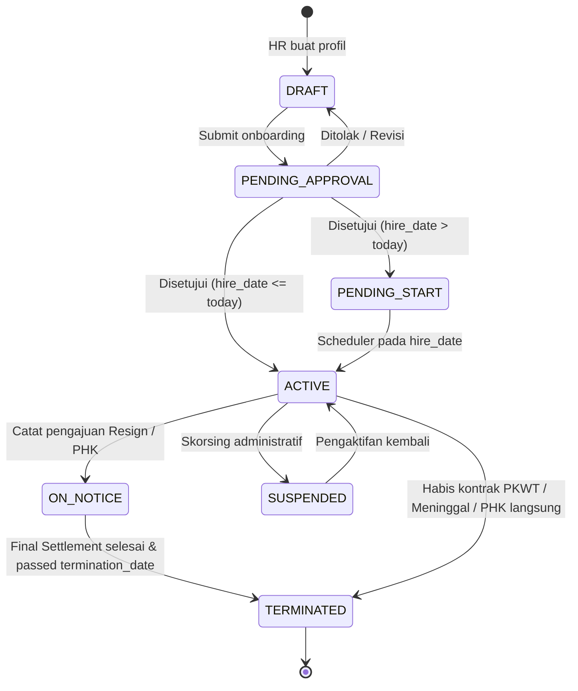
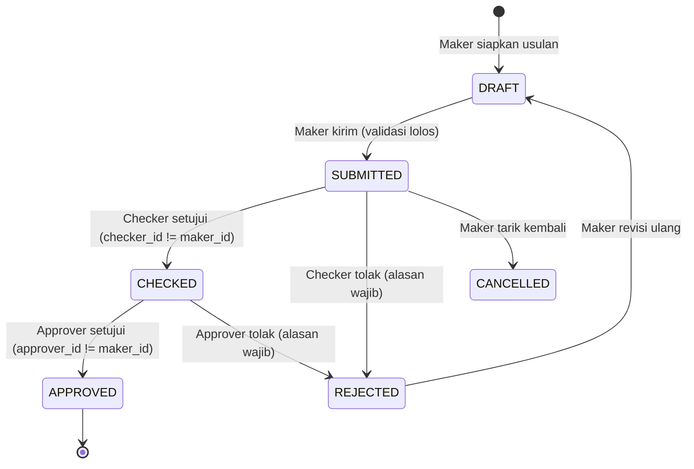
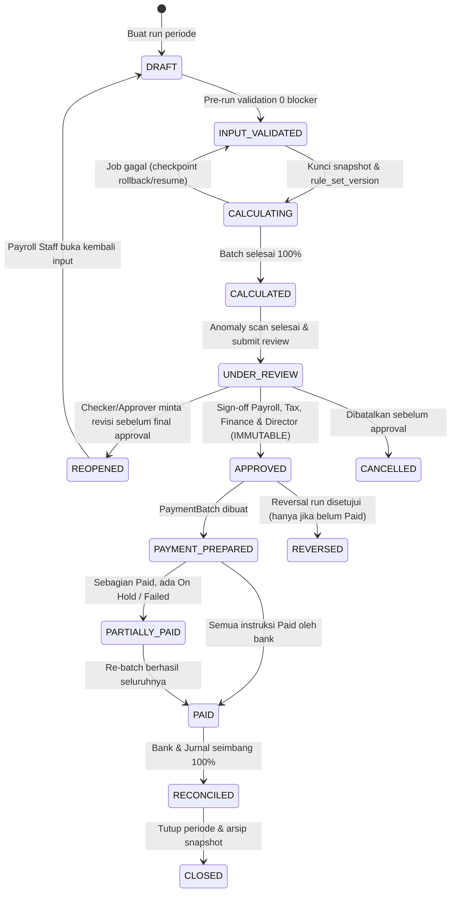
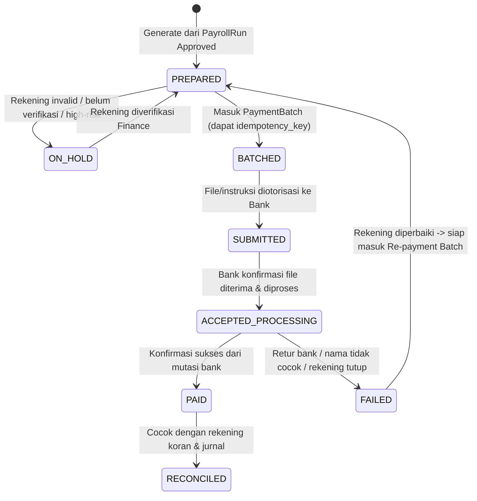
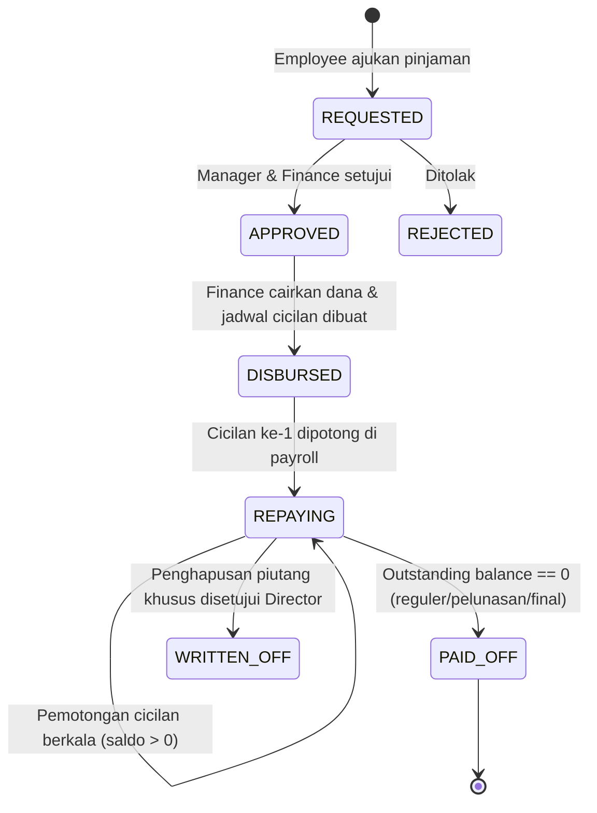

# Use Case Specification & State Machine
## Sistem Informasi Penggajian (Payroll Management System — Standar Indonesia)

**Dokumen ID:** `DOC-SA-UC-001`  
**Versi:** 1.1  
**Tanggal:** 18 November 2026 (Revisi Pasca-Audit Internal BA/SA)  
**Acuan:** [01-SRS-Software-Requirements-Specification.md](file:///home/aliube/Workspace/PLan/Payroll/docs/02-system-analysis/01-SRS-Software-Requirements-Specification.md)

---

## 1. Matriks Aktor vs Use Case

| Use Case ID | Nama Use Case | Aktor Utama | Aktor Pendukung / Penyetuju |
|---|---|---|---|
| **UC-01** | Onboarding Karyawan PKWTT/PKWT & Struktur Gaji | HR Administrator | Tax Officer, BPJS Officer, HR Manager |
| **UC-02** | Perubahan Kompensasi / Rekening Bank (*Effective Date*) | HR Admin / Employee | Payroll Supervisor, HR Manager, Finance Manager, Director |
| **UC-03** | Impor Raw Attendance, Rekonsiliasi Shift & Finalisasi Cutoff | Attendance Officer | Employee, Line Manager |
| **UC-04** | Pengajuan, Verifikasi & Perhitungan Lembur (PP 35/2021) | Line Manager | Employee, HR Manager, Payroll Engine |
| **UC-05** | Eksekusi Payroll Run Bulanan, Snapshot & Deteksi Anomali | Payroll Staff | Payroll Supervisor, Finance Manager, Director |
| **UC-06** | Perhitungan PPh 21 (TER) & Rekonsiliasi Masa Terakhir (Pasal 17) | Payroll Engine | Tax Officer, Director |
| **UC-07** | Perhitungan & Rekonsiliasi Tagihan BPJS Kes & TK | BPJS Officer | Payroll Engine, HR Admin, Finance Staff |
| **UC-08** | Eksekusi THR Keagamaan Run | HR Admin / Payroll Staff | Tax Officer, Finance Manager, Director |
| **UC-09** | Offboarding, Final Payroll, Kompensasi PKWT & PHK | HR Administrator | Legal/HR Manager, Payroll Staff, Finance Manager, Director |
| **UC-10** | Pembuatan Payment Batch Bank, Penanganan Retur & Rekonsiliasi | Finance Staff | Finance Manager, Authorized Bank Signatory |
| **UC-11** | Koreksi Payroll Pasca-Approval (Rapel / Off-Cycle / Reversal) | Payroll Staff | Payroll Supervisor, Tax Officer, Finance Manager, Director |
| **UC-12** | Pembaruan Konfigurasi Regulasi Berversi (`RuleSetVersion`) | Tax / BPJS Officer | Payroll Supervisor, Legal, HR Manager, Finance Manager |
| **UC-13** | Impor Input Variabel, Klaim Reimbursement & Saldo Awal YTD | Payroll Staff / Employee | Line Manager, Tax Officer, HR Manager, Finance Manager |

---

## 2. Spesifikasi Rinci Use Case

### UC-01: Onboarding Karyawan PKWTT/PKWT & Aktivasi Struktur Gaji
- **Preconditions:** Struktur organisasi (`Branch`, `Department`, `Position`, `JobGrade`, `CostCenter`) dan `SalaryComponent` sudah tersedia.
- **Trigger:** Kandidat menandatangani kontrak kerja dan HR Admin memulai pembuatan profil.
- **Main Flow:**
  1. HR Admin membuka form *New Employee Onboarding* dan mengisi identitas (Nama, Tanggal Lahir, NIK, NPWP, Kontak).
  2. Sistem memvalidasi format NIK (16 digit) dan mengecek *blind index hash* untuk mencegah duplikasi karyawan aktif.
  3. HR Admin membuat record `Employment` dengan tipe kontrak (`PKWTT` atau `PKWT`), `hire_date`, `contract_end_date` (wajib jika PKWT), jabatan, grade, lokasi kerja, dan cost center.
  4. HR Admin memilih template struktur gaji dan memasukkan nominal komponen dengan `valid_from = hire_date`.
  5. Sistem memvalidasi nominal terhadap rentang `JobGrade`, UMP/UMK `WorkLocation`, dan aturan Gaji Pokok >= 75% upah tetap (`BR-COMP-002`).
  6. HR Admin memasukkan data `TaxProfile` (PTKP, metode pajak), `BPJSMembership`, dan `EmployeeBankAccount` beserta dokumen pendukung.
  7. Tax Officer & BPJS Officer memvalidasi data kepesertaan/pajak; HR Manager menyetujui `ApprovalRequest`.
  8. Sistem mengaktifkan status `Employment` menjadi `ACTIVE` (atau `PENDING_START` hingga `hire_date`), menginisiasi saldo awal cuti di `leave_transactions`, dan mencatat `AuditLog`.
- **Alternate Flow:**
  - *A1 (Data Non-Blokir Belum Lengkap):* Jika nomor rekening atau nomor BPJS baru belum tersedia saat masuk, sistem mengizinkan aktivasi `Employment` dengan menandai `OnboardingChecklist` terbuka dan memberi flag `PAYMENT_HOLD` pada rekening hingga dilengkapi.
- **Exception Flow:**
  - *E1 (Duplikasi NIK / NIP):* Sistem menolak draft dan menampilkan referensi karyawan existing.
  - *E2 (Gaji Di Bawah UMP/UMK):* Sistem menampilkan error validasi `ERR_PAY_BELOW_MIN_WAGE` dan memblokir pengajuan approval.
- **Postconditions:** Data karyawan, kontrak, kompensasi, profil pajak, dan BPJS tersimpan dengan `valid_from` yang siap diproses payroll.

### UC-02: Perubahan Kompensasi / Rekening Bank Berbasis Effective Date
- **Preconditions:** Karyawan berstatus `ACTIVE` dan telah melewati onboarding.
- **Trigger:** Terbit SK penyesuaian gaji/promosi/mutasi atau karyawan mengajukan ganti rekening bank.
- **Main Flow (Perubahan Gaji / Organisasi):**
  1. HR Admin memilih karyawan, menentukan `effective_date` (`valid_from`), alasan perubahan, dan mengunggah dokumen SK.
  2. HR Admin mengubah komponen gaji atau penugasan `CostCenter`/`Branch` yang baru.
  3. Sistem memvalidasi UMP/UMK dan rentang grade, lalu membuat `ApprovalRequest` (status `SUBMITTED`).
  4. Checker (Payroll Supervisor / HR Manager) memeriksa usulan; Approver (Director) menyetujui.
  5. Sistem menutup record lama (`valid_to = valid_from - 1 hari`) dan menyisipkan record versi baru (`valid_from`).
  6. Jika `valid_from` lebih awal dari periode payroll terakhir yang berstatus `APPROVED/PAID`, sistem menambahkan item ke `RetroactiveQueue` (`SRS-COMP-004`).
- **Alternate Flow (Perubahan Rekening Bank):**
  - *A1:* Employee atau HR Admin mengunggah bukti buku tabungan/e-statement dan mengirim perubahan. Jika diajukan `<= 5 hari` sebelum payday, sistem melabeli request `HIGH_RISK_BANK_CHANGE`. Persetujuan wajib melewati Checker + Finance Manager sebelum status rekening menjadi `VERIFIED`.
- **Exception Flow:**
  - *E1 (Pelanggaran SoD):* Jika HR Admin mencoba menyetujui tiket yang dia buat sendiri, sistem menolak dengan `ERR_PAY_SOD_VIOLATION`.
- **Postconditions:** Histori bitemporal tercatat utuh tanpa menimpa nilai masa lalu; *audit trail* before-after tersimpan.

### UC-03: Impor Raw Attendance, Rekonsiliasi Shift & Finalisasi Cutoff
- **Preconditions:** `WorkCalendar` dan `Shift`/`Schedule` periode berjalan telah ditetapkan.
- **Trigger:** Sinkronisasi terjadwal dari mesin fingerprint/aplikasi mobile atau unggahan manual oleh Attendance Officer menjelang *cutoff* (`SOP-PAY-001`).
- **Main Flow:**
  1. Sistem menerima payload atau file log absensi dan menyimpannya ke `attendance_raw` tanpa mengubah timestamp asli.
  2. Matching engine memadankan punch dengan jadwal shift karyawan (mendukung `is_cross_midnight = true`) dan membentuk `attendance_records`.
  3. Sistem menandai baris bermasalah (`MISSING_IN`, `MISSING_OUT`, `LATE_IN`, `ABSENT`) ke daftar *Attendance Exception*.
  4. Karyawan mengajukan koreksi absensi beserta alasan/bukti melalui portal ESS; Line Manager menyetujui/menolak.
  5. Pada hari *cutoff* (H-5), Attendance Officer memeriksa seluruh exception tersisa dan mengeklik *Finalize Attendance Summary*.
  6. Sistem mengagregasi status kehadiran + transaksi `leave_transactions` menjadi `attendance_summaries` berstatus `LOCKED`.
- **Exception Flow:**
  - *E1 (Exception Masih Terbuka Saat Cutoff):* Sistem menampilkan daftar karyawan yang belum terselesaikan dan menahan status `LOCKED` hingga diselesaikan atau dikonfirmasi sebagai *Unpaid Absence* oleh Attendance Officer.
- **Postconditions:** Ringkasan absensi dan cuti siap menjadi input deterministik bagi `PayrollRun`.

### UC-04: Pengajuan, Verifikasi & Perhitungan Lembur (PP 35/2021)
- **Preconditions:** Karyawan bertanda `overtime_eligible = true` dan jadwal kerja periode aktif tersedia.
- **Trigger:** Line Manager menugaskan lembur sebelum pelaksanaan kerja lembur.
- **Main Flow:**
  1. Line Manager membuat `OvertimeRequest` dengan estimasi jam mulai/selesai dan deskripsi pekerjaan.
  2. Sistem memvalidasi kelayakan jabatan (`BR-OT-001`) dan batas jam lembur sesuai regulasi.
  3. Setelah lembur selesai, jam aktual diambil dari `attendance_records` (atau diinput oleh karyawan/atasan).
  4. Line Manager memverifikasi durasi aktual; HR memverifikasi kategori hari (`WEEKDAY`, `REST_DAY`, `PUBLIC_HOLIDAY`, `SHORT_DAY`) dan pola kerja (`5_DAYS` / `6_DAYS`).
  5. Engine menghitung upah lembur sejam (`1/173 × Dasar Upah`, cek proporsi 100% vs 75% sesuai `BR-OT-002`) dan menerapkan tabel pengali PP 35/2021 (`BR-OT-003..005`).
  6. Transaksi lembur berstatus `APPROVED` siap masuk ke `PayrollRun`.
- **Alternate Flow:**
  - *A1 (Emergency Overtime):* Untuk pekerjaan darurat tanpa pra-persetujuan, pengajuan ditandai `RETROACTIVE_OT` dan mewajibkan persetujuan tambahan dari HR Manager.
- **Exception Flow:**
  - *E1 (Jabatan Dikecualikan):* Jika karyawan memiliki `overtime_eligible = false`, sistem menolak perhitungan upah lembur otomatis.
- **Postconditions:** Nilai upah lembur dan rincian per jam pengali tersimpan siap ditarik ke kalkulasi gaji.

### UC-05: Eksekusi Payroll Run Bulanan, Snapshot & Deteksi Anomali
- **Preconditions:** `PayrollPeriod` dibuka, `attendance_summaries` berstatus `LOCKED`, komponen variabel diimpor, dan `RuleSetVersion` aktif tersedia.
- **Trigger:** Payroll Staff memulai pembuatan `PayrollRun` tipe `REGULAR` (H-4 sebelum Payday).
- **Main Flow:**
  1. Payroll Staff membuat `PayrollRun` (status `DRAFT`), memilih periode, dan menjalankan *Pre-Run Input Validation*.
  2. Setelah lolos dari *Blocker*, sistem membuat snapshot data input (`payroll_run_inputs`) dan mengunci `rule_set_version_id` ke run. Status berubah ke `INPUT_LOCKED`.
  3. Payroll Staff menekan *Run Calculation*. Engine memproses 13 tahap kalkulasi untuk seluruh karyawan eligible secara chunk paralel (Tahap 5 menghitung BPJS Kes & TK 1x/bulan `UC-07`, lalu Tahap 6–7 menghitung Basis Pajak & PPh 21 `UC-06`), menyimpan `payroll_results`, `payroll_details`, dan `calculation_trace_json`. Status menjadi `CALCULATED`.
  4. Sistem menjalankan *Anomaly Detection* dan menandai peringatan (*variance > ±20%*, perubahan rekening baru, dll.) atau blocker (*net pay negatif*, batas potongan > 50%). Status masuk ke `UNDER_REVIEW`.
  5. Payroll Supervisor, Tax Officer, dan BPJS Officer meninjau hasil & *calculation trace* secara silang.
  6. Finance Manager meninjau total anggaran & *cost center*, lalu Director memberikan *Final Approval*.
  7. Sistem mengunci `PayrollRun` menjadi `APPROVED` (immutable), membangkitkan `PaymentInstruction` dan draf `Journal`.
- **Alternate Flow:**
  - *A1 (Ditemukan Kesalahan Input Saat Review):* Supervisor/Tax mengembalikan run ke status `DRAFT` (`REJECTED_FOR_REVISION`), memperbaiki data sumber, membuat snapshot ulang, dan menghitung ulang.
- **Exception Flow:**
  - *E1 (Net Pay Negatif):* Karyawan bertanda blocker `NEGATIVE_NET_PAY`; sistem memblokir tombol `Submit for Approval` hingga potongan non-wajib ditahan/dijadwalkan ulang.
- **Postconditions:** Payroll Run berstatus `APPROVED` dan tidak dapat diubah lagi secara langsung.

### UC-06: Perhitungan PPh 21 Masa Biasa (TER) & Rekonsiliasi Masa Pajak Terakhir (Pasal 17)
- **Preconditions:** `TaxProfile` karyawan aktif, `RuleSetVersion` tabel TER & Pasal 17 tersedia, bruto pajak dari `PayrollRun` telah dihitung.
- **Trigger:** Dipanggil otomatis sebagai Tahap 6 dalam pipeline `UC-05`, `UC-08`, atau `UC-09`.
- **Main Flow:**
  1. Engine memeriksa apakah periode run adalah **Masa Pajak Biasa (Jan–Nov & karyawan tidak berhenti)** atau **Masa Pajak Terakhir (Desember atau karyawan berhenti/resign/PHK bulan ini)**.
  2. *Jika Masa Biasa:* Tentukan Kategori TER (`A`, `B`, `C`) dari PTKP, jumlahkan bruto pajak bulan ini (termasuk JKK, JKM, BPJS Kes 4%, bonus/THR bila ada). Bila ada run sebelumnya pada bulan kalender yang sama (`THR`/`Bonus`/`Off-Cycle`), gabungkan bruto bulan berjalan (`mtd_prior_gross + current_gross`), cocokkan tarif TER pada `tax_ter_brackets`, lalu hitung `PPh_Run = FLOOR(Total_Bruto_Bulan × Tarif_TER) − PPh_Sudah_Dipotong_Bulan_Ini` (`BR-TAX-009`).
  3. *Jika Masa Terakhir:* Akumulasikan bruto pajak dari masa 1 s/d masa terakhir dalam tahun takwim (termasuk `employee_ytd_opening_balances` jika go-live tengah tahun atau bukti potong pemberi kerja sebelumnya jika ada), kurangi Biaya Jabatan (5%, max Rp500rb/bln atau Rp6jt/thn) dan total iuran JHT+JP pekerja, hitung PKP (bulatkan ribuan ke bawah), terapkan tarif progresif Pasal 17 UU HPP, lalu kurangi total PPh 21 yang sudah dipotong di masa-masa sebelumnya.
  4. Jika metode pajak karyawan adalah `GROSS_UP`, jalankan solver iterasi tunjangan pajak hingga konvergen (`|PPh - Tunjangan| <= 1`).
  5. Simpan rincian di `tax_calculations` dan lampirkan ke *tax trace*.
- **Alternate Flow:**
  - *A1 (Lebih Potong di Masa Terakhir):* Jika `PPh_Setahun < Σ PPh_Masa_Sebelumnya`, hasil negatif dicatat sebagai `TAX_REFUND` dan ditambahkan kembali ke `Net Pay` karyawan pada skema Gross.
- **Postconditions:** Potongan/tunjangan pajak tercatat akurat dan data siap diekspor ke format bukti potong DJP.

### UC-07: Perhitungan & Rekonsiliasi Tagihan BPJS Kesehatan & Ketenagakerjaan
- **Preconditions:** `BPJSMembership` karyawan dan batas upah pada `RuleSetVersion` tersedia.
- **Trigger:** Tahap 7 kalkulasi payroll (`UC-05`) serta proses bulanan rekonsiliasi tagihan (`SOP-PAY-005`).
- **Main Flow:**
  1. Engine menghitung BPJS Kesehatan (batas UMP/UMK s/d cap atas, 4% perusahaan, 1% pekerja + 1% per tanggungan tambahan) dan mencatatnya di `bpjs_calculations`.
  2. Engine menghitung program BPJS TK yang berbayar secara terpisah: JHT (3,7% + 2%), JKK (sesuai kelas risiko), JKM (0,30%), dan JP (2% + 1% dengan cap atas & cek usia pensiun/WNA). Program **JKP** dicatat sebagai status kelayakan kepesertaan (`is_jkp_eligible` untuk WNI usia < 54 thn) tanpa menambah baris biaya iuran. Kalkulasi BPJS hanya dieksekusi **1 kali per bulan** per karyawan (`BR-BPJS-TK-007`).
  3. Pasca-payroll, BPJS Officer mengunggah file tagihan resmi CSV/Excel dari **e-Dabu** dan **SIPP**.
  4. Sistem mencocokkan nilai per nomor peserta antara `bpjs_calculations` vs nilai tagihan resmi.
  5. Item yang cocok ditandai `MATCHED`; item berselisih masuk ke `bpjs_reconciliation_exceptions` untuk diinvestigasi penyebabnya (beda upah, mutasi terlambat).
- **Exception Flow:**
  - *E1 (Mencoba Ubah Hasil Payroll Lama Agar Cocok Tagihan):* Sistem melarang penyuntingan langsung hasil payroll; selisih diselesaikan via koreksi mutasi/rapel periode berikutnya.
- **Postconditions:** Seluruh iuran pekerja/perusahaan terpisah jelas pada ledger akuntansi dan perbedaan tagihan resmi terlacak.

### UC-08: Eksekusi THR Keagamaan Run
- **Preconditions:** Tanggal hari raya keagamaan ditetapkan; `RuleSetVersion` dan gaji pokok/tunjangan tetap aktif tersedia.
- **Trigger:** HR Admin membuat `THREvent` minimal H-21 sebelum Hari Raya.
- **Main Flow:**
  1. HR Admin menetapkan jenis Hari Raya, tanggal acuan Hari Raya, dan tanggal pembayaran (maks H-7).
  2. Sistem menarik seluruh karyawan PKWTT & PKWT yang aktif pada tanggal acuan (serta PKWTT yang di-PHK dalam 30 hari sebelum Hari Raya sesuai `BR-THR-003`).
  3. Engine menghitung masa kerja dalam bulan terus-menerus per tanggal acuan. Karyawan < 1 bulan tidak eligible; >= 12 bulan mendapat 1× upah tetap; 1–<12 bulan mendapat `(masa_kerja / 12) × upah_tetap`.
  4. Engine membuat `PayrollRun` bertipe `THR`, menggabungkan bruto THR ke penghitungan PPh 21 masa pajak bulan pembayaran (`UC-06`).
  5. Setelah review Payroll Supervisor/Tax dan approval Finance/Director, batch pembayaran diterbitkan dan slip THR dikirim ke ESS.
- **Postconditions:** Hak THR karyawan terhitung, terbayar <= H-7, dan pajaknya terekonsiliasi dengan SPT Masa bulan bayar.

### UC-09: Offboarding, Final Payroll, Kompensasi PKWT & PHK
- **Preconditions:** Karyawan mengajukan pengunduran diri, kontrak PKWT berakhir, atau terdapat keputusan PHK.
- **Trigger:** HR Admin mencatat *Termination Event* beserta `termination_date` dan `termination_reason_code`.
- **Main Flow:**
  1. HR/Legal memvalidasi dokumen pengakhiran hubungan kerja dan `termination_reason_code`.
  2. Sistem menghentikan *leave accrual* dan jadwal komponen rutin setelah `termination_date`, serta mengunci absensi/lembur hingga hari kerja terakhir.
  3. Payroll Staff membuat `PayrollRun` tipe `FINAL_SETTLEMENT`.
  4. Engine menghitung prorata gaji hari kerja terakhir, kompensasi sisa cuti tahunan (sesuai kebijakan), Uang Kompensasi PKWT jika kontrak PKWT berakhir dengan masa kerja >= 1 bulan (`BR-FINAL-001`), atau UP/UPMK/UPH dari *Decision Table* PP 35/2021 jika PHK (`BR-FINAL-002..003`).
  5. Engine menarik seluruh sisa saldo `EmployeeLoan` dan menghitung PPh 21 Masa Terakhir (`UC-06`) serta PPh Final Pesangon PP 68/2009 secara terpisah (`BR-FINAL-004`).
  6. Setelah persetujuan berjenjang (wajib mencakup Legal/HR Manager untuk PHK, Finance Manager, Director), batch pembayaran dan bukti potong akhir diterbitkan, dan status `Employment` ditutup menjadi `TERMINATED`.
- **Exception Flow:**
  - *E1 (Sisa Pinjaman Melebihi Gaji Final):* Sistem memicu blocker `NEGATIVE_NET_PAY` agar Finance dan HR membuat perjanjian penyelesaian sisa piutang di luar pemotongan gaji penuh.
- **Postconditions:** Hak & kewajiban karyawan selesai, status employment ditutup tanpa menghapus histori.

### UC-10: Pembuatan Payment Batch Bank, Penanganan Retur & Rekonsiliasi
- **Preconditions:** `PayrollRun` berstatus `APPROVED` dan menghasilkan daftar `PaymentInstruction`.
- **Trigger:** Finance Staff memulai pencairan gaji (`SOP-PAY-004`).
- **Main Flow:**
  1. Finance Staff memilih instruksi pembayaran dari run `APPROVED`; sistem otomatis menahan (`ON_HOLD`) karyawan yang rekeningnya berstatus `INVALID`/`PENDING`.
  2. Finance Staff (*Maker*) membuat `PaymentBatch` dikelompokkan per bank. Sistem membubuhkan `idempotency_key` unik per instruksi dan mengekspor file upload bank.
  3. Finance Manager (*Checker*) memverifikasi kesesuaian `Total Batch + Hold == Total Approved Net Pay`.
  4. Authorized Signatory merilis pembayaran di bank; status berubah `SUBMITTED`.
  5. Setelah menerima respons/mutasi bank, Finance Staff mengimpor file hasil transfer ke sistem.
  6. Instruksi sukses ditandai `PAID` dan `RECONCILED`; instruksi gagal/retur ditandai `FAILED` dan masuk exception queue.
  7. Untuk item `FAILED`, setelah rekening diperbaiki (`UC-02`), Finance Staff membuat *Re-payment Batch* baru hingga seluruh item `RECONCILED`.
  8. Sistem memfinalisasi status `PayrollRun` menjadi `RECONCILED` / `CLOSED` dan mem-posting jurnal akuntansi (`Journal`).
- **Exception Flow:**
  - *E1 (Upaya Ubah Batch Setelah Disetujui):* Sistem membatalkan persetujuan batch dan mewajibkan re-approval Finance Manager.
- **Postconditions:** Seluruh transfer gaji terekonsiliasi dengan mutasi bank dan jurnal akuntansi seimbang.

### UC-11: Koreksi Payroll Pasca-Approval (Rapel / Off-Cycle / Reversal)
- **Preconditions:** `PayrollRun` asal berstatus `APPROVED` atau `PAID` (immutable).
- **Trigger:** Ditemukan keterlambatan input lembur, kenaikan gaji berlaku surut, atau kesalahan hitung setelah run disetujui.
- **Main Flow:**
  1. Payroll Staff membuat tiket koreksi dengan merujuk `reference_run_id` asal, daftar karyawan, alasan, dan pilihan metode: `RETROACTIVE` (masuk periode berikut), `OFF_CYCLE` (dibayar segera), atau `REVERSAL` (pembatalan sebelum bayar).
  2. Jika `REVERSAL` (syarat: belum ada instruksi `PAID`), setelah disetujui Director, sistem membuat `PayrollRun` penyeimbang bernilai negatif dan jurnal pembalik, lalu membuka peluang membuat run pengganti.
  3. Jika `RETROACTIVE` atau `OFF_CYCLE`, engine menghitung ulang selisih `Nilai Seharusnya - Nilai Terbayar` per komponen, menambahkan penyesuaian bruto pajak ke masa pajak berjalan, dan meminta approval Maker-Checker-Approver.
- **Postconditions:** Koreksi terlacak penuh dengan referensi silang ke run asal tanpa pernah menimpa histori.

### UC-12: Pembaruan Konfigurasi Regulasi Berversi (`RuleSetVersion`)
- **Preconditions:** Terbit peraturan pemerintah baru (mis. perubahan batas atas JP, tarif TER, UMP/UMK tahun baru).
- **Trigger:** Tax Officer / BPJS Officer / Legal memulai perubahan konfigurasi (`SOP-PAY-006`).
- **Main Flow:**
  1. Officer membuat `RuleSetVersion` baru berstatus `DRAFT`, menginput nomor peraturan, tautan resmi, dan tanggal `effective_from`.
  2. Officer memperbarui tabel parameter terdampak tanpa menyentuh baris versi sebelumnya.
  3. Payroll Supervisor menjalankan *Regression Simulation* pada dataset uji standar untuk memverifikasi hasil terhadap contoh resmi regulasi.
  4. HR Manager & Finance Manager memberikan approval -> status berubah `ACTIVE` dan `effective_to` versi lama otomatis ditutup pada `effective_from - 1 hari`.
- **Postconditions:** Periode baru memakai aturan baru; penghitungan ulang periode lama tetap memakai versi lama.

### UC-13: Impor Input Variabel, Klaim Reimbursement & Saldo Awal YTD
- **Preconditions:** `PayrollPeriod` dibuka (untuk input variabel) atau periode pra-cutover tengah tahun disiapkan (untuk YTD).
- **Trigger:** Payroll Staff mengunggah batch bonus/insentif/potongan satu kali, Employee mengajukan klaim reimbursement, atau Tax/Payroll Staff mengimpor saldo awal YTD.
- **Main Flow:**
  1. *Input Variabel:* Payroll Staff mengunggah file CSV/menginput item ke `payroll_variable_inputs` dengan `import_batch_id`. Sistem memvalidasi NIP, kode komponen, periode terbuka, dan batas nominal, lalu mengirim ke Checker/Approver (`Payroll Supervisor` / `HR Manager`).
  2. *Reimbursement:* Employee mengajukan `ReimbursementClaim` dengan lampiran bukti; Line Manager dan Finance menyetujui. Nilai disinkronkan sebagai komponen `REIMBURSEMENT` non-upah pada `PayrollRun`.
  3. *Saldo Awal YTD (Cutover Tengah Tahun):* Tax Officer & Payroll Staff mengimpor `employee_ytd_opening_balances`, mencocokkan total PPh 21 terhadap SPT Masa terakhir sebelum go-live, dan menyetujuinya agar otomatis dijumlahkan pada Masa Pajak Terakhir.
- **Postconditions:** Input variabel disetujui siap dibekukan ke snapshot run; reimbursement terpisah dari bruto pajak; saldo YTD siap untuk rekonsiliasi Desember/resign.

---

## 3. State Machine Diagrams & Guard Conditions

### 3.1 State Machine 1: `Employment` Lifecycle

### 3.2 State Machine 2: `ApprovalRequest` (Maker–Checker–Approver)

### 3.3 State Machine 3: `PayrollRun` Lifecycle

### 3.4 State Machine 4: `PaymentInstruction` Lifecycle

### 3.5 State Machine 5: `EmployeeLoan` Lifecycle

