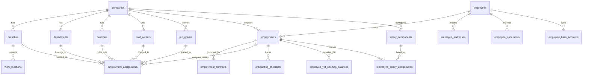
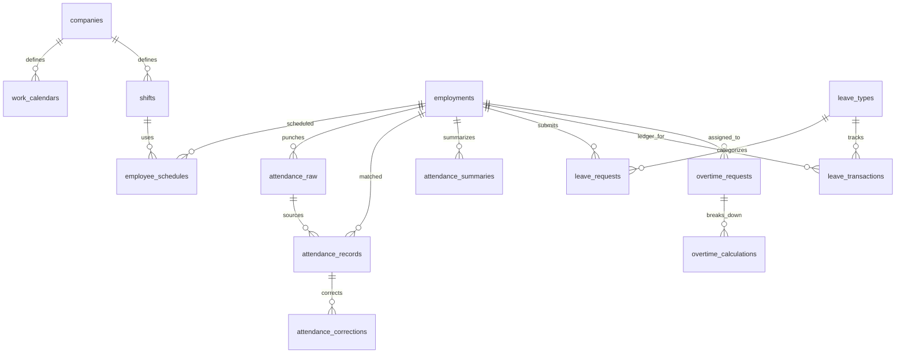
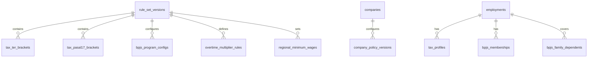
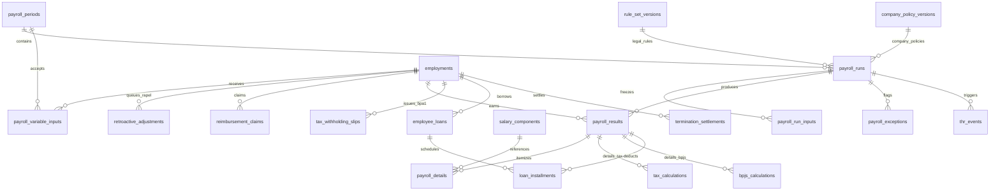
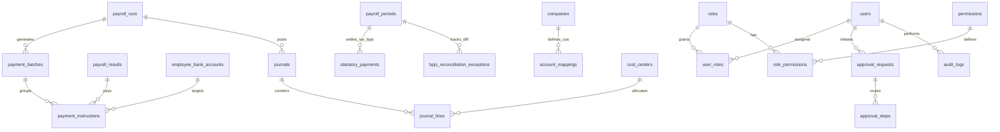

# Entity Relationship Diagram (ERD) & Physical Data Dictionary
## Sistem Informasi Penggajian (Payroll Management System — Standar Indonesia)

**Dokumen ID:** `DOC-SA-ERD-001`  
**Versi:** 1.1  
**Tanggal:** 18 November 2026 (Revisi Pasca-Audit Internal BA/SA — Siap DDL)  
**Acuan:** [01-SRS-Software-Requirements-Specification.md](file:///home/aliube/Workspace/PLan/Payroll/docs/02-system-analysis/01-SRS-Software-Requirements-Specification.md) & [03-Business-Rules-and-Calculation-Specification.md](file:///home/aliube/Workspace/PLan/Payroll/docs/01-business-analysis/03-Business-Rules-and-Calculation-Specification.md)

---

## 1. Standar & Prinsip Desain Basis Data

1. **Primary Key & Kesiapan Multi-Company:** Seluruh tabel menggunakan `UUID` (UUIDv7 disarankan) sebagai PK. Kolom `company_id UUID NOT NULL` hadir pada entitas bisnis meskipun Fase 1 berjalan untuk **Single-Company (1 PT)**.
2. **Presisi Finansial Mutlak:** Seluruh nominal uang memakai `DECIMAL(18,2)` (atau `DECIMAL(18,4)` untuk tarif per jam) dan persentase/rasio memakai `DECIMAL(10,6)`. **Dilarang menggunakan `FLOAT`/`DOUBLE`.**
3. **Bitemporal & Effective Dating:** Entitas histori dan konfigurasi memisahkan `valid_from DATE` / `valid_to DATE NULL` dari `created_at TIMESTAMPTZ` / `updated_at TIMESTAMPTZ`.
4. **Imutabilitas & Append-Only:** Tabel `attendance_raw`, `leave_transactions`, `payroll_run_inputs`, `payroll_results`, `payroll_details`, `tax_calculations`, `bpjs_calculations`, dan `audit_logs` bersifat *append-only* setelah periode/run dikunci.
5. **Enkripsi & Blind Index:** Kolom sensitif (`nik`, `npwp`, `bank_account_number`) disimpan terenkripsi (`*_encrypted`) dengan `HMAC-SHA256` pada `*_hash` untuk pencarian dan validasi keunikan.

---

## 2. Diagram ERD per Domain

### 2.1 Domain 1: Organization, Employee, Contract, YTD Opening & Compensation


### 2.2 Domain 2: Time, Attendance, Leave Ledger & Overtime


### 2.3 Domain 3: Regulatory Versioning (`Legal` vs `Company Policy`), Tax & BPJS


### 2.4 Domain 4: Payroll Run, Variable Inputs, Result, Trace, THR, Loan & Settlement


### 2.5 Domain 5: Payment, Statutory Tax/BPJS Payment, Accounting & IAM/Audit


---

## 3. Kamus Data Fisik (Physical Data Dictionary — Lengkap Siap DDL)

### 3.1 Domain Organisasi (`companies`, `branches`, `departments`, `positions`, `job_grades`, `work_locations`, `cost_centers`)

#### `companies`
| Kolom | Tipe Data | Constraint | Keterangan |
|---|---|---|---|
| `id` | `UUID` | `PK` | ID unik badan hukum |
| `code` | `VARCHAR(30)` | `UNIQUE, NOT NULL` | Kode entitas (`PT-UTAMA`) |
| `legal_name` | `VARCHAR(150)` | `NOT NULL` | Nama resmi PT |
| `npwp_encrypted` | `TEXT` | `NOT NULL` | NPWP perusahaan terenkripsi |
| `jkk_risk_group` | `SMALLINT` | `NOT NULL, CHECK (1..5)` | Kelompok risiko JKK (I–V) |
| `work_pattern` | `VARCHAR(10)` | `NOT NULL, CHECK ('5_DAYS','6_DAYS')` | Pola hari kerja default |
| `is_active` | `BOOLEAN` | `NOT NULL DEFAULT TRUE` | Status aktif |
| `created_at` | `TIMESTAMPTZ` | `NOT NULL` | Waktu pembuatan |

#### Tabel Struktur Organisasi Pendukung
- **`branches`**: `id (PK)`, `company_id (FK)`, `code VARCHAR(30)`, `name VARCHAR(100)`, `address TEXT`, `is_active BOOLEAN`, `UNIQUE(company_id, code)`.
- **`departments`**: `id (PK)`, `company_id (FK)`, `parent_department_id (FK NULL)`, `code VARCHAR(30)`, `name VARCHAR(100)`, `is_active BOOLEAN`, `UNIQUE(company_id, code)`.
- **`positions`**: `id (PK)`, `company_id (FK)`, `code VARCHAR(30)`, `title VARCHAR(100)`, `default_overtime_eligible BOOLEAN`, `is_active BOOLEAN`, `UNIQUE(company_id, code)`.
- **`job_grades`**: `id (PK)`, `company_id (FK)`, `code VARCHAR(20)`, `name VARCHAR(60)`, `level_rank SMALLINT`, `min_salary DECIMAL(18,2)`, `max_salary DECIMAL(18,2)`, `UNIQUE(company_id, code)`.
- **`work_locations`**: `id (PK)`, `company_id (FK)`, `branch_id (FK)`, `code VARCHAR(30)`, `name VARCHAR(100)`, `region_code VARCHAR(20)` *(kode Kab/Kota untuk UMP/UMK)*, `sector_code VARCHAR(30) NULL` *(untuk UMSP/UMSK PP 49/2025)*, `timezone VARCHAR(40) NOT NULL DEFAULT 'Asia/Jakarta'`.
- **`cost_centers`**: `id (PK)`, `company_id (FK)`, `code VARCHAR(30)`, `name VARCHAR(100)`, `is_active BOOLEAN`, `UNIQUE(company_id, code)`.

### 3.2 Domain Karyawan, Alamat, Dokumen, Kontrak, Rekening & Saldo Awal YTD

#### `employees`
| Kolom | Tipe Data | Constraint | Keterangan |
|---|---|---|---|
| `id` | `UUID` | `PK` | ID unik individu karyawan |
| `company_id` | `UUID` | `FK -> companies.id, NOT NULL` | Lingkup perusahaan |
| `full_name` | `VARCHAR(150)` | `NOT NULL` | Nama lengkap sesuai KTP |
| `birth_date` | `DATE` | `NOT NULL` | Validasi usia JP/JKP & password slip |
| `nationality` | `VARCHAR(5)` | `NOT NULL DEFAULT 'ID'` | Kode ISO negara (`ID` = WNI) |
| `nik_encrypted` | `TEXT` | `NOT NULL` | NIK 16 digit terenkripsi `AES-256-GCM` |
| `nik_hash` | `CHAR(64)` | `UNIQUE(company_id, nik_hash), NOT NULL` | Blind index SHA-256 HMAC |
| `nik_masked` | `VARCHAR(20)` | `NOT NULL` | Format masked (`3171********0004`) |
| `email` | `VARCHAR(150)` | `NOT NULL` | Email resmi / pribadi |
| `phone` | `VARCHAR(30)` | `NULL` | Nomor telepon |
| `created_at` | `TIMESTAMPTZ` | `NOT NULL` | Waktu pembuatan |

#### `employments`, `employment_contracts`, `employment_assignments`, `employee_addresses`, `employee_documents`, `onboarding_checklists`
- **`employments`**: `id (PK)`, `company_id (FK)`, `employee_id (FK)`, `employee_number VARCHAR(30)`, `contract_type VARCHAR(10) CHECK ('PKWTT','PKWT')`, `probation_end_date DATE NULL` *(hanya boleh diisi jika `PKWTT`, `CHECK (contract_type = 'PKWTT' OR probation_end_date IS NULL)`)*, `hire_date DATE NOT NULL`, `termination_date DATE NULL`, `termination_reason VARCHAR(50) NULL`, `status VARCHAR(20)`, `overtime_eligible BOOLEAN`, `created_at TIMESTAMPTZ`, `UNIQUE(company_id, employee_number)`.
- **`employment_contracts`**: `id (PK)`, `company_id`, `employment_id (FK)`, `contract_number`, `contract_type`, `sequence_no INT`, `start_date DATE`, `end_date DATE NULL`, `document_url`, `status VARCHAR(20)`.
- **`employment_assignments`** *(Bitemporal)*: `id (PK)`, `company_id`, `employment_id (FK)`, `branch_id (FK)`, `department_id (FK)`, `position_id (FK)`, `job_grade_id (FK)`, `work_location_id (FK)`, `cost_center_id (FK)`, `manager_employment_id (FK NULL)`, `valid_from DATE NOT NULL`, `valid_to DATE NULL`, `change_reason`, `approval_request_id (FK)`, `created_at`. Index: `idx_emp_assign_eff (employment_id, valid_from, valid_to)`.
- **`employee_addresses`**: `id (PK)`, `company_id`, `employee_id (FK)`, `address_type VARCHAR(20)` (`KTP`, `DOMICILE`), `street TEXT`, `city VARCHAR(100)`, `province VARCHAR(100)`, `postal_code VARCHAR(10)`, `valid_from DATE`, `valid_to DATE NULL`.
- **`employee_documents`**: `id (PK)`, `company_id`, `employee_id (FK)`, `doc_type VARCHAR(30)` (`KTP`, `NPWP`, `KK`, `CONTRACT`, `SK`, `REKENING`), `storage_path TEXT`, `checksum_sha256 CHAR(64)`, `uploaded_by`, `uploaded_at`.
- **`onboarding_checklists`**: `id (PK)`, `company_id`, `employment_id (FK)`, `item_code VARCHAR(40)`, `description TEXT`, `is_completed BOOLEAN DEFAULT FALSE`, `due_date DATE`, `completed_by UUID NULL`, `completed_at TIMESTAMPTZ NULL`.

#### `employee_bank_accounts`
- `id (PK)`, `company_id (FK)`, `employee_id (FK)`, `bank_code VARCHAR(20)`, `account_number_encrypted TEXT`, `account_number_masked VARCHAR(30)`, `account_holder_name VARCHAR(150)`, `is_primary BOOLEAN DEFAULT TRUE`, `verification_status VARCHAR(20)` (`PENDING`, `VERIFIED`, `INVALID`), `verified_by UUID NULL`, `verified_at TIMESTAMPTZ NULL`, `valid_from DATE NOT NULL`, `valid_to DATE NULL`.

#### `employee_ytd_opening_balances` *(Migrasi Tengah Tahun)*
| Kolom | Tipe Data | Constraint | Keterangan |
|---|---|---|---|
| `id` | `UUID` | `PK` | ID migrasi saldo awal |
| `company_id` | `UUID` | `FK, NOT NULL` | Perusahaan |
| `employment_id` | `UUID` | `FK -> employments.id, NOT NULL` | Karyawan |
| `tax_year` | `SMALLINT` | `NOT NULL` | Tahun pajak migrasi |
| `cutoff_month_count` | `SMALLINT` | `NOT NULL, CHECK (1..11)` | Jumlah bulan yg sudah diproses di sistem lama |
| `ytd_gross_taxable` | `DECIMAL(18,2)` | `NOT NULL` | Akumulasi bruto pajak Jan s/d bulan sebelum cutover |
| `ytd_biaya_jabatan` | `DECIMAL(18,2)` | `NOT NULL` | Akumulasi biaya jabatan terpakai |
| `ytd_bpjs_worker_pension` | `DECIMAL(18,2)` | `NOT NULL` | Akumulasi JHT 2% + JP 1% pekerja |
| `ytd_pph21_withheld` | `DECIMAL(18,2)` | `NOT NULL` | Akumulasi PPh 21 telah dipotong/disetor |
| `approval_request_id` | `UUID` | `FK, NULL` | Persetujuan Tax/Finance |
| `UNIQUE` | | `(employment_id, tax_year)` | 1 saldo awal per tahun takwim |

### 3.3 Domain Kompensasi, Absensi, Cuti & Lembur

#### `salary_components` & `employee_salary_assignments`
- **`salary_components`**: `id (PK)`, `company_id (FK)`, `code VARCHAR(30)`, `name VARCHAR(100)`, `category VARCHAR(30)` (`EARNING`, `DEDUCTION`, `EMPLOYER_CONTRIBUTION`, `REIMBURSEMENT`, `MEMO`), `is_fixed BOOLEAN`, `is_recurring BOOLEAN`, `tax_treatment VARCHAR(30)` (`TAXABLE_REGULAR`, `TAXABLE_IRREGULAR`, `NON_TAXABLE`, `TAX_ALLOWANCE`), `is_bpjs_kes_base BOOLEAN`, `is_bpjs_jht_base BOOLEAN`, `is_bpjs_jkk_jkm_base BOOLEAN`, `is_bpjs_jp_base BOOLEAN`, `is_overtime_base BOOLEAN`, `is_thr_base BOOLEAN`, `is_pkwt_comp_base BOOLEAN`, `prorate_method VARCHAR(20)`, `rounding_mode VARCHAR(20)`, `coa_account_code VARCHAR(50)`, `UNIQUE(company_id, code)`.
- **`employee_salary_assignments`**: `id (PK)`, `company_id`, `employment_id (FK)`, `salary_component_id (FK)`, `amount DECIMAL(18,2)`, `valid_from DATE NOT NULL`, `valid_to DATE NULL`, `approval_request_id (FK)`, `change_reason`, `created_at`. Index: `idx_sal_assign_lookup (employment_id, valid_from, valid_to)`.

#### Tabel Waktu, Absensi, Cuti & Lembur
- **`work_calendars`**: `id (PK)`, `company_id`, `branch_id (FK NULL)`, `calendar_date DATE`, `day_type VARCHAR(20)` (`WORKDAY`, `REST_DAY`, `PUBLIC_HOLIDAY`, `SHORT_DAY`), `description VARCHAR(150)`, `UNIQUE(company_id, branch_id, calendar_date)`.
- **`shifts`**: `id (PK)`, `company_id`, `code VARCHAR(20)`, `name VARCHAR(80)`, `start_time TIME`, `end_time TIME`, `break_minutes INT`, `is_cross_midnight BOOLEAN`, `is_short_day BOOLEAN`, `grace_late_minutes INT`.
- **`employee_schedules`**: `id (PK)`, `company_id`, `employment_id (FK)`, `work_date DATE`, `shift_id (FK)`, `UNIQUE(employment_id, work_date)`.
- **`attendance_raw`** *(Immutable)*: `id (PK)`, `company_id`, `employment_id (FK)`, `device_id`, `source_channel`, `raw_timestamp TIMESTAMPTZ NOT NULL`, `timezone VARCHAR(40)`, `punch_type VARCHAR(15)`, `import_batch_id`, `raw_payload_json JSONB`, `created_at`.
- **`attendance_records`**: `id (PK)`, `company_id`, `employment_id (FK)`, `work_date DATE`, `shift_id (FK)`, `clock_in TIMESTAMPTZ`, `clock_out TIMESTAMPTZ`, `status VARCHAR(20)`, `late_minutes INT`, `early_leave_minutes INT`, `exception_code VARCHAR(30)`, `exception_status VARCHAR(20)`, `UNIQUE(employment_id, work_date)`.
- **`attendance_corrections`**: `id (PK)`, `company_id`, `attendance_record_id (FK)`, `employment_id (FK)`, `requested_clock_in TIMESTAMPTZ NULL`, `requested_clock_out TIMESTAMPTZ NULL`, `reason TEXT`, `attachment_url`, `status VARCHAR(20)`, `approved_by UUID NULL`, `approved_at TIMESTAMPTZ NULL`.
- **`attendance_summaries`** *(Cutoff Input)*: `id (PK)`, `company_id`, `payroll_period_id (FK)`, `employment_id (FK)`, `scheduled_working_days INT`, `actual_working_days INT`, `paid_leave_days DECIMAL(5,2)`, `unpaid_leave_days DECIMAL(5,2)`, `absent_days DECIMAL(5,2)`, `total_late_minutes INT`, `status VARCHAR(15)` (`DRAFT`, `LOCKED`), `locked_by`, `locked_at`, `UNIQUE(payroll_period_id, employment_id)`.
- **`leave_types`**: `id (PK)`, `company_id`, `code VARCHAR(20)`, `name VARCHAR(80)`, `is_paid BOOLEAN`, `requires_attachment BOOLEAN`, `annual_quota DECIMAL(5,2)`, `max_carry_forward DECIMAL(5,2)`, `sick_wage_scale_enabled BOOLEAN DEFAULT FALSE`.
- **`leave_requests`**: `id (PK)`, `company_id`, `employment_id (FK)`, `leave_type_id (FK)`, `start_date DATE`, `end_date DATE`, `total_days DECIMAL(5,2)`, `reason TEXT`, `attachment_url NULL`, `status VARCHAR(20)`, `approved_by UUID NULL`.
- **`leave_transactions`** *(Ledger)*: `id (PK)`, `company_id`, `employment_id (FK)`, `leave_type_id (FK)`, `leave_request_id (FK NULL)`, `tx_type VARCHAR(20)` (`OPENING`, `ACCRUAL`, `USAGE`, `ADJUSTMENT`, `CARRY_FORWARD`, `EXPIRY`), `days DECIMAL(6,2)`, `tx_date DATE`, `notes`, `created_at`.
- **`overtime_requests` & `overtime_calculations`**:
  - `overtime_requests`: `id (PK)`, `company_id`, `employment_id (FK)`, `work_date DATE`, `day_category VARCHAR(20)`, `planned_minutes INT`, `actual_minutes INT`, `is_emergency_override BOOLEAN`, `status VARCHAR(20)`, `approved_by`, `approved_at`.
  - `overtime_calculations`: `id (PK)`, `overtime_request_id (FK)`, `hourly_rate DECIMAL(18,4)`, `multiplier DECIMAL(4,2)`, `tier_hours DECIMAL(5,2)`, `amount DECIMAL(18,2)`.

### 3.4 Domain Aturan Hukum vs Kebijakan Perusahaan, Pajak & BPJS

- **`rule_set_versions`** *(Aturan Hukum Nasional Berversi)*: `id (PK)`, `jurisdiction_code VARCHAR(10) DEFAULT 'ID'`, `version_code VARCHAR(30) UNIQUE`, `regulation_ref TEXT NOT NULL`, `effective_from DATE NOT NULL`, `effective_to DATE NULL`, `status VARCHAR(20)`, `approved_by UUID NULL`.
- **`company_policy_versions`** *(Kebijakan Internal Perusahaan Berversi — Terpisah dari Hukum)*: `id (PK)`, `company_id (FK)`, `version_code VARCHAR(30)`, `default_prorate_method VARCHAR(20)` (`WORKING_DAYS`, `CALENDAR_DAYS`), `working_day_divisor SMALLINT DEFAULT 21`, `variance_warning_pct DECIMAL(5,2) DEFAULT 20.00`, `max_non_statutory_ded_pct DECIMAL(5,2) DEFAULT 50.00`, `bank_change_risk_days SMALLINT DEFAULT 5`, `effective_from DATE NOT NULL`, `effective_to DATE NULL`, `status VARCHAR(20)`, `approved_by UUID NULL`.
- **Tabel Parameter Terikat `rule_set_version_id`:**
  - **`tax_ter_brackets`**: `id (PK)`, `rule_set_version_id (FK)`, `ter_category CHAR(1)` (`A`,`B`,`C`), `income_min DECIMAL(18,2)`, `income_max DECIMAL(18,2) NULL`, `rate DECIMAL(10,6)`.
  - **`tax_pasal17_brackets`**: `id (PK)`, `rule_set_version_id (FK)`, `layer_no SMALLINT`, `pkp_min DECIMAL(18,2)`, `pkp_max DECIMAL(18,2) NULL`, `rate DECIMAL(10,6)`.
  - **`bpjs_program_configs`**: `id (PK)`, `rule_set_version_id (FK)`, `program_code VARCHAR(20)` (`BPJS_KES`, `JHT`, `JKK`, `JKM`, `JP`), `risk_group SMALLINT NULL`, `employer_rate DECIMAL(10,6)`, `employee_rate DECIMAL(10,6)`, `min_wage_cap DECIMAL(18,2) NULL`, `max_wage_cap DECIMAL(18,2) NULL`, `max_age_limit SMALLINT NULL`. *(JKP dicatat via flag kelayakan pada `bpjs_memberships` tanpa baris iuran).*
  - **`overtime_multiplier_rules`**: `id (PK)`, `rule_set_version_id (FK)`, `work_pattern VARCHAR(10)`, `day_category VARCHAR(20)`, `hour_from SMALLINT`, `hour_to SMALLINT NULL`, `multiplier DECIMAL(4,2)`.
  - **`regional_minimum_wages`**: `id (PK)`, `rule_set_version_id (FK)`, `region_code VARCHAR(20)`, `sector_code VARCHAR(30) NULL`, `region_name VARCHAR(100)`, `amount DECIMAL(18,2)`, `valid_from DATE`, `valid_to DATE NULL`.
- **`tax_profiles`**: `id (PK)`, `company_id`, `employment_id (FK)`, `npwp_encrypted TEXT NULL`, `npwp_hash CHAR(64) NULL`, `npwp_status VARCHAR(20)`, `ptkp_status VARCHAR(10)` (`TK/0`..`K/3`), `ter_category CHAR(1)`, `tax_method VARCHAR(15)` (`GROSS`, `GROSS_UP`, `NET`), `prev_employer_gross DECIMAL(18,2) DEFAULT 0`, `prev_employer_tax DECIMAL(18,2) DEFAULT 0`, `valid_from DATE NOT NULL`, `valid_to DATE NULL`.
- **`bpjs_memberships` & `bpjs_family_dependents`**:
  - `bpjs_memberships`: `id (PK)`, `company_id`, `employment_id (FK)`, `bpjs_kes_number VARCHAR(30)`, `bpjs_kes_extra_dependents SMALLINT DEFAULT 0`, `bpjs_tk_kpj_number VARCHAR(30)`, `is_jht_active BOOLEAN`, `is_jp_active BOOLEAN`, `is_jkp_eligible BOOLEAN`, `valid_from DATE`, `valid_to DATE NULL`.
  - `bpjs_family_dependents`: `id (PK)`, `bpjs_membership_id (FK)`, `full_name VARCHAR(150)`, `relation_type VARCHAR(20)` (`SPOUSE`, `CHILD`, `PARENT`, `IN_LAW`), `is_extra_1pct BOOLEAN`, `bpjs_member_no VARCHAR(30) NULL`.

### 3.5 Domain Payroll Execution, Input Variabel, Rapel, Klaim, Bukti Potong & Exception

- **`payroll_periods`**: `id (PK)`, `company_id`, `period_year SMALLINT`, `period_month SMALLINT`, `period_start DATE`, `period_end DATE`, `cutoff_date DATE`, `pay_date DATE`, `status VARCHAR(15)` (`OPEN`, `CLOSED`), `UNIQUE(company_id, period_year, period_month)`.
- **`payroll_runs`**: `id (PK)`, `company_id`, `payroll_period_id (FK)`, `run_number VARCHAR(40) UNIQUE`, `run_type VARCHAR(25)`, `parent_run_id (FK NULL)`, `rule_set_version_id (FK NOT NULL)`, `company_policy_version_id (FK NOT NULL)`, `engine_version VARCHAR(20)`, `status VARCHAR(25)`, `total_employees INT`, `total_gross DECIMAL(18,2)`, `total_deductions DECIMAL(18,2)`, `total_net_pay DECIMAL(18,2)`, `total_employer_cost DECIMAL(18,2)`, `snapshot_locked_at TIMESTAMPTZ`, `approved_by`, `approved_at`, `created_by`.
- **`payroll_run_inputs`**: `id (PK)`, `payroll_run_id (FK)`, `employment_id (FK)`, `process_status VARCHAR(20)` (`PENDING`, `COMPLETED`, `FAILED`) *(untuk checkpoint/resume)*, `input_snapshot_json JSONB NOT NULL`, `UNIQUE(payroll_run_id, employment_id)`.
- **`payroll_variable_inputs`**: `id (PK)`, `company_id`, `payroll_period_id (FK)`, `employment_id (FK)`, `salary_component_id (FK)`, `amount DECIMAL(18,2)`, `source_type VARCHAR(20)` (`IMPORT_CSV`, `MANUAL`, `RETRO_QUEUE`), `import_batch_id VARCHAR(50) NULL`, `notes TEXT`, `status VARCHAR(20)` (`DRAFT`, `APPROVED`, `CONSUMED`), `consumed_in_run_id UUID NULL`.
- **`retroactive_adjustments`**: `id (PK)`, `company_id`, `employment_id (FK)`, `source_run_id (FK NULL)`, `salary_component_id (FK)`, `effective_period_year SMALLINT`, `effective_period_month SMALLINT`, `old_amount DECIMAL(18,2)`, `new_amount DECIMAL(18,2)`, `diff_amount DECIMAL(18,2)`, `status VARCHAR(20)` (`PENDING`, `QUEUED`, `PAID`), `target_run_id UUID NULL`.
- **`reimbursement_claims`**: `id (PK)`, `company_id`, `employment_id (FK)`, `claim_number VARCHAR(40) UNIQUE`, `expense_category VARCHAR(40)`, `claim_date DATE`, `amount DECIMAL(18,2)`, `receipt_url TEXT`, `status VARCHAR(20)` (`DRAFT`, `APPROVED`, `PAID`, `REJECTED`), `paid_in_run_id UUID NULL`.
- **`payroll_results`**: `id (PK)`, `company_id`, `payroll_run_id (FK)`, `employment_id (FK)`, `primary_cost_center_id (FK)`, `gross_earnings DECIMAL(18,2)`, `total_reimbursements DECIMAL(18,2)`, `total_deductions DECIMAL(18,2)`, `net_pay DECIMAL(18,2)`, `total_take_home_transfer DECIMAL(18,2)`, `total_employer_cost DECIMAL(18,2)`, `anomaly_flags_json JSONB`, `calculation_trace_json JSONB`, `UNIQUE(payroll_run_id, employment_id)`.
- **`payroll_details`**: `id (PK)`, `payroll_result_id (FK)`, `salary_component_id (FK NULL)`, `component_code VARCHAR(30)`, `category VARCHAR(30)`, `base_amount DECIMAL(18,2)`, `rate DECIMAL(10,6) NULL`, `prorate_factor DECIMAL(10,6) DEFAULT 1`, `amount DECIMAL(18,2)`, `cost_center_id (FK)` *(mendukung split cost center bila pindah tengah periode)*, `formula_desc TEXT`.
- **`tax_calculations`**: `id (PK)`, `payroll_result_id (FK)`, `tax_period_type VARCHAR(20)`, `ptkp_status VARCHAR(10)`, `ter_category CHAR(1)`, `tax_method VARCHAR(15)`, `mtd_prior_gross DECIMAL(18,2) DEFAULT 0`, `mtd_prior_tax_withheld DECIMAL(18,2) DEFAULT 0`, `monthly_gross_taxable DECIMAL(18,2)`, `tax_allowance DECIMAL(18,2)`, `applied_rate DECIMAL(10,6)`, `ytd_gross DECIMAL(18,2)`, `ytd_biaya_jabatan DECIMAL(18,2)`, `ytd_bpjs_worker DECIMAL(18,2)`, `annual_pkp DECIMAL(18,2)`, `annual_tax_due DECIMAL(18,2)`, `previously_withheld DECIMAL(18,2)`, `current_tax_amount DECIMAL(18,2)`.
- **`tax_withholding_slips`** *(Bukti Potong BPA1 / Bulanan)*: `id (PK)`, `company_id`, `employment_id (FK)`, `tax_year SMALLINT`, `tax_month SMALLINT NULL`, `slip_type VARCHAR(20)` (`MONTHLY_TER`, `ANNUAL_BPA1`), `slip_number VARCHAR(50) UNIQUE`, `object_code VARCHAR(20)` (`21-100-01`), `gross_amount DECIMAL(18,2)`, `tax_amount DECIMAL(18,2)`, `coretax_export_status VARCHAR(20)`, `issued_at TIMESTAMPTZ`.
- **`bpjs_calculations`**: `id (PK)`, `payroll_result_id (FK)`, `program_code VARCHAR(20)` (`BPJS_KES`, `JHT`, `JKK`, `JKM`, `JP`), `raw_wage_base DECIMAL(18,2)`, `capped_wage_base DECIMAL(18,2)`, `employer_rate DECIMAL(10,6)`, `employer_amount DECIMAL(18,2)`, `employee_rate DECIMAL(10,6)`, `employee_amount DECIMAL(18,2)`, `extra_dependent_amount DECIMAL(18,2) DEFAULT 0`.
- **`payroll_exceptions` & `bpjs_reconciliation_exceptions`**:
  - `payroll_exceptions`: `id (PK)`, `company_id`, `payroll_run_id (FK)`, `employment_id (FK)`, `exception_code VARCHAR(40)`, `severity VARCHAR(15)` (`INFO`, `WARNING`, `BLOCKER`), `owner_role VARCHAR(30)`, `resolution_action TEXT`, `due_date DATE`, `status VARCHAR(20)` (`OPEN`, `RESOLVED`, `WAIVED`), `resolved_by UUID NULL`, `resolved_at TIMESTAMPTZ NULL`.
  - `bpjs_reconciliation_exceptions`: `id (PK)`, `company_id`, `payroll_period_id (FK)`, `employment_id (FK NULL)`, `program_code VARCHAR(20)`, `internal_amount DECIMAL(18,2)`, `billing_amount DECIMAL(18,2)`, `diff_amount DECIMAL(18,2)`, `cause_category VARCHAR(30)`, `status VARCHAR(20)`, `resolved_by UUID NULL`.
- **`employee_loans`**, **`loan_installments`**, **`thr_events`**, **`termination_settlements`**: *(tetap sebagaimana struktur bitemporal/ledger pada versi 1.0 dengan penambahan `company_id` pada `loan_installments` dan referensi ke `payroll_results`)*.

### 3.6 Domain Payment, Statutory Payment, Accounting, IAM & Audit

- **`payment_batches` & `payment_instructions`**:
  - `payment_batches`: `id (PK)`, `company_id`, `payroll_run_id (FK)`, `batch_code UNIQUE`, `bank_code`, `total_instructions INT`, `total_amount DECIMAL(18,2)`, `file_checksum_sha256 CHAR(64)`, `status VARCHAR(25)`, `maker_id`, `checker_id`, `approved_by`, `approved_at`.
  - `payment_instructions`: `id (PK)`, `company_id`, `payment_batch_id (FK NULL)`, `payroll_result_id (FK)`, `employment_id (FK)`, `bank_account_id (FK)`, `idempotency_key VARCHAR(100) UNIQUE NOT NULL`, `amount DECIMAL(18,2) NOT NULL`, `status VARCHAR(25)` (`PREPARED`, `ON_HOLD`, `BATCHED`, `SUBMITTED`, `ACCEPTED_PROCESSING`, `PAID`, `FAILED`, `RECONCILED`), `bank_ref_no VARCHAR(100) NULL`, `failure_reason TEXT NULL`, `paid_at TIMESTAMPTZ NULL`, `reconciled_at TIMESTAMPTZ NULL`.
- **`statutory_payments`** *(Pembayaran Kewajiban Pajak & BPJS Perusahaan)*: `id (PK)`, `company_id`, `payroll_period_id (FK)`, `payment_type VARCHAR(20)` (`PPH21`, `BPJS_KES`, `BPJS_TK`), `billing_code VARCHAR(50)`, `ntpn_or_va_ref VARCHAR(50) NULL`, `due_date DATE`, `paid_date DATE NULL`, `amount DECIMAL(18,2)`, `receipt_url TEXT NULL`, `status VARCHAR(20)` (`UNPAID`, `PAID`, `REPORTED`), `recorded_by UUID`.
- **`account_mappings`, `journals` & `journal_lines`**:
  - `account_mappings`: `id (PK)`, `company_id`, `mapping_type VARCHAR(30)` (`COMPONENT`, `TAX_PAYABLE`, `BPJS_PAYABLE`, `NET_PAYABLE`, `BANK_CLEARING`), `source_code VARCHAR(40)`, `debit_coa VARCHAR(50) NULL`, `credit_coa VARCHAR(50) NULL`.
  - `journals`: `id (PK)`, `company_id`, `payroll_run_id (FK)`, `journal_number UNIQUE`, `posting_date DATE`, `total_debit DECIMAL(18,2)`, `total_credit DECIMAL(18,2)`, `status VARCHAR(20)`, `CHECK (total_debit = total_credit)`.
  - `journal_lines`: `id (PK)`, `journal_id (FK)`, `line_no INT`, `coa_account_code`, `cost_center_id (FK)`, `debit DECIMAL(18,2)`, `credit DECIMAL(18,2)`, `description`.
- **`users`, `roles`, `permissions`, `user_roles`, `role_permissions`, `approval_requests`, `approval_steps`, `audit_logs`**:
  - `users`: `id (PK)`, `company_id`, `employment_id (FK NULL)`, `username VARCHAR(80) UNIQUE`, `email VARCHAR(150) UNIQUE`, `mfa_enabled BOOLEAN`, `is_active BOOLEAN`.
  - `roles`: `id (PK)`, `company_id`, `code VARCHAR(30) UNIQUE`, `name VARCHAR(80)`.
  - `permissions`: `id (PK)`, `code VARCHAR(50) UNIQUE`, `module VARCHAR(30)`, `description`.
  - `user_roles` & `role_permissions`: tabel pivot `UNIQUE(user_id, role_id)` & `UNIQUE(role_id, permission_id)`.
  - `approval_requests` & `approval_steps`: `maker_id NOT NULL`, `CHECK (actor_id IS NULL OR actor_id <> maker_id)` untuk menjamin SoD di level aplikasi/DB.
  - `audit_logs` *(Append-Only dengan Partitioned Hash Chain)*: `id (PK)`, `company_id`, `partition_year_month CHAR(7)` *(mis. `2026-11`)*, `actor_id`, `actor_role`, `action VARCHAR(50)`, `entity_type`, `entity_id`, `before_json JSONB`, `after_json JSONB`, `reason TEXT`, `correlation_id UUID`, `prev_hash CHAR(64)`, `record_hash CHAR(64)`, `created_at TIMESTAMPTZ NOT NULL`. Index: `idx_audit_chain (company_id, partition_year_month, created_at)`.

---

## 4. Standar JSON Schema: `calculation_trace_json` (Selaras dengan `03-Business-Rules` v1.1)

```json
{
  "engineVersion": "1.1.0",
  "legalRuleVersionCode": "ID-REG-2026-V1",
  "companyPolicyVersionCode": "PT-POL-2026-V1",
  "calculatedAtUtc": "2026-11-21T03:15:22Z",
  "proration": {
    "method": "WORKING_DAYS",
    "totalPeriodDays": 21,
    "segments": [
      {
        "from": "2026-11-01",
        "to": "2026-11-30",
        "paidDays": 21,
        "factor": 1.000000,
        "components": { "BASIC_SALARY": 10000000.00 }
      }
    ]
  },
  "bpjs": {
    "singleMonthlyDeductionApplied": true,
    "kesehatan": { "rawBase": 10000000.00, "cappedBase": 10000000.00, "employer4Pct": 400000.00, "employee1Pct": 100000.00, "extraDep": 0.00 },
    "ketenagakerjaan": {
      "JHT": { "base": 10000000.00, "employer": 370000.00, "employee": 200000.00 },
      "JKK": { "base": 10000000.00, "riskGroup": 1, "rate": 0.0024, "employer": 24000.00 },
      "JKM": { "base": 10000000.00, "rate": 0.0030, "employer": 30000.00 },
      "JP":  { "rawBase": 10000000.00, "cappedBase": 10000000.00, "capLimitRef": 11086300.00, "employer": 200000.00, "employee": 100000.00 },
      "JKP": { "isEligible": true, "employerExtraCost": 0.00, "employeeExtraDeduction": 0.00, "note": "Status kepesertaan; didanai pemerintah & rekomposisi JKK/JKM tanpa iuran tambahan" }
    }
  },
  "pph21": {
    "mode": "MONTHLY_TER",
    "ptkp": "TK/0",
    "terCategory": "A",
    "taxMethod": "GROSS",
    "mtdPriorGross": 0.00,
    "mtdPriorTaxWithheld": 0.00,
    "currentRunGrossTaxable": 10454000.00,
    "mtdTotalGrossTaxable": 10454000.00,
    "terBracketSource": "PP_58_2023_TABLE_TER_A",
    "note": "Nilai terRateApplied dan taxAmount dibaca dari tax_ter_brackets resmi PP 58/2023"
  }
}
```
