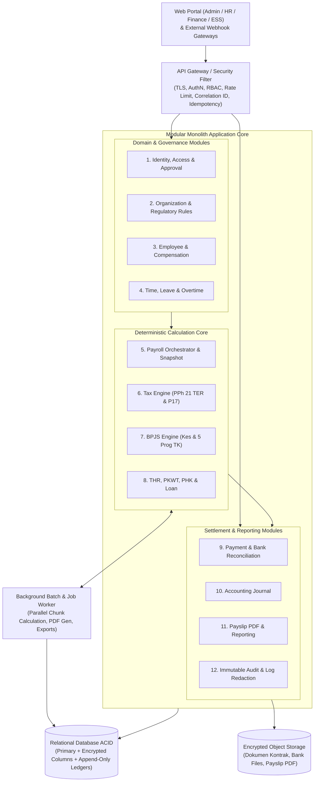
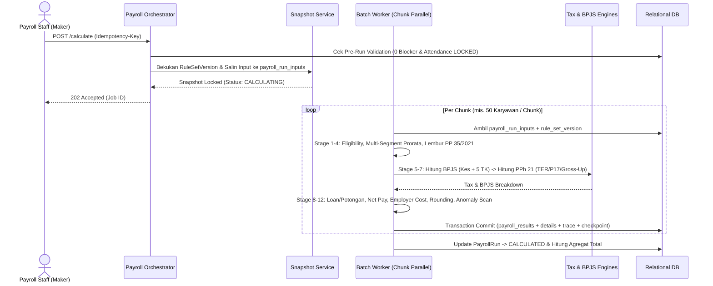

# System Design & Architecture Document
## Sistem Informasi Penggajian (Payroll Management System — Standar Indonesia)

**Dokumen ID:** `DOC-SA-SYS-001`  
**Versi:** 1.2 (Diselaraskan dengan Implementasi Java Spring Boot + Angular + Docker Compose)  
**Tanggal:** 18 November 2026  
**Implementasi Terpilih:** *Modular Monolith* (**Java 21 / Spring Boot 3.3**, **PostgreSQL 16 + Flyway**, **Redis 7**, **Angular 18 + Nginx**, orkestrasi **`docker-compose.yml`**)  
**Acuan:** [01-SRS-Software-Requirements-Specification.md](file:///home/aliube/Workspace/Project-Personal/Gemini/Payroll/docs/02-system-analysis/01-SRS-Software-Requirements-Specification.md) & [03-ERD-and-Data-Dictionary.md](file:///home/aliube/Workspace/Project-Personal/Gemini/Payroll/docs/02-system-analysis/03-ERD-and-Data-Dictionary.md)

---

## 1. Pilihan Gaya Arsitektur: Modular Monolith

Sesuai rekomendasi blueprint sumber (Bab 22) dan sifat transaksi penggajian yang menuntut konsistensi ACID kuat antara komponen upah, pajak, BPJS, pinjaman, dan jurnal akuntansi, sistem dirancang sebagai **Modular Monolith**:

1. **Mengapa bukan Microservices pada Fase 1?**
   - Kalkulasi payroll membutuhkan integritas transaksi atomik lintas domain (gaji + PPh 21 + BPJS + cicilan pinjaman + jurnal). Pemisahan database antar-service di tahap awal akan menambah kompleksitas *distributed transactions (Saga)* dan risiko inkonsistensi rekonsiliasi tanpa manfaat bisnis sebanding untuk skala 100–5.000 karyawan.
2. **Aturan Batas Modul (*Module Boundary Rules*):**
   - Modul berkomunikasi melalui *Internal Service Interface* atau *Domain Events* di dalam proses aplikasi yang sama, **dilarang keras melakukan JOIN SQL langsung lintas tabel inti modul lain** tanpa melalui API kontrak modul pemiliknya.
   - Setiap modul dapat diekstrak menjadi *service* mandiri di masa depan apabila skala beban kerja menuntut (mis. memisahkan `Attendance Ingestion` atau `PDF Payslip Worker`).

---

## 2. Desain Internal *Deterministic Payroll Calculation Engine*

### 2.1 Pipeline Eksekusi 13 Tahap & Snapshot Isolation
Agar hasil kalkulasi payroll lama selalu dapat direproduksi 100% (*deterministic & repeatable*), engine dilarang membaca langsung tabel master yang bersifat *live* saat kalkulasi berjalan:

### 2.2 Strategi Chunking, Checkpointing & Idempotency
1. **Partisi Chunk:** Karyawan eligible dibagi menjadi batch kecil (mis. 50–100 karyawan per chunk) yang diproses secara paralel oleh worker pool. Satu kegagalan data karyawan tidak membatalkan progres chunk lain yang berhasil, melainkan mencatat status gagal pada baris karyawan tersebut untuk diperbaiki.
2. **Checkpoint & Resume:** Setiap chunk selesai dalam 1 transaksi ACID bersama pembaruan checkpoint. Jika server restart di tengah jalan, job otomatis melanjutkan hanya untuk `employment_id` yang belum memiliki record di `payroll_results` pada `payroll_run_id` terkait.
3. **Aritmatika Presisi Tetap (*Fixed-Point Decimal*):**
   - Seluruh perhitungan perantara (mis. faktor prorata `11/21`, upah lembur `/173`) mempertahankan minimal **6 digit desimal** di memori (`BigDecimal` / `Decimal`), dan baru menerapkan aturan pembulatan resmi (`HALF_UP`, `FLOOR` ribuan untuk PKP, atau `FLOOR` rupiah untuk PPh 21) pada titik keluaran yang ditentukan regulasi agar terhindar dari *rounding drift* 1 rupiah.

---

## 3. Arsitektur Keamanan, Privasi (UU PDP) & Kontrol Internal

### 3.1 Strategi Enkripsi Kolom & Pencarian (*Field-Level Encryption + Blind Index*)
Untuk memenuhi perlindungan data pribadi (NIK, NPWP, Nomor Rekening Bank):
1. **Enkripsi Data:** Nilai asli dienkripsi di lapisan aplikasi menggunakan algoritma simetris autentik **`AES-256-GCM`** dengan *Data Encryption Key (DEK)* yang dikelola oleh *Key Management Service / Secret Vault* (di luar kode sumber dan database).
2. **Blind Index (`*_hash`):** Untuk mendukung validasi duplikasi (`UNIQUE NIK`) dan pencarian cepat tanpa mendekripsi seluruh tabel, sistem menyimpan nilai `HMAC-SHA256(normalisasi_nilai, secret_pepper)` pada kolom terindeks.
3. **Dynamic Masking:** Lapisan serialisasi API menerapkan aturan masking berdasarkan peran pengakses (contoh: Payroll Staff melihat `******7890` di daftar umum, dan hanya endpoint pencetakan file bank terotorisasi oleh Finance yang mendekripsi nomor rekening penuh).

### 3.2 Penegakan Pemisahan Tugas (SoD) & Isolasi SysAdmin
- **Database & Application Guard:** Tabel `approval_requests` dan layanan approval mewajibkan aturan `actor_id != maker_id` dan pengecekan bahwa `actor_id` memiliki peran yang sah untuk langkah tersebut.
- **Anti-IDOR Middleware:** Endpoint portal karyawan (`/api/v1/ess/**`) mengambil `employee_id` murni dari klaim token sesi yang terverifikasi, bukan dari query parameter, serta melakukan verifikasi kepemilikan sebelum mengakses berkas PDF di Object Storage (*presigned URL* berumur pendek < 60 detik).
- **SysAdmin Isolation:** Role `SYSADMIN` dipetakan secara eksplisit ke daftar penolakan (*deny-list*) pada modul Kompensasi, Payroll Result, Tax, Payment, dan Read-Only pada Audit Log tidak diizinkan mengubah entri log.

### 3.3 Desain *Immutable Audit Trail* dengan Hash Chain Terpartisi
Agar modifikasi ilegal langsung pada baris database dapat terdeteksi saat audit eksternal/internal **tanpa menimbulkan bottleneck kunci global (*write lock contention*)** saat banyak pengguna atau batch worker menulis log bersamaan:
- Setiap rantai hash (`prev_hash` -> `record_hash`) dipartisi berdasarkan **`(company_id, partition_year_month)`** (mis. `2026-11`), dengan formula:
  `record_hash = SHA256(prev_hash + actor_id + action + entity_id + after_json + created_at)`.
- Hak akses user database aplikasi pada tabel `audit_logs` dibatasi hanya `INSERT` dan `SELECT` (tanpa privilege `UPDATE` atau `DELETE`), dan ringkasan *root hash* akhir bulan diarsipkan pada penutupan periode.

---

## 4. Strategi Observabilitas, Resiliensi & Cutover Migration

### 4.1 Logging dengan PII & Salary Redaction
- Seluruh log terstruktur menggunakan format JSON dengan menyertakan `correlation_id`, `payroll_run_id`, `module`, dan `duration_ms`.
- **Redaction Interceptor:** Terpasang di tingkat logger framework untuk menyaring pola regex NIK (16 digit), NPWP, nomor rekening, dan field kunci (`basicSalary`, `netPay`, `takeHomePay`, `nik`, `npwp`, `accountNumber`) sehingga terganti otomatis menjadi `[REDACTED]` sebelum ditulis ke file log atau aggregator.

### 4.2 Resiliensi, Backup & Disaster Recovery
- **RPO <= 1 Jam / RTO <= 4 Jam:** Point-in-Time Recovery (PITR) aktif pada database transaksi ditambah backup snapshot harian terenkripsi yang direplikasi ke lokasi penyimpanan terpisah.
- **Uji Restore Berkala:** Tim infrastruktur wajib melakukan uji simulasi pemulihan (*restore drill*) di lingkungan terisolasi minimal 1 kali per kuartal dan memverifikasi integritas checksum data payroll.

### 4.3 Desain *Automated Parallel Run Comparator* (Strategi Cutover SDLC)
Mengacu pada Bab 24 dokumen sumber, sebelum sistem baru menggantikan sistem penggajian lama (*cutover*):
1. Bangun utilitas **Parallel Run Comparator** sebagai bagian dari paket verifikasi pra-produksi.
2. Impor output Excel/CSV dari sistem lama (minimal 2 siklus payroll historis/berjalan) dan jalankan periode yang sama di sistem baru.
3. Comparator mencocokkan **per karyawan dan per komponen** (Gaji Pokok, Prorata, Lembur, BPJS Kes, 5 Program BPJS TK, PPh 21, Pinjaman, dan Net Pay) dengan toleransi pembulatan maksimal Rp1 (atau 0 untuk total persis) dan menghasilkan **Variance Root-Cause Report** hingga seluruh perbedaan ditandatangani oleh HR, Payroll, Tax, Finance, dan Legal.

---

## 5. Realisasi Implementasi Stack & Struktur Paket (MVP v1.2)

Pada tahap implementasi SDLC, arsitektur Modular Monolith di atas diwujudkan ke dalam paket aplikasi terstruktur berikut:

1. **Orkestrasi Container (`docker-compose.yml`):**
   - `postgres` (`postgres:16-alpine`, internal `5432`, host `5439`) — Database transaksional `payroll_db` dengan migrasi otomatis **Flyway** (`V1__init_schema.sql` & `V2__seed_master_data.sql`).
   - `redis` (`redis:7-alpine`, internal `6379`, host `6381`) — Penyimpanan status eksekusi & lock idempotensi kalkulasi.
   - `backend` (`Java 21` + `Spring Boot 3.3.5`, internal `8080`, host `8085`) — Menggunakan *Standard Layered Package* (`controller`, `service`, `service/calculator`, `repository`, `entity`, `dto`, `config`, `exception`).
   - `frontend` (`Angular 18` + `Nginx`, internal `80`, host `4200`) — SPA Web Portal dengan reverse proxy `/api/` menuju `http://backend:8080/api/` dan 3 halaman utama (`payroll-run`, `payslip-trace`, `master-data`).
2. **Isolasi Mesin Hitung (`com.payroll.service.calculator`):**
   - `ProrataCalculator`: Menghitung prorata tunggal dan *multi-segment split* dengan skala presisi intermediate 6 desimal (`HALF_UP`).
   - `OvertimeCalculator`: Menghitung upah lembur PP 35/2021 berbasis `1/173` (termasuk aturan 75% bila upah tetap < 75%) dan pengali berjenjang `1.5x / 2x / 3x / 4x`.
   - `BpjsCalculator`: Menghitung BPJS Kesehatan (batas UMP s/d Rp12 juta + tanggungan tambahan 1%) serta 5 program BPJS TK (JP dengan cap Rp11.086.300 & JKP sebagai status kelayakan tanpa *double-count* iuran), serta menerapkan aturan 1x potong per bulan (`BR-BPJS-TK-007`).
   - `Pph21Calculator`: Menghitung PPh 21 bulanan berbasis **TER A/B/C PP 58/2023** (termasuk akumulasi *multi-run* `BR-TAX-009`), solver iterasi *fixed-point* **Gross-Up**, serta rekonsiliasi **Masa Pajak Terakhir Pasal 17 UU HPP** termasuk pengembalian *lebih potong* (*tax refund*).
